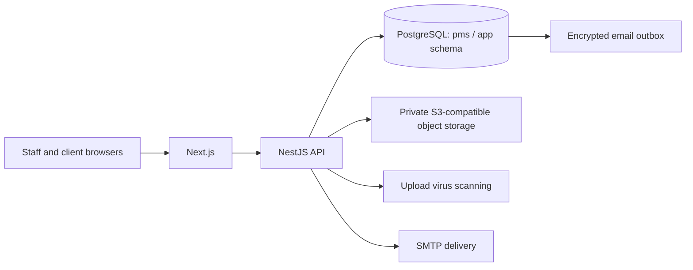
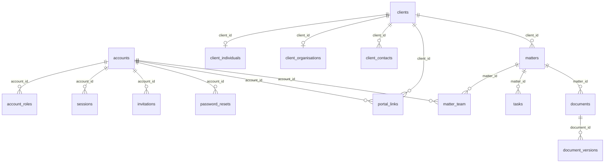
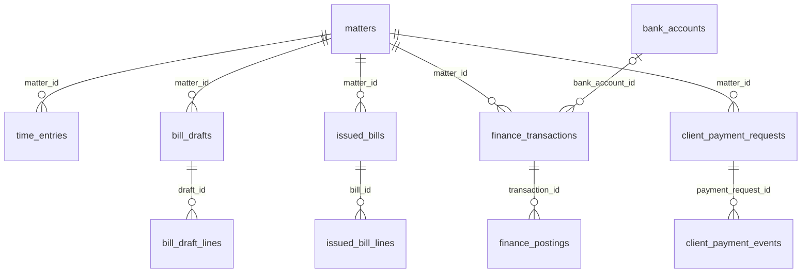
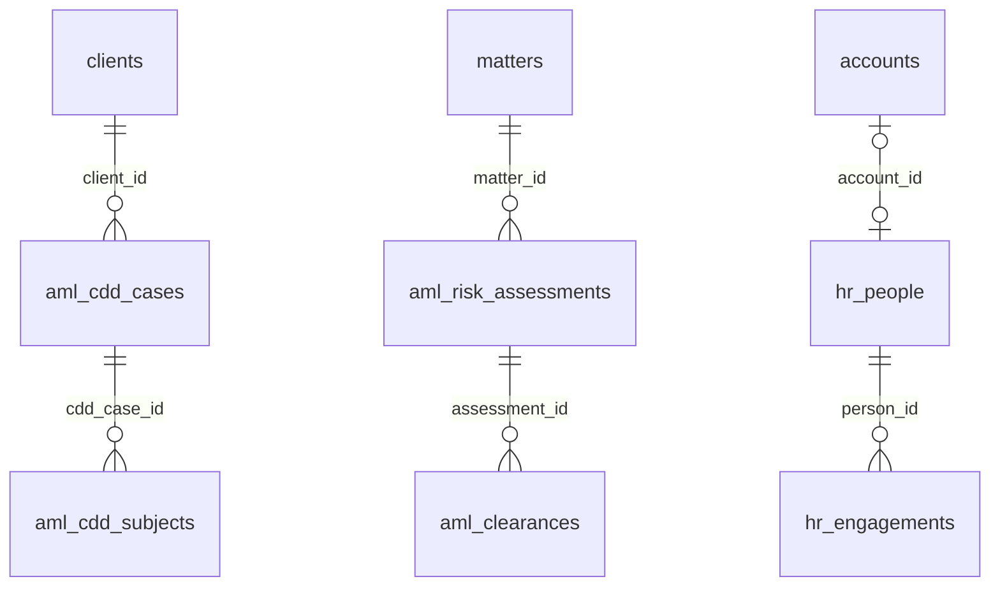

# Stass database design

Design baseline: 30 October 2026. Scope: the existing single-practice application, including employee accounts and invited client portal accounts.

This design is grounded in the running PostgreSQL catalog and the repository's migrations. The catalog export uses a read-only transaction and contains definitions, not client records, passwords or encryption keys. Schema changes belong in subsequent forward-only migrations after the relevant design and tests are ready.

## Deliverables and current baseline

- [Interactive schema explorer](database-design.html): search tables and columns, inspect keys and indexes, and follow relationships.
- [Complete catalog snapshot](database-schema.json): machine-readable columns, constraints, indexes, triggers, functions and migration reconciliation.
- Schema source: `apps/api/src/database/schema.ts`.
- Database change history: `apps/api/migrations/`.
- Regenerate the snapshot and explorer with `node scripts/export-database-schema.mjs` using local API environment settings.

The inspected database has **178 tables, 1,764 columns, 414 foreign keys, 482 indexes, 457 application triggers and 363 functions**. All **75 migrations** are applied, through `0075_security_ephemeral_retention`. These counts describe the inspected catalog; they are not a claim that every business rule or query plan has been validated.

| Database area | Tables | Purpose |
| --- | ---: | --- |
| Identity and access | 8 | Staff/client accounts, roles, sessions, invitations and recovery |
| Clients and onboarding | 24 | Individual/company records, contacts, verification, engagement and activation |
| Matters and tasks | 10 | Case teams, parties, conflicts, task progress and closure |
| Documents and portal | 5 | Document metadata, versions, sharing and client access links |
| Finance and billing | 24 | Time, bills, payments, postings, bank statements and reconciliation |
| AML and compliance | 49 | Due diligence, risk, sanctions, approvals, restricted reports and retention |
| People and HR | 48 | Employment records, leave, checks, confidential cases and controlled exports |
| Audit and notifications | 6 | Audit trail, notices, read status, reminders and encrypted email delivery |
| AI drafting | 4 | Configurations, requests, drafts and human reviews |

## Storage architecture

PostgreSQL stores structured business records and file metadata. Document, identity-evidence and HR file bodies are stored through the private object-storage boundary used by their owning module. File integrity, encryption context and version history must remain associated with the correct record.

`pms_owner` owns the application schema and applies migrations. `pms_app` runs the API with narrower privileges. PostgreSQL superuser credentials belong to local infrastructure/bootstrap operations. The `migrations` schema tracks migration history separately from `app`. Tests use separate databases.

## Core entity relationships

These diagrams show selected, existing relationships. Actor-history links such as `created_by` are omitted for readability. Crow's-foot notation shows parent/child structure; triggers and conditional checks add rules beyond the foreign keys.

An account is a login identity. A client is a person or organisation receiving services. A client contact is a person representing an organisation. An HR person is an employment record. These have different lifecycles and access rules, so they remain separate entities.

A client has the appropriate individual or organisation detail record. The database enforces the subtype requirement. Each matter belongs to one client; its team links staff accounts to case access and supervision. Portal access is a separate, revocable account-to-client link, optionally tied to a contact, rather than an automatic consequence of email matching.

## Identity, invitation and recovery design

1. Staff invite an account. `invitations` stores a token hash and expiry; the plaintext token travels through the protected delivery flow.
2. The recipient chooses a password. `accounts.password_hash` stores an Argon2id hash, not the password.
3. Authenticator enrolment uses `totp_credentials`; confirmation and used time-step checks prevent replay. Backup codes are individually hashed and spent once.
4. Only completed setup activates the account. `sessions` records the transition from pending second factor to authenticated, plus expiry and termination.
5. `password_resets` supports expiring, single-use recovery links without removing the authenticator requirement.
6. Roles are separate history rows in `account_roles`; grants and revocations are audited.

Keep account status, authentication status, client onboarding status and matter clearance status separate. A valid password does not imply an active account, and an active account does not imply access to every client or matter.

An identity-checked staff-assisted recovery workflow for a lost authenticator and lost backup codes remains a separate application feature to design. It must preserve sessions, role separation and audit requirements; password reset is not a substitute for it.

## Matter and document design

| Record | Responsibility | Important relationship |
| --- | --- | --- |
| `clients` | Stable client identity and responsible staff | Individual/organisation details and matters |
| `conflict_checks` | Fixed record of names searched and possible matches | Client, requester and matter |
| `matters` | Case reference, title, type and operational status | Client and conflict check |
| `matter_team` | Staff membership and supervision | Matter and account |
| `matter_parties` | Other people/organisations involved | Matter |
| `tasks`, `task_changes` | Work assignment and progress history | Matter and staff accounts |
| `documents`, `document_versions` | Document identity and immutable file versions | Matter and uploader |
| `document_sharing_changes` | Deliberate client-sharing history | Document |
| `portal_links` | Explicit client-portal access | Account, client and optional contact |

New work must pass conflict and current compliance gates. Case/document/task creation and changes need both API authorisation and the database's applicable constraints/functions. A browser-hidden button is not an access control.

## Finance design

Validate these relationships against the explorer when extending a module; business rules also impose stricter shapes on each transaction kind.

- Use integer pence for monetary amounts and exact duration units for time. Preserve range, currency and tax rules. Avoid floating-point arithmetic for posted balances.
- Draft bills can be reviewed before issue. Issued bills retain their line snapshots; later rate changes must not silently change historical bills.
- Financial transactions and postings are the source of ledger activity. Balances are derived from permitted postings, rather than independently editable totals.
- Separate client and business bank accounts. Payment requests, independent approval, reservations and bank outcomes remain distinct records/events.
- Correct posted financial activity with the supported reversal/correction process and a reason. Preserve the original evidence.
- Statement imports, match events and reconciliation sign-offs preserve what was reviewed and by whom.

## Compliance and HR boundaries

The exact relationship fields are exported from the catalog. Restricted AML reports and confidential HR cases require their own access boundaries, not ordinary matter-team visibility. Do not join sensitive narrative into generic dashboard, search, notification or export responses.

Versioned CDD, risk assessments, measures, sanctions checks and human decisions retain the basis for clearance. Sanctions candidates are possible matches, resolved through authorised review. HR records similarly separate directory data, employment history, private evidence, health information and case memberships.

Application encryption domains cover authentication secrets, mail, finance, AML, restricted reports, HR and documents. Keep encryption keys outside PostgreSQL; preserve record/purpose binding and key-version metadata. Database backups alone cannot restore encrypted content without the matching key material.

## Constraints and change rules

| Concern | Existing pattern to preserve | Verification for new work |
| --- | --- | --- |
| Identity | UUID primary keys; generated references where defined | Unique identity/reference under concurrent inserts |
| Relationships | Foreign keys and conditional shape constraints | Wrong client, matter, actor or record type is refused |
| Active records | Partial unique indexes for applicable live/open state | Concurrent duplicates fail atomically |
| History | Permanent event/version records and restricted mutation grants | Update, delete and truncate protections where required |
| Transitions | Triggers/protected functions and transaction boundaries | Invalid transitions and concurrent stale writes are refused |
| Money | Exact pence, bounded values and balanced posting rules | Over-allocation, self-approval and inconsistent postings fail |
| Files | Metadata, version, scan and encrypted storage boundary | Failed scans never become usable/shared files |
| Privacy | Role/module access, encryption and retention/disposal workflows | Unauthorised reads/exports and premature disposal fail |
| Search | Normalised names and trigram indexes where applicable | Name variation handling and bounded search cost |
| Notifications | Transactional encrypted outbox and deduplication | Retries do not create duplicate delivery or expose content |

`pms_app` does not universally have row-level security enabled on every table. Assess database grants, protected functions, triggers and API query scoping together; do not assume a tenant or row policy exists merely because a table has foreign keys.

## Findings from the baseline inspection

1. **Migration alignment:** all 75 repository migrations are applied. No mapped TypeScript table is absent from the database. No invalid index was found.
2. **Mapping exception:** PostgreSQL has `notification_reminder_settings`, which is absent from the Kysely `Database` interface. Existing migrations and tests access this protected reminder-start configuration through SQL. Document this as an intentional internal-table exception unless typed application access is introduced; it is not evidence that a user-facing feature is missing.
3. **Legacy constraint:** `matters_conflict_check_required` remains unvalidated. Its original migration deliberately uses `NOT VALID` for older records. Inspect legacy rows and define a backfill/exception policy before proposing `VALIDATE CONSTRAINT`; do not assume the unvalidated flag is an accidental omission.
4. **Index review:** 240 foreign keys have no detected unconditional valid B-tree index with their columns as the exact leading prefix. This is a conservative review list, not 240 required new indexes. It includes actor-history fields and cases that may have useful partial or differently ordered indexes. Review realistic query plans, table sizes, write cost and disposal/update paths before selecting additions. The complete candidate list is in `database-schema.json`.
5. **Migration integrity:** the runner checks ordering/missing files, but the repository documents that it does not check changed file contents after application. A checksum ledger is a reasonable follow-up design, with a reviewed baseline for already-applied migrations.

## Next implementation sequence

| Order | Work | Completion evidence |
| --- | --- | --- |
| 1 | Agree the baseline, single-practice scope and intended deployment | This document, catalog snapshot and module owners reviewed |
| 2 | Exercise the largest case lists, search, ledgers and review queues with representative synthetic records | Query plans and measured response times |
| 3 | Select only justified constraint/index improvements | Forward-only migration with concurrency and privilege tests |
| 4 | Design authenticator recovery and any new account-management requirements | State transitions, approver identity rules and audit events specified |
| 5 | Add migration integrity checking without rewriting old migrations | Baseline procedure and tamper-detection regression tests |
| 6 | Validate backup restoration, encryption-key recovery and retention replay | Recorded recovery rehearsal using a separate database and storage |

If the product becomes a multi-practice hosted service, tenancy needs a separate design covering tenant-bound identities, composite uniqueness/foreign keys, storage isolation, background jobs and tenant-specific access tests. Adding an unverified `tenant_id` column alone does not provide that isolation.
