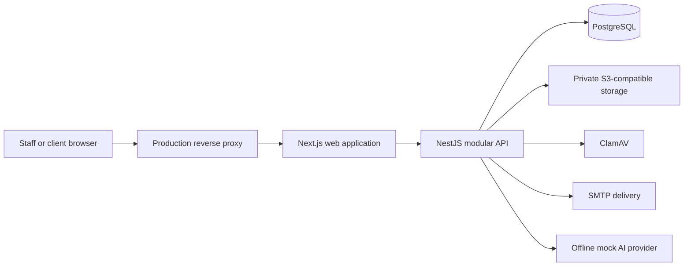
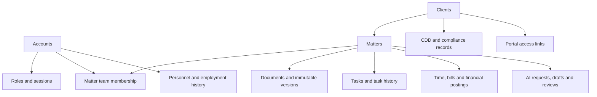

# Stass: system review and A–Z study guide

Review date: 30 October 2026 (Asia/Dhaka).

## 1. What this review establishes

This is a repository review with executed compilation, selected tests and dependency checks. It is not a completed penetration test, browser acceptance test, database performance benchmark or production certification. Source findings below are distinguished from runtime results. Existing review documents describe earlier work; their historical pass counts are not results from this review.

**Assessment:** the project contains a substantial modular application with unusually extensive database safeguards. Some AI paths have weaker consistency and evidence guarantees than the rest of the design. Production capacity is unmeasured, and current dependency advisories require attention before deployment.

### Executed checks

| Check | Result | Meaning |
|---|---|---|
| Dependency installation | Passed using a writable temporary npm cache, with install scripts disabled | Enables inspection and compilation; does not validate every optional native package |
| API TypeScript check | Passed | Static types compile |
| Web TypeScript check | Passed | Static types compile |
| API production build | Passed | API JavaScript builds; services were not started |
| Selected API tests | **9 files, 84 tests passed** | AI utilities, mocked AI controller/security scenarios and password hashing |
| Full API suite | Blocked during global setup | `TEST_MIGRATION_DATABASE_URL` missing; no full-suite result |
| Additional validation/serialization selection | 2 suites failed setup; 11 tests skipped | These apparently small suites use a test application requiring database configuration; failures do not establish product defects |
| Web production build | Failed | `next/font/google` could not fetch Source Sans 3; build also emitted a security warning |
| Hidden-character check | Passed | Script scans tracked HEAD content, not every working-tree/untracked file |
| Production hygiene script | Passed | Checks selected source/configuration strings; does not test deployed security or backups |
| `git diff --check` | Passed before this document | Whitespace check only |
| Production dependency audit | **7 affected package entries: 1 critical, 4 high, 2 moderate** | Registry advisory matching; exploitability has not been demonstrated |
| Docker engine | Unavailable | Engine pipe absent; a separate Compose check also failed required environment interpolation |
| Database integration / browser E2E / load testing | Not completed | Database, SMTP, object storage, scanner and application environment are not ready |

The selected passing files are the six AI utility specs (redaction, prompt builder, document chunker, citation grounding, chronology extraction, attendance notes), `ai.controller.spec.ts`, `ai-security-review.spec.ts`, and `password-hasher.spec.ts`. The AI controller tests use a mocked repository: their success is not proof of PostgreSQL enforcement.

There are 118 API spec files, 18 browser spec files and 75 SQL migrations in this checkout. Counts measure repository size, not coverage or correctness.

## 2. Findings and priorities

### P1: production dependencies have published advisories

`npm audit --omit=dev --json` reported these affected entries:

| Package | Registry severity | Audit-reported remediation |
|---|---|---|
| `next` | Critical | Update from 16.4.0; audit offers 16.4.3 |
| `@nestjs/platform-express` | High, via multer | Audit offers 12.3.2; keep Nest packages compatible |
| `multer` | High | Resolve through the framework dependency update |
| `body-parser` | High | Update dependency resolution |
| `zod` | High | Audit offers 4.6.7 |
| `nodemailer` | Moderate | Audit offers 10.3.1 |
| `qs` | Moderate | Update dependency resolution |

These are seven package entries, not seven proven attack paths or seven unique advisories. For example, this application's document handling uses Busboy, so an installed Multer advisory needs reachability analysis. Next advisories also have feature-specific prerequisites. Record the advisory URLs from a fresh audit, update compatible packages and the lockfile in a focused change, and rerun compilation, integration and browser tests. Do not equate a zero audit count with a secure application.

### P1: AI database access does not consistently use protected functions

Evidence: `apps/api/migrations/0074_ai_foundations.sql:113` grants `pms_app` SELECT and INSERT on requests, drafts and reviews. The table triggers prevent UPDATE/DELETE, but direct INSERT remains available. In contrast, other sensitive domains deliberately revoke direct access and expose narrow protected functions.

Impact: possession of the application database credentials can bypass the AI recording functions' actor/matter checks and budget accounting by writing structurally valid rows directly. This does not mean an unauthenticated browser can issue SQL; it means the database boundary is weaker than the stated defense-in-depth design.

Improvement: revoke direct writes, expose narrowly authorized functions/projections and test both raw SQL denial and normal workflow success as `pms_app`.

### P1: AI review, promotion and audit are separate commits

Evidence: `apps/api/src/ai/ai.service.ts:375` creates document/task records before `recordReview`, then appends audit separately. Repository methods use the shared database without one enclosing transaction.

Failure scenario: submit a review with promotion for an already reviewed or nonexistent draft. A promotion can succeed before review fails. Retrying can leave additional records. Audit failure can also produce a failed response after the domain operation has committed. Runtime reproduction remains pending database availability.

Improvement: validate and lock the draft first, bind its matter to the route, and commit promotion, review and audit together. Use an idempotency key for safe retries. If storage is involved, use staged objects plus compensation/outbox processing rather than pretending PostgreSQL can roll back an S3 operation.

### P1: review links are not bound to the draft's matter

Evidence: `reviewDraft` checks the route's matter, while `app.record_ai_review` independently derives the matter from the draft. The SQL function checks access to that derived matter but does not compare the supplied promotion targets' matter IDs. Promotion IDs are ordinary foreign keys.

Impact: a user with access to two matters can submit mismatched matter/draft/link combinations. The code does enforce access to the draft's matter; this finding is about cross-matter integrity, not demonstrated access to an unauthorized matter.

Improvement: derive all target matter IDs from the locked draft and validate any linked document/task belongs to it. Add two-authorized-matter regression cases and nonexistent/already-reviewed rollback cases.

### P2: document promotion creates a record without the approved content

Evidence: `apps/api/src/ai/ai.repository.ts:197` inserts document metadata only. It does not accept final text, write encrypted file bytes or insert a document version.

Impact: the returned document ID is not evidence that a downloadable approved draft was saved. Mocked promotion tests only check the method call and returned ID.

Improvement: route promotion through the owning document service with a real supported file format, version, encryption and audit. Verify download bytes equal the approved text.

### P2: citation checks trust caller-supplied document text

Evidence: the AI controller accepts `{id,title,content}`. `validateMatterDocumentOwnership` checks the IDs belong to the matter, while generation and grounding consume supplied `content` rather than retrieving an authorized stored version.

Impact: a valid document ID with fabricated text can produce a citation marked grounded against that fabricated text. This checks internal consistency, not authenticity of the stored evidence. The grounding service also treats an empty citation list as grounded, so the score does not prove that narrative claims have evidence.

Improvement: load immutable authorized versions server-side; store version IDs, content hashes and extraction metadata. Distinguish no citations, text overlap and verified factual support. Test altered text under a valid ID.

### P2: configured AI providers are not wired to implementations

Evidence: `apps/api/src/ai/ai.module.ts` always resolves `AI_PROVIDER_TOKEN` to `OfflineMockAiProvider`; the configuration API accepts several provider names. The mock returns canned legal text and fixed example chronology entries.

Impact: selecting another provider in configuration does not establish a real model integration. Study and demo workflows exist; real drafting quality has not been validated.

Also, `generateDraft` builds a system/user prompt for hashing but passes `promptRequest` to the provider, not the assembled prompt. A future adapter must deliberately use the same security prompt and serialization. Detection currently logs suspicious patterns and continues; it is not a reliable blocking boundary.

### P2: AI budgeting happens after provider invocation

Evidence: application preflight uses estimated input tokens; the SQL recording function locks the singleton configuration and enforces actual input plus output tokens after generation.

Impact: database accounting serializes the firm-wide budget, but a future paid provider can incur cost before a request is rejected. Concurrent requests can all pass preflight. Application-only matter allowance checks also need concurrent enforcement. A stale exhausted monthly counter may reject at preflight before the database function gets an opportunity to reset it.

Improvement: atomically reserve bounded input/output allowance before dispatch, set provider output limits, release or reconcile reservations, record failures and test month rollover/concurrency.

### P2: readiness and build reproducibility need improvement

`apps/api/src/health/health.controller.ts` always returns `{status:'ok'}`. The database module checks connectivity at startup, but the health endpoint does not detect a later database outage. Separate liveness from readiness and test post-start dependency failure.

`apps/web/src/app/layout.tsx` downloads a Google font at build time. This review's web build failed there. Vendor a licensed local font or make that network dependency reliable, then rebuild. This does not prove the rest of the web build would pass.

### P3: bounded lists and status documentation need review

Many Compliance/HR/onboarding list queries cap output at fixed limits. The AI draft list has no pagination. Fixed caps protect resources but can hide older work unless users can paginate or filter explicitly. Test datasets larger than each cap.

`docs/architecture.md` describes AI as complete in one section and in progress in another. Treat implementation and executed tests as evidence when documentation disagrees.

## 3. System design: follow one request



The reverse proxy is a supplied deployment configuration; it was not running in this review. Local Compose supplies PostgreSQL, SeaweedFS, ClamAV and Mailpit rather than a complete managed production platform.

For a normal mutation:

1. Browser submits through the web application's API boundary.
2. Session guard resolves the account; permission guard checks the action.
3. Strict Zod validation rejects an unexpected request shape.
4. Controller calls a service; service checks domain access and workflow rules.
5. Repository issues parameterized Kysely queries or protected SQL function calls.
6. PostgreSQL enforces constraints, locks and domain-specific rules.
7. Where correctly implemented, mutation, audit and outbox insert commit together.
8. Response serializer restricts returned fields; no-store headers prevent sensitive response caching.

This is a **modular monolith**: many domains in one deployable API. That is a practical starting design. Separate services only when measured operational needs justify their network, transaction and deployment complexity.

Important correction to a simplified architecture description: authorization exists in both API code and protected PostgreSQL functions. Study both layers. A UI hiding a button is not authorization.

## 4. Database design from first principles

Start with `apps/api/src/database/schema.ts` for TypeScript names and the SQL migrations for actual constraints, grants, functions and triggers. Types are not a substitute for database enforcement.

### Relationship map



This is a conceptual map, not a complete physical ERD. For exact foreign keys, inspect every relevant migration or export the schema after migrations run.

| Concept | Project example | What to study |
|---|---|---|
| Primary key | Account UUID using PostgreSQL `uuidv7()` | Stable identity versus human reference numbers |
| Foreign key | Matter belongs to client | Preventing orphaned references; indexing referencing columns where access requires it |
| Unique constraint/index | Normalized account email | Race-safe uniqueness, not only a pre-insert check |
| CHECK constraint | Account kind/status/password shape | Invalid states rejected even outside the API |
| Many-to-many relationship | Matter team | Membership history and revocation |
| Normalization | Account, role, client and matter separated | Avoiding duplicated facts and update anomalies |
| Append-only history | Financial corrections, HR events, audit | Preserve original evidence; correct with a new event |
| Transaction | Business update plus audit/outbox | All-or-nothing database effects |
| Concurrency control | Advisory/row locks | Serializing only conflicting operations |
| Least privilege | `pms_owner` and `pms_app` | Migration authority versus runtime authority |
| Protected functions | HR/AML operations | Narrow operations with live role checks |
| Envelope encryption | Private document keys | Per-file encryption keys wrapped by a domain key |
| Retention tombstone | Disposal records | Remove content while retaining minimal evidence of disposal |
| Index | Conflict-name trigrams, AI matter/time indexes | Speed versus storage and write overhead |

The two PostgreSQL roles are not application user roles. A fee earner's identity is passed through application operations; connections share the runtime database role. Careful function validation matters because a database connection is not automatically the end user's identity.

### Strengths visible in source

- Separate runtime/migration roles; runtime is not a superuser and cannot create roles/databases.
- Runtime defaults include a 15-second statement timeout and 30-second idle-in-transaction timeout.
- Database-enforced email normalization and uniqueness.
- Cursor-style paging in core lists rather than large OFFSET scans.
- Extensive append-only history and explicit corrections.
- Protected sensitive-domain functions with fixed search paths.
- Streaming document inspection, scanning and encrypted storage with cleanup attempts.
- Durable encrypted mail outbox with leasing, retries and deduplication keys.

### Tradeoffs to understand

Append-only designs increase storage, index and query complexity. Encryption limits searching and makes key loss a recovery problem. Protected SQL functions improve enforcement but put business logic in two languages. Advisory locks prevent races but introduce contention and require a consistent lock order. Deleting an object cannot be rolled back by a SQL transaction, so staged workflows and repair jobs matter.

This schema appears designed for one firm per deployment: firm-wide configuration and appointments are shared, and the reviewed core schema has no consistent tenant discriminator. Client portal separation is not multi-tenant firm isolation. Hosting multiple independent firms in one database requires a separately designed tenant boundary or isolated databases/deployments.

### Practical database exercises

Use a disposable migrated test database and synthetic records:

1. Insert duplicate normalized emails concurrently; confirm one unique-constraint failure.
2. Try forbidden HR/AML writes as `pms_app`; confirm denial.
3. Try a direct AI INSERT and compare its privileges with HR/AML.
4. Run two approvals against one limited balance; verify no overspend.
5. Revoke matter membership during a sensitive operation; verify the intended serialization.
6. Generate more than 100 records for capped lists and verify discoverability.
7. Run `EXPLAIN (ANALYZE, BUFFERS)` for representative reads using realistic volume. ANALYZE executes queries; use care with mutations.
8. Restore a backup into a separate environment and reconcile database rows, objects and disposal tombstones.

## 5. User scaling: what can be claimed

**No measured user-capacity number is available.** Registered accounts, daily active users, concurrent sessions and simultaneous requests are different quantities.

Example planning assumptions, not benchmarks:

```text
1,000 registered people
100 actively interacting at the same time
one action every 10 seconds per active person
= about 10 actions/second
```

One action can cause several web/API requests and many SQL statements. Model the actual page/request graph. At 20 requests/second and 0.25 seconds average response time, Little's Law suggests about five requests in flight in a stable system. That is average concurrency, not a p95 target or a database capacity estimate.

### A concrete connection limit

`apps/api/src/database/database.ts` sets a default pool maximum of 10. `infra/postgres/init/01-roles.sh` gives `pms_app` a connection limit of 50.

```text
5 fully used API pools × 10 connections = 50
```

Pools open lazily; five replicas do not immediately consume 50 connections. But they can exhaust that role limit under load, leaving no margin for other consumers using the role. Additional independent pools count too. This is a connection budget, not a five-server or 50-user capacity claim. Live database settings may differ from initialization scripts and must be checked.

### Likely pressure points to measure

| Workload | Pressure | Measurements |
|---|---|---|
| Sign-in burst | Argon2 CPU/native worker pool and memory | Sign-in latency, CPU, RSS, rate-limit outcomes |
| Authenticated page loads | Dynamic rendering, session checks and SQL | Requests per action, SQL time, pool wait, p95/p99 |
| Conflict search | Name matching and candidate expansion | Query plans, rows examined, index hit rate |
| Large uploads | Network, scanner concurrency and object storage | Concurrent streams, backpressure, RSS, scanner queue |
| Finance approvals | Necessary serialized checks | Lock waits, transaction duration, deadlocks |
| AI generation | Provider latency/cost and singleton budget lock | In-flight calls, reservations, budget-lock wait |
| Email delivery | Per-process worker polling and SMTP | Queue depth, oldest age, retry count, delivery lag |
| Growing history | Larger tables/indexes, backups and retention | Size growth, vacuum activity, restore time |

The outbox polls every 250 ms when scheduled; adding API replicas also adds workers and polling. Database leasing supports coordination, but SMTP can still deliver twice if a process dies after sending and before recording success. Deduplicating queue inserts is not exactly-once external delivery.

### A staged scaling plan

1. Establish a baseline on recorded hardware with realistic records and permissions.
2. Fix slow queries, missing pagination and long transactions before adding infrastructure.
3. Define a connection budget across API replicas, jobs and operational tools; consider a pooler only after testing session/transaction behavior.
4. Run multiple web/API instances behind a load balancer and verify revocation, outbox leases and scheduled jobs across replicas.
5. Move expensive jobs to dedicated workers when measured contention warrants it. Use durable job states and idempotent handlers.
6. Add PostgreSQL HA and tested backups for availability. A replica improves availability/read capacity only when the application actually uses it correctly.
7. Use cached projections/read replicas only for data where stale results are acceptable; authorization and financial decisions need current authoritative state.
8. Consider partitioning high-growth history only after measuring retention/query patterns. Sharding and microservices are later options, not automatic requirements.

## 6. A reproducible verification plan

### Prepare the environment

Start Docker Desktop, prepare `.env`, `apps/api/.env` and `apps/web/.env.local` from their examples, and generate separate synthetic development secrets. Do not paste those secrets into review output. Supply test URLs for `pms_test` under the intended app/owner roles.

Dependency installation used `npm.cmd` because this PowerShell environment blocks `npm.ps1`. If the normal cache is unwritable:

```powershell
npm.cmd ci --ignore-scripts --no-audit --no-fund --cache "$env:TEMP\pms-review-npm-cache"
docker compose up -d
docker compose ps
npm.cmd run typecheck -w @practice/api
npm.cmd run typecheck -w @practice/web
npm.cmd run build -w @practice/api
npm.cmd test -w @practice/api -- --maxWorkers=1
npm.cmd run test:e2e -w @practice/web
```

The E2E command rebuilds web and recreates **`pms_e2e`**. Verify that name and test-only configuration before running. Keep it separate from `pms` and `pms_test`. Install the required Chromium version if absent. Resolve the font build dependency first. Starting Compose does not itself start the API and web development servers.

### Acceptance matrix

| Domain | Positive path | Failure/security path |
|---|---|---|
| Authentication | Invite, password, 2FA, sign-in, sign-out, recovery | Replayed code, disabled account, expired session, rate limits |
| Staff/roles | Assign/revoke intended roles | Immediate loss of access; last-administrator rule |
| Clients/matters | Create client, conflicts, team, activation, close | Non-team access, failed gates, concurrent reassignment |
| Documents | Scan/upload/version/download | EICAR, scanner outage, interrupted upload, revoked sharing |
| Portal | Invite client and show explicitly shared records | Staff routes denied, unrelated client records denied |
| Tasks/notifications | Assign, change, complete, remind | Invalid assignee, duplicate reminders, revoked recipient |
| Finance | Time, bill, receipt, allocation, approval, reconciliation | Imbalanced postings, self-approval, concurrent double spend |
| Compliance | Evidence, screening, clearance, hold, disposal | Stale clearance, active hold, restricted-report disclosure |
| HR | Self/manager/HR views and leave decisions | Former-manager access, private-field leak, overlapping leave |
| Onboarding | Contact verification through engagement and activation | Expired/replayed links, incomplete evidence, wrong client |
| AI | Generate, review, persist and download approved content | Fabricated context, cross-matter links, failed promotion rollback, budget races |
| Recovery | Restore database, objects and keys coherently | Missing key, missing object, stale backup and disposal replay |

For UI design, verify keyboard navigation, focus after errors, 390-pixel layout, long names, large tables, loading/empty/error states and role-specific navigation. Existing CSS contains design tokens and the root layout includes a skip link, but those source features are not a live visual/accessibility pass.

### Load-test specification

Run against an isolated environment with synthetic data and Mailpit/test storage. Begin at 1 user, then 10, 25, 50 and 100 simulated active users. These are test steps, not supported capacity promises. Use realistic think time and a measured workload mix. Separate login, normal reads, uploads and finance contention so one aggregate number does not hide a bottleneck.

Capture throughput, p50/p95/p99 latency, unexpected errors, CPU, RSS, event-loop lag, database connections/pool waits, slow SQL, locks, storage throughput and mail lag. Define latency/error targets with the intended users before testing. Include a sustained soak and dependency-outage recovery, not only a short peak test. Record the first constraint rather than reporting the largest user count reached.

## 7. A–Z learning route

| Topic | Learn it through this project |
|---|---|
| A — Architecture | Draw browser → web → API → database/storage and label trust boundaries |
| B — Business rules | Trace matter activation and payment approval gates |
| C — Concurrency | Reproduce competing approvals and membership revocation |
| D — Database | Map primary/foreign keys, constraints and permissions |
| E — Encryption | Follow a private file key through wrapping, storage and download |
| F — Failure handling | Interrupt upload, SMTP and audit operations; inspect partial effects |
| G — Guards | Trace session and permission guard order |
| H — HTTP | Study status codes, cookies, CSRF, streaming and no-store headers |
| I — Indexes | Compare conflict-search plans before and after indexed access |
| J — Jobs | Follow outbox claim, lease expiry, retry and duplicate delivery |
| K — Keys | Separate IDs, human references, idempotency keys and encryption keys |
| L — Load | Translate user actions into request rate and database work |
| M — Migrations | Build an empty database through all 75 forward migrations |
| N — Normalization | Explain why clients, accounts, matters and personnel are separate |
| O — Observability | Design useful latency, pool-wait, lock and queue-age dashboards |
| P — Permissions | Compare UI visibility, API permission and database authority |
| Q — Query design | Review pagination, joins, search and bounded projections |
| R — Recovery | Prove restoration, key access and tombstone replay |
| S — Security | Triage dependency advisories and test authorization boundaries |
| T — Testing | Distinguish unit mocks, HTTP tests, real database tests and E2E |
| U — User experience | Evaluate accessible errors, navigation and dense workflows |
| V — Validation | Compare strict request schemas and database constraints |
| W — Workflows | Draw explicit states for matter, payment, draft and disposal |
| X — External systems | Model SMTP, storage, scanner and future AI failure contracts |
| Y — Year/month boundaries | Test token resets, leave years, dates and London timezone rules |
| Z — Zero data loss claims | Replace claims with measured RPO/RTO and restoration evidence |

Suggested sequence: first trace one client/matter request; then model the related tables; then test a successful workflow; then force an invalid state; then introduce concurrency; finally measure load and recover from failure. Explain each result in your own words before moving to the next domain.

## 8. What remains open

The outstanding work is running the real database and browser acceptance matrix, demonstrating the code findings with integration tests, auditing every domain's privilege boundary, measuring realistic query plans/load, visually reviewing screens, and executing restoration drills. No source fixes or dependency upgrades were applied as part of this assessment. The existing untracked `docs/client-presentation.html` was left untouched.

Repository documentation for deeper study: [architecture](architecture.md), [data model](data-model.md), [testing](testing.md), [authorization](authorization.md), [deployment](deployment.md), [disaster recovery](disaster-recovery.md), and the domain documents linked from [README](../README.md).
