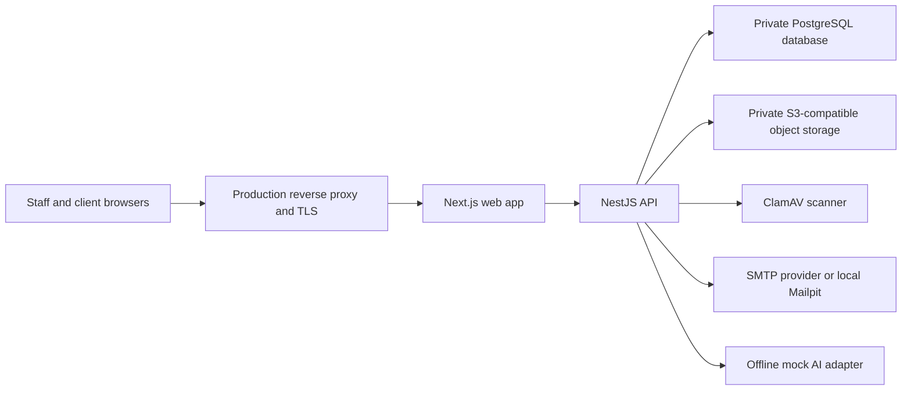
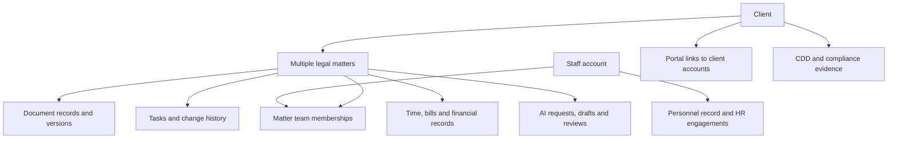
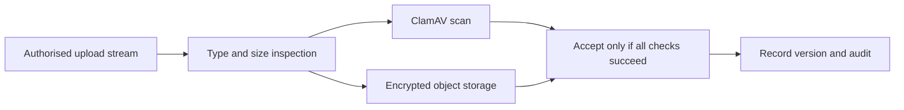

# Stass: Whole-System Design Learning Handbook

**Architecture, database and feature workflows for law-firm staff, clients and software engineers**

Prepared for this repository on **30 October 2026**, Asia/Dhaka. Intended legal operating context: an SRA-regulated firm in England and Wales. Overseas clients do not automatically change the firm's regulatory jurisdiction.

## How to use this handbook

Read chapters 1–5 to understand the system. Read chapters 6–17 to follow its features. Use chapters 18–24 to study implementation, scaling and verification. Appendix A is an automatically extracted reference to every table mapped in the TypeScript database interface. Appendix B lists the migration history and Appendix C provides a controller route index.

This handbook explains the checked-out design, not a certified production installation. **Source-confirmed** means code or SQL was inspected. **Documented** means repository documentation describes the intended behavior. **Verified** refers only to executed checks explicitly listed in chapter 23. **Proposed** means an exercise or improvement, not existing functionality. SQL and live database inspection remain authoritative when an extracted reference differs.

The legal sections are an educational map of design requirements, not a determination that the product or any particular firm complies with law. Firm policies, appointments, evidence quality and professional judgement remain necessary. The ICO currently marks relevant guidance as under review following legislative changes. Recheck the linked primary sources before making operational legal decisions.

### Reading routes

| Your perspective | Read first | Question to keep asking |
|---|---|---|
| Law-firm owner, solicitor or operational staff | Chapters 2, 4, 6–17, 22–23 | Who is accountable, what evidence supports this decision, and what blocks unsafe work? |
| Client or organisation contact | Chapters 2, 6–11, 14–15 | What do I submit, what can I see, what needs staff review, and what happens to my data? |
| Software engineer | Chapters 3–5, all engineering sections, 18–24 and appendices | Where is each invariant enforced, what happens concurrently, and how is failure repaired? |

### Contents

1. [What the product is](#1-what-the-product-is)
2. [A complete example client journey](#2-a-complete-example-client-journey)
3. [Architecture and deployment boundaries](#3-architecture-and-deployment-boundaries)
4. [People, roles and authority](#4-people-roles-and-authority)
5. [Database fundamentals and relationships](#5-database-fundamentals-and-relationships)
6. [Authentication and recovery](#6-authentication-and-recovery)
7. [Clients, contacts and portal access](#7-clients-contacts-and-portal-access)
8. [Conflicts, matters and teams](#8-conflicts-matters-and-teams)
9. [Onboarding, policies and identity evidence](#9-onboarding-policies-and-identity-evidence)
10. [Engagement, signatures and activation](#10-engagement-signatures-and-activation)
11. [Documents and controlled sharing](#11-documents-and-controlled-sharing)
12. [Tasks, reminders and notifications](#12-tasks-reminders-and-notifications)
13. [Time recording, billing and corrections](#13-time-recording-billing-and-corrections)
14. [Client money, approvals and reconciliation](#14-client-money-approvals-and-reconciliation)
15. [AML, sanctions and restricted reports](#15-aml-sanctions-and-restricted-reports)
16. [People and HR](#16-people-and-hr)
17. [AI drafting and human review](#17-ai-drafting-and-human-review)
18. [API contracts and code structure](#18-api-contracts-and-code-structure)
19. [Transactions, concurrency and idempotency](#19-transactions-concurrency-and-idempotency)
20. [Security, encryption and privacy](#20-security-encryption-and-privacy)
21. [Capacity and scaling](#21-capacity-and-scaling)
22. [Deployment, retention and disaster recovery](#22-deployment-retention-and-disaster-recovery)
23. [What has been tested and what remains uncertain](#23-what-has-been-tested-and-what-remains-uncertain)
24. [Learning exercises and interview questions](#24-learning-exercises-and-interview-questions)
25. [Legal source map and vocabulary](#25-legal-source-map-and-vocabulary)

## 1. What the product is

Stass is a practice-management system plus a client portal. A law firm uses it to organise client relationships, individual legal matters, evidence, staff work, money records, compliance decisions and personnel administration. A client uses a smaller, explicitly filtered part of the application.

The system is not a court filing service, a bank, a universal legal-compliance calculator or a working general-purpose AI provider integration. A database entry that says a payment was approved does not prove money left a bank. A file upload does not prove identity. A signature event does not settle every legal question about execution. These distinctions drive the domain boundaries.

| Domain | Business problem | Principal records |
|---|---|---|
| Authentication and authority | Establish who is acting and what they may do | Accounts, sessions, 2FA, role history |
| Clients and matters | Identify the relationship and each piece of legal work | Client identities, contacts, matters, teams, conflicts |
| Onboarding | Gather and review prerequisites before work proceeds | Evidence requests, verification, engagement, activation |
| Documents | Keep private files versioned and share deliberately | Document metadata, versions, wrapped keys, sharing history |
| Work management | Assign work and track due dates | Tasks, changes, notifications and outbox |
| Finance | Preserve time, bills, allocations and money controls | Rates, time, bills, transactions, postings, reconciliation |
| Compliance | Support risk-based review and sensitive oversight | CDD, risk, sanctions, holds, restricted reports, exports |
| People/HR | Administer employment without exposing private personnel data | Engagements, leave, vetting, competence, cases |
| AI | Assist drafting under review | Configuration, requests, draft outputs and review records |
| Audit and operations | Explain actions and recover reliably | Audit events, disposal evidence, migration history |

## 2. A complete example client journey

Use a fictional client, **Amina Rahman**, asking the firm to advise on a commercial lease. All examples use synthetic facts. If the legal client is her company rather than Amina personally, the company is the client and Amina is its authorised contact. Identity, authority and beneficial ownership are related but different questions.

1. Staff create the correct individual or organisation client record. They search existing records to avoid duplicates.
2. Staff collect counterparty and connected-person names and run a conflict search. A possible match requires an accountable decision, not simply ignoring a warning.
3. A supervising partner and fee-earner team are recorded for the matter. Activation prerequisites are reviewed independently from the basic matter record.
4. Staff verify the recorded email channel and invite the correct person to the portal. The person sets a password and second factor.
5. The client supplies requested identity, authority or source evidence through the scoped evidence workflow. Staff review it; Compliance decides the relevant clearance.
6. The firm prepares engagement documents and fee estimates from approved versions. The client reads and signs or returns documents; staff review the returned evidence.
7. The firm records an initial payment request where appropriate. Actual bank receipts and allocations pass through Finance controls.
8. Once applicable gates are satisfied, the team performs work, uploads documents, records time and assigns tasks. Staff deliberately share selected outputs.
9. Accounts issues a fixed bill. Client money movements use the separate approval and bank-outcome process. Reconciliation checks internal records against external statements.
10. The partner closes the matter through the permitted workflow. Retention eligibility, legal holds and eventual disposal remain separate decisions.

**Client perspective:** a portal status is a limited view of the firm's records. Internal risk notes, other clients' information, HR data and restricted reports are outside that view.

**Engineer perspective:** this journey spans many transactions and human pauses. Model each step as a durable state with its own actor, evidence and failure path. Do not implement the journey as one long database transaction or one editable `onboarding_complete` checkbox.

## 3. Architecture and deployment boundaries



This is a **modular monolith**. One NestJS backend contains separate domain modules rather than many independently deployed microservices. The design favours local transactions, shared security infrastructure and simpler operations. Domain separation still matters: owning services should control their tables and invariants. The AI promotion path identified in chapter 17 is an example where direct cross-domain writes weaken this discipline.

| Layer | Technology in checkout | Responsibility |
|---|---|---|
| Web | Next.js 16, React 19, TypeScript | Render staff/client pages and forward permitted requests |
| API | NestJS 12 on Node.js 24 | Validate, authorise, execute workflows and serialize safe output |
| Data access | Kysely plus PostgreSQL driver | Parameterized queries and explicit SQL functions |
| Database | PostgreSQL 18 | Durable state, constraints, transactions, locks and protected operations |
| Files | S3-compatible SeaweedFS locally | Store encrypted file objects outside relational rows |
| Malware checks | ClamAV | Scan upload streams before acceptance |
| Email | Nodemailer/SMTP, Mailpit locally | Deliver messages from a durable encrypted outbox |
| Tests | Vitest, Supertest, Playwright, axe | Different levels of functional and accessibility verification |

The browser should not connect directly to PostgreSQL, storage credentials or the private API network. The web/API boundary also needs a threat model: user-controlled paths, cookies, bodies and forwarded headers cannot be trusted just because a request passed through Next.js.

The supplied Compose setup is local infrastructure. Reverse-proxy files and deployment runbooks describe production arrangements; their existence does not mean HA, backups or TLS are active. Older architecture decision records mention Django and Python proposals that were superseded. The current backend is TypeScript/NestJS.

## 4. People, roles and authority

Authentication asks **who are you?** Authorization asks **may you do this to this record now?** A role permission alone is insufficient if the person is not on the matter team or no longer holds the relevant relationship.

| Actor | Typical authority | Important boundary |
|---|---|---|
| Administrator | Staff invitations, roles and account disabling | Does not automatically gain Finance, matter or HR content |
| Partner | Supervision, team decisions, conflicts and closure | Needs the relevant matter/relationship conditions |
| Fee earner | Day-to-day matter work, documents, tasks and time | Access is scoped to permitted clients/matters |
| Accounts | Billing, receipts, payment requests and reconciliation preparation | Cannot approve their own client-payment request |
| Compliance | Regulatory controls, AML decisions and selected oversight | Restricted reports additionally require a live nominated-officer appointment |
| HR | Personnel administration and private HR workflows | HR role alone does not make someone an administrator or matter worker |
| Current manager | Bounded current direct-report views and decisions | Relationship is live and revocable; medical detail is separate |
| Client account | Permitted portal records and explicit client actions | No staff roles and no access to staff routes |

The API uses audience declarations, session checks, permissions and record-specific checks. Protected SQL functions recheck sensitive live facts under appropriate locks. A hidden navigation item helps usability but does not protect an endpoint.

Role definitions are fixed in code; assignments have database history. A person can hold several roles, but separation requiring **different people** still applies. Two roles on one account do not turn that person into two approvers.

Database roles are different: `pms_owner` runs migrations, and `pms_app` serves runtime queries. A human partner does not get their own PostgreSQL login through the application's role system.

## 5. Database fundamentals and relationships

The application schema is `app`; migration bookkeeping has its own schema. Development, API tests and browser tests use separate databases: `pms`, `pms_test` and `pms_e2e`. Application types in `apps/api/src/database/schema.ts` map **177 tables** in this checkout. There are **75 forward SQL migrations**.



### The essential distinctions

**Client versus account:** a client is the legal relationship. An account is a person who can sign in. One organisation may have several authorised contacts, and one account can have links to several clients. Never infer representation from a shared email domain.

**Client versus matter:** a client can instruct on multiple matters. Matter-specific scope, team, risk, documents and bills belong to that work rather than being mixed into one client-wide folder.

**Document versus version:** a document identifies an item; versions identify fixed content. Client sharing normally exposes only the latest permitted version. A versioned file needs stored bytes, integrity information and key metadata, not just a title.

**Current projection versus history:** screens display current status derived from underlying events. Corrections should preserve the earlier evidence. Not every table uses a fully event-sourced model; this is a relational system with substantial append-only histories.

### Why the database enforces rules too

Frontend validation can be bypassed. API checks can race. A unique index, CHECK constraint, foreign key or protected function can reject an invalid write at the actual persistence boundary. Examples include normalized unique account emails, active team assignees and immutable posted records.

`ColumnType<Select, Insert, Update>` expresses write permissions to TypeScript. Wrappers such as `InsertOnly` and `DatabaseSet` make forbidden writes harder to express in application code. They do not independently secure the database: SQL GRANT/REVOKE statements and triggers must agree.

### Normalization example

Do not store the client's name, current staff rate and full document content repeatedly on every task. Keep identities and relationships in their own tables. When historical evidence matters, deliberately snapshot the relevant rate, bill address or policy version. Normalization avoids accidental duplication; snapshots preserve what was relied on at a decision time.

### Money, dates and identifiers

Money uses exact integer pence and controlled string conversion rather than binary floating-point arithmetic. Leave/time use integer minutes. `date` represents a calendar date; `timestamptz` represents an instant. Reminders use Europe/London calendar logic. A Dhaka reader must not silently change UK operational dates into the workstation's timezone.

UUID primary keys identify records; client/matter references make them readable to humans. Foreign keys enforce referenced identity, but not every business relationship. For example, a foreign key to a document does not by itself prove that document belongs to the same matter as an AI draft.

## 6. Authentication and recovery

**Law-firm staff:** administrators invite staff; clients are invited through permitted client relationships. Users choose a password and enroll an authenticator. Recovery links and backup codes are sensitive credentials and should not appear in logs or screenshots shared outside testing.

**Client:** accept the invitation sent to the recorded address, complete account setup and keep backup codes safe. Email control and successful sign-in establish control of credentials, not completion of identity due diligence.

**Engineering flow:** email/password check → short-lived pending second-factor stage → successful TOTP/backup-code check → newly issued authenticated session. The pending token is not upgraded into the final token, reducing session-fixation risk. Sessions live server-side and can be ended. Replay protection prevents reuse of an accepted TOTP step.

Passwords are normalized and hashed with Argon2id; password hashes are not decryptable passwords. TOTP secrets must be recoverable to validate codes, so they are encrypted instead. Backup codes are high-entropy one-use values stored as hashes. Password resets and invitations have expiring, single-use state.

The documented breached-password integration sends a hash prefix, compares results locally and records when an outage causes that check to be skipped. Sign-in failures receive generic answers and rate limits apply by account and address. Availability and anti-enumeration controls must be tested together.

**Database study:** `accounts`, `sessions`, `totp_credentials`, `backup_codes`, `invitations`, `password_resets`, `sign_in_failures`, `account_roles`. Read the guard order and then the SQL rules that prevent state reversal.

**Exercise:** authenticate with a backup code, replay it, disable the account and retry an existing session. Explain why a previously rendered page cannot be recalled from a person's memory even though later API access is revoked.

## 7. Clients, contacts and portal access

**Staff:** create the correct client kind, maintain contacts, and record who is responsible. A responsible person's departure needs an explicit takeover/handover; deleting their name is not a transfer process.

**Client:** the portal shows permitted matters and deliberately shared material. An organisation contact acts through a specific client link. Updating an email or ending the relationship can invalidate access on the next checked request.

**Engineer:** core entities include `clients`, individual/organisation details, `client_contacts` and `portal_links`. Portal links carry who linked whom, when and whether the link ended. An ended link is history, not a row to reactivate silently. Visibility filtering belongs inside data-access queries, not only after fetching broad results.

Invitation destinations come from the recorded client/contact data, which prevents a staff user typing an arbitrary destination at invitation time. The account's kind distinguishes staff and client audiences. One email/account can be linked to multiple clients, but each link must independently be valid.

Do not confuse early portal documentation describing a read-only first version with later onboarding additions. Current documented scope includes requested evidence submission, engagement signing and initial-payment request information. It does not establish an unrestricted client file uploader or a complete client finance dashboard.

**Exercise:** create two organisation clients with one contact login. End one link and show that the second remains valid without exposing the first client's records.

## 8. Conflicts, matters and teams

**Staff:** perform and review conflict checks before accepting work; record a supervising partner and appropriate team. Potential names are review leads, not automatic conclusions. Closing a matter is a controlled transition, not removing it from the database.

**Client:** an unresolved acceptance decision may delay the firm's ability to act. Internal conflict details can concern others and should not be exposed through a broad portal status or search result.

**Engineer:** `matters` links work to clients; team membership is a relationship with history. Conflict checks preserve inputs and results, while later decisions preserve the rationale. PostgreSQL functions and triggers enforce live staff/team state at writes. Search uses normalized/fuzzy names and trigram indexes for candidate discovery.

Do not collapse the system into one status field. A base matter status, a conflict decision, AML clearance, onboarding activation and financial holds express separate dimensions. An `open` matter label does not mean every later action passes all gates.

**State example:** request search → inspect possible matches → reviewer records decision and controls → activation checks independent prerequisites → work proceeds or remains blocked. The sequence is a teaching model; read the relevant SQL for exact allowed transitions.

**Exercise:** remove an assignee while another request creates a task. Determine which rows/locks serialize the outcome and whether the result is an intentional denial or an unexpected server error.

## 9. Onboarding, policies and identity evidence

**Staff:** manage policy versions and acknowledgements, verify contact channels, request scoped evidence, review identity/authority facts, and obtain relevant Compliance decisions. Policies are evidence of procedures; acknowledging one does not prove staff followed it on a later matter.

**Client:** receive a clear request specifying evidence and purpose, submit it against the correct open request and respond to any replacement request. A rejected submission remains part of the history rather than being silently overwritten.

**Engineer:** onboarding records capture request scope, submission references and review events. Evidence uploads use the scanning/encryption boundary and do not become generally shared matter documents. A Companies House snapshot is external evidence with retrieval time and source; differences require review rather than silently overwriting the client.

Email verification demonstrates control of that channel at a point in time. An address change makes the result stale. Phone verification and commercial electronic checks require configured real providers. Manual review is a documented route. Do not label a result government-verified without an actual authorised integration producing it.

**Data groups:** policy versions/acknowledgements; contact-verification requests/results; `onboarding_evidence_requests`, submissions and reviews; electronic checks; company snapshots; conflict aliases, connected persons and decisions.

**Exercise:** change the contact address after a successful verification. Verify that a new invitation/verification does not inherit trust solely because the client ID is unchanged.

## 10. Engagement, signatures and activation

**Staff:** use an approved template, generate the right letter/fee document, review the returned signature and record any allowed exception explicitly. Missing mandatory prerequisites should remain visible. An exception should have scope, rationale and expiry rather than rewriting a failed check to passed.

**Client:** read the scope, charging assumptions and responsibilities; sign or decline through the offered route. Wet-signature upload is part of the provider-neutral design. A full commercial e-sign service should not be assumed from the presence of signature tables.

**Engineer:** template version, allowed merge inputs, generated artifact/hash and signer evidence need stable references. The documented signature progression includes draft, sent, viewed, signed, declined, expired and verified events. Submitted evidence and staff verification are different facts.

Estimates and budgets use explicit assumptions and exact money. A changed fee agreement should create a new evidenced version, preserving what the client previously saw. Activation checks combine the appropriate evidence and independent conflict/AML/money gates.

**Tables:** `engagement_templates`, `engagement_documents`, `engagement_signatures`, `engagement_signature_reviews`, `matter_fee_estimates`, `onboarding_payment_requests`, activation records and exceptions.

**Exercise:** regenerate a document after its template changes. Explain which signature belongs to which exact generated artifact, and why the earlier signature cannot simply be copied onto the replacement.

## 11. Documents and controlled sharing

**Staff:** add a document to an authorised open matter, add later versions, share deliberately and withdraw with a reason. Sharing a document is a consequential disclosure decision; a valid upload is not an instruction to publish it.

**Client:** see only eligible shared content and the permitted latest version. Revoking sharing prevents future authorised downloads; it cannot erase a copy already downloaded to a device.

**Engineer:** the file flows through streaming type inspection, malware scanning and encrypted storage. Metadata/version recording follows acceptance. Per-file keys are wrapped by a master/domain key. Object storage contains encrypted bytes; PostgreSQL holds references and wrapped-key metadata.



The stream is split so scanning and storage can progress with backpressure. Rejected/interrupted uploads need cleanup. SQL rollback cannot undo a completed storage request, so failure repair must handle the gap between object persistence and metadata commit. Privacy projections should avoid leaking private file names through notifications and general audit metadata.

**Exercise:** simulate scanner outage, unsupported bytes under a permitted extension, malware test data, storage failure and a team revocation during upload. Check both user result and leftover objects.

## 12. Tasks, reminders and notifications

**Staff:** create an open task with an active matter-team assignee, due date and priority. Mark completion/cancellation through the controlled change workflow. Changes preserve before/after facts rather than allowing silent history edits.

**Client:** staff tasks and internal reminders are not automatically portal-visible. A matter's internal operational workload should not become a client inbox simply because the matter is shared.

**Engineer:** `tasks` stores current task state, `task_changes` stores history, and notifications reference recipients/resources. Notification rendering rechecks current visibility before showing current task text. Read state is separate from immutable notification existence.

Due reminders use Europe/London dates, durable unique keys and a scheduler coordinated with database locks. Startup catch-up handles missed windows within database-defined bounds. The encrypted mail outbox retains work across process restarts, with leases, retry times and terminal outcomes.

An email saying a generic action is needed is safer than putting a private task description into a mailbox. SMTP delivery is an external effect: a crash after sending but before recording success can lead to duplicate delivery. Queue deduplication alone does not solve that final ambiguity.

**Exercise:** run two worker instances against the same disposable database and restart one during delivery. Check duplicate queue creation separately from duplicate external delivery.

## 13. Time recording, billing and corrections

**Staff:** record real work dates, whole minutes, descriptions and the applicable rate. Accounts prepares a bill, checks its lines and issues an immutable numbered snapshot. Mistakes in issued financial evidence require credits/corrections, not editing history.

**Client:** distinguish an estimate, a request for money on account, an issued bill and a receipt. They describe different events. The portal's initial payment workflow does not imply that all internal billing and ledger screens are exposed.

**Engineer:** permanent rates and time snapshots prevent a later rate change from rewriting prior billed work. Draft lines can be prepared before issue; issued headers/lines preserve the relied-on values. Linked corrections prevent the same billed time being reused improperly.

**Arithmetic exercise:** 90 minutes at £200/hour gives £300 net: `90 × 20000 / 60 = 30000` pence. With an explicitly applicable 20% illustrative VAT treatment, tax is 6000 pence and gross is 36000. This is a calculation example, not a legal determination of VAT treatment. Real classification, rounding and disbursement handling must use the configured rules and appropriate tax review.

Billing a true disbursement versus recharging the firm's own cost needs correct classification; the description alone should not choose tax treatment. Snapshot both the numeric treatment and meaning so exempt and outside-scope lines do not become indistinguishable merely because both produce zero tax.

**Tables:** rates, time entries/corrections, bill drafts/lines, issued bills/lines, credits and delivery evidence. Use the appendix for exact mapped names.

## 14. Client money, approvals and reconciliation

**Staff:** Accounts records bank-confirmed receipts, allocation and payment evidence. One Accounts holder requests a client-account payment; a different Accounts holder approves. Approval reserves availability. A later event records what the bank actually did. Compliance supplies the configured reconciliation sign-off authority.

**Client:** money held on account remains different from the firm's earned fee. A payment request is not a receipt, and an approved withdrawal is not bank confirmation. Ask for an explanation of recorded charges or movements through the firm's service process.

**Engineer:** keep client and business sides distinct, derive balances from posted history and preserve reversal links. Transactions and postings must reconcile mathematically. Concurrency checks must prevent multiple requests spending the same available funds.

### An illustrative movement

```text
Bank-confirmed receipt allocated to matter:  £1,000.00
Approved payment reservation:                 £300.00
Remaining available amount for new requests:  £700.00
```

Before bank execution, the reservation is a workflow encumbrance, not a completed bank debit. If a bank rejects the payment, record the outcome and release/reverse the appropriate reservation through the domain operation. Do not edit a balance field to make the screen look right.

Reconciliation compares independent bank statements with cash-book and client-liability records. Import hashes/account/row identities help avoid duplicate imports. Matching/reversals preserve evidence. A fixed reconciliation stores what was signed at that time, even if later corrections change present-day totals.

**Legal linkage:** SRA Accounts Rules require separate client money controls and suitable records. The rules' reconciliation requirement is at least every five weeks with appropriate sign-off; Stass's two-person payment and role-specific sign-off design is a project control, not a claim that the law prescribes these exact software roles. See the [current Accounts Rules](https://www.sra.org.uk/solicitors/standards-regulations/accounts-rules/).

**Exercise:** give two concurrent requests access to a £500 available balance and request £400 each. Confirm that only an allowed amount can reserve; inspect committed postings, reservations, history and error handling.

## 15. AML, sanctions and restricted reports

**Staff:** assemble client due diligence, authority/ownership facts, evidence, risk assessment and relevant source information. Compliance decides clearance and monitors changes. A provider pass, company registry result or uploaded passport is one input, not the whole decision.

**Client:** respond to legitimate evidence requests. Some internal compliance decisions cannot be disclosed through ordinary portal views. A missing status must not be interpreted as proof that no internal review exists.

**Engineer:** firm controls, immutable CDD versions, sanctions list versions, screening candidates and reasoned resolutions are separate entities. A new applicable framework or changed list can make an earlier result stale. Sensitive money/work operations check the relevant live gates.

The restricted-report subsystem uses a distinct authority boundary and encryption key. A general Compliance role is not sufficient without the live nominated-officer conditions. Ordinary counts, navigation, audit metadata and exports must not reveal restricted-report existence. Statutory restrictions on disclosure and privilege issues require trained review; avoid designing client-visible explanations that expose confidential internal reporting.

Sanctions candidates need resolution; a name match is not automatically a definitive designation. Frozen funds/licence records use protected operations and amount limits. The system records decisions and evidence; it does not autonomously determine the legal permissibility of every transfer.

**Retention linkage:** regulation 40 has specific AML recordkeeping periods tied to completion/end of relationship and exceptions. It is not a universal five-year deletion rule for the whole system. See [regulation 40](https://www.legislation.gov.uk/uksi/2017/692/regulation/40). Apply the current text and matter-specific grounds before disposal.

**Exercise:** activate a new sanctions list, test previously cleared work, confirm the intended stale/review state, and inspect whether ordinary staff can infer a restricted report from a dashboard count.

## 16. People and HR

**Firm/HR:** maintain personnel identity, engagements, terms, manager relationships, work patterns, leave, vetting, competence and confidential cases. A leaver needs coordinated handover across account ownership, supervision and operational roles. Ending employment alone must not be assumed to disable every account or transfer each matter.

**Worker/client perspective:** a worker sees permitted self-service records. A client does not receive HR records because they know the staff member. A line manager receives operationally necessary information rather than full medical history.

**Engineer:** HR uses purpose/person-bound encryption, effective-dated events and protected projections. Reporting lines must not form cycles or create overlapping active engagements. Current-manager visibility depends on the current relationship rather than a forever-cached manager permission.

| HR feature | Business action | Data/control lesson |
|---|---|---|
| Employment history | Record terms, work pattern and manager changes | Effective dates and append-only corrections |
| Leave | Request, approve/refuse, cancel | Per-person/year locks and exact minute ledger |
| Sickness | Record absence/status | Keep medical narrative outside manager-safe forms |
| Adjustments | Review a request and communicate instructions | Separate grounds from practical operational projection |
| Vetting | Record right-to-work and professional checks | Versioned evidence, expiry and follow-up |
| Competence | Reflection, learning, objectives and appraisal | Different authorship/acknowledgement responsibilities |
| Cases | Assigned procedural work and outcomes | Explicit membership in addition to HR role |
| Retention/export | Review scoped disclosure or disposal | Legal holds, two-person review and integrity |

Leave policies and payroll-supplied pay evidence are records, not a comprehensive statutory entitlement/pay calculator. Employment duties depend on facts and current law; this handbook does not certify the repository's retention-period or entitlement assumptions. A worker export also needs review for third-party information and applicable disclosure limits.

**Exercise:** reassign a manager, then request the former manager's previous direct-report detail. Test the next request, not just whether the navigation link disappeared.

## 17. AI drafting and human review

**Staff:** use summaries, chronology, correspondence and attendance-note support as draft assistance. Check facts, source passages, missing context and the final approved content. Human acceptance is an accountable step; a favorable automated grounding score is not legal verification.

**Client:** an AI draft is not automatically published advice. Only permitted reviewed outputs should enter normal document sharing. The current code is wired to a canned offline provider, so this checkout does not establish real-world model quality.

**Engineer:** configuration, request metadata, drafts and reviews are the core records. Inputs pass redaction and prompt-building utilities; output citations are compared to provided context; budget accounting occurs in SQL. However, code review found important limitations:

1. `AI_PROVIDER_TOKEN` always resolves to `OfflineMockAiProvider` despite several configurable provider names.
2. The service hashes assembled prompts but calls the provider with a request object. A future real adapter must consume the actual intended system/instruction boundary.
3. Context IDs are checked for matter ownership, but text is supplied by the caller. Grounding checks consistency against that text rather than retrieving a trusted immutable file version.
4. Direct app-role INSERT privileges on AI records can bypass the protected recording functions' checks.
5. Review, document/task promotion and audit run as separate operations. Failed review can leave a promotion behind.
6. Document promotion creates document metadata without storing approved file bytes/version.
7. Route matter, draft matter and linked target matter need explicit integrity binding.
8. Firm budget recording serializes on one configuration row after generation. A future paid provider can incur cost before rejection; reservations are needed.

The passing selected AI tests include mocked repositories and utility scenarios. They do not refute these persistence/integration findings. The prior review PDF explains them further; fix and reproduce them with a real disposable database before calling the workflow complete.

**Exercise:** request promotion while forcing review failure, then inspect documents/tasks/audit. Separately submit altered text using a valid document ID and observe what the grounding checker actually establishes.

## 18. API contracts and code structure

The backend follows controller → service → repository. Controllers define transport, request schemas, permissions and response schemas. Services orchestrate business rules. Repositories issue queries and protected function calls. PostgreSQL also contains business enforcement, so tracing only TypeScript misses part of the system.

```text
apps/web/src/app/               staff, public and portal routes
apps/web/src/lib/               typed API-facing helpers
apps/api/src/app.module.ts      module composition
apps/api/src/app.setup.ts       guards, validation and error/response pipeline
apps/api/src/<domain>/          controllers, services, repositories and tests
apps/api/src/database/schema.ts typed database mapping
apps/api/migrations/            SQL schema, grants, functions and triggers
apps/api/test/                  database/app fixtures and test helpers
apps/web/e2e/                   real-browser workflow tests
infra/                         database setup and proxy configurations
docs/                          design, decisions, reviews and runbooks
```

**Request trace exercise:** choose a task-create route, inspect its audience/permission decorators, input schema, service call, repository insert, database trigger, transactional audit/outbox and serialized output. Then repeat for a portal evidence submission and compare the authority sources.

Response schemas matter as much as input validation: a query selecting a sensitive extra column should not accidentally expose it in JSON. HTTP error design should distinguish invalid input, denied access, missing records and concurrent conflicts without leaking unrelated record existence. Operational failures should be diagnosable through safe internal correlation, not by returning SQL or provider secrets to the browser.

Appendix C is a source-extracted endpoint index, not an OpenAPI specification. It does not include complete bodies, query parameters, permission decorators or response shapes; inspect each controller before writing a client.

## 19. Transactions, concurrency and idempotency

**Transaction:** one database unit either commits its changes or rolls them back. Put logically inseparable mutation, history, audit and outbox records together. An SMTP send or object-store request is outside PostgreSQL's transaction and requires a separate failure strategy.

**Race condition:** two requests read the same old facts and both act as if nothing changed. A preflight balance check alone is unsafe. Recheck under the relevant locks and constraints at the write.

**Row lock:** serializes access to a particular stored record. **Advisory lock:** serializes a business key such as person/year or matter/team, including cases without an existing row to lock. All competing paths must participate, and lock acquisition order should be consistent to avoid deadlocks.

**Idempotency:** repeating an action should not repeat its intended effect. Natural unique constraints, explicit idempotency keys and terminal workflow states help. A timeout is ambiguous: the server may have committed even though the browser missed the answer. Retrying blindly is unsafe for money or promotion.

**Outbox:** commit the business change and a queued delivery intent together; send afterward with leases/retries. This protects against losing the intent on restart. It does not make delivery exactly once.

**Test design:** intentionally hold a competing lock to force a predictable overlap, then assert the resulting committed state. Repeating a timing-dependent test many times is weaker evidence than controlling the interleaving.

## 20. Security, encryption and privacy

Think in trust boundaries and assets: client confidentiality, money integrity, private HR/AML evidence, credentials, encryption keys and immutable history. Defenses should apply even when a caller bypasses the UI.

| Threat | Existing design control | What still needs proof |
|---|---|---|
| Stolen session | Server-side sessions, expiry/revocation, second factor | Cookie/proxy behavior in the deployed environment |
| Cross-record access | Live record predicates and protected functions | Every route, download/export and concurrency path |
| SQL injection | Parameterized queries and validation | Review deliberate raw SQL and dynamic identifiers |
| Sensitive response leak | Explicit serializers and no-store headers | Browser caches, logs, exports and error output |
| Malicious upload | Limits, type inspection, scanner and encryption | Outage behavior, cleanup and archive/format edge cases |
| Privileged misuse | Role history, separation and append-only evidence | Actual grants, operator access and key management |
| Dependency compromise/flaws | Locked dependencies and audit/check scripts | Current advisories, reachability, updates and regression tests |
| Loss/ransomware | Recovery design and immutable-backup policy | Real offsite backups, isolated keys and measured restoration |

Separate encryption domains reduce the blast radius of one key compromise. AEAD encryption binds ciphertext to the intended purpose/record using authenticated context; copying a blob into another identity should fail authentication. Key-version columns allow a rotation design, but they do not prove a rotation process has been exercised.

Data minimisation should govern outputs as well as storage. The [ICO principles guide](https://ico.org.uk/for-organisations/uk-gdpr-guidance-and-resources/data-protection-principles/a-guide-to-the-data-protection-principles/) maps purpose, accuracy, minimisation, retention, security and accountability. In this system those goals motivate scoped projections, category retention and evidence of actions; implementation must also address legal basis and rights procedures outside those technical controls.

An append-only application table is not mathematically tamper-proof against the database superuser, host administrator or someone controlling all backups. Describe the actual threat model and protection level rather than saying history can never be changed by anyone.

## 21. Capacity and scaling

**No maximum supported user count has been measured.** A registered person is not necessarily active, an active browser is not always sending requests, and one user action can create multiple web/API/SQL calls.

Example assumptions: 100 simultaneously active people × one action every 10 seconds ≈ 10 actions/second. Translate each action into actual requests and database work before sizing. At a stable 20 requests/second with 0.25-second average response time, roughly five requests are in flight on average; tail latency and burst capacity require separate measurement.

The default API pool allows 10 PostgreSQL connections; initialization gives the runtime role a 50-connection limit. Five fully occupied pools can use that budget with no margin. Pools are lazy, so that is not a five-replica hard limit or a 50-user limit. Account for jobs and other consumers, and inspect live settings rather than assuming scripts still match.

### A practical growth sequence

1. Measure representative workloads with realistic records, indexes and role distributions.
2. Fix missing pagination, expensive queries and unnecessarily long transactions.
3. Set database connection budgets, timeouts and application resource limits together.
4. Add web/API replicas and verify shared sessions, live revocation, leases and scheduler coordination.
5. Isolate expensive work into durable workers when measurements justify it.
6. Add HA for availability and replicas/caches only with deliberate consistency rules.
7. Consider partitioning large historical datasets after observing retention/query patterns.

Sensitive authorization, balance and clearance decisions should not rely on stale read replicas/caches without an explicit correctness design. Bigger infrastructure does not fix an integrity bug.

**Metrics:** requests/second, p50/p95/p99, expected denials versus unexpected errors, CPU, RSS, event-loop lag, pool wait, transaction duration, lock waits, slow queries, scanner throughput, object-store latency and oldest outbox age. Load-test login, normal reads, uploads and money contention separately, then run a realistic combined soak.

## 22. Deployment, retention and disaster recovery

Local Compose runs private dependencies bound to loopback. Production needs a real TLS edge, trusted-proxy configuration, isolated private services, secret management, monitoring, current dependencies, backup automation and owner-approved operating procedures. Supplied Nginx/Caddy examples are starting configurations, not evidence of a deployed perimeter.

**Retention workflow:** compute a category-specific due basis → check holds and authority → prepare affected objects/records → perform controlled deletion → recheck/finalize → retain minimal disposal evidence. Ordinary document retention, AML record retention, financial evidence and HR categories need distinct rules. Historical records do not all become deletable on matter closure.

**Backup issue:** restoring an old backup can resurrect data disposed after that backup. The runbook's tombstone/disposal replay procedure is therefore part of correct recovery. Recovery must reconcile database state, object bytes and encryption keys.

**RPO** is the tolerable data-loss window. **RTO** is the target time to restore service. Repository targets of up to 15 minutes RPO and four hours RTO are plans, not measured results from this review. A snapshot alone does not establish continuous WAL recovery or multi-zone failover.

**Recovery exercise:** restore to an isolated network, verify the selected recovery point, obtain the correct keys, confirm object integrity, replay required disposals, compare financial totals, test representative authorisation and record actual elapsed time. A successful backup upload is not a restore test.

## 23. What has been tested and what remains uncertain

The earlier assessment in this conversation produced the following results; generating this handbook did not rerun the full system:

| Check | Result | Limit |
|---|---|---|
| API and web TypeScript | Passed | Compile-time correctness only |
| API build | Passed | Not a running acceptance test |
| Nine selected test files | 84 tests passed | AI utilities/mocked scenarios and password hashing |
| Full API suite | Blocked at missing test DB configuration | No complete integration result |
| Two additional HTTP utility suites | Setup failed; 11 tests skipped | Require configured test app/database |
| Web build | Failed fetching Google font | Further build/runtime behavior unverified |
| Docker engine | Not available | No database/storage/scanner acceptance run |
| Repository hygiene checks | Passed selected scripts | Checks source/config patterns, not deployment |
| Production dependency audit | Seven affected package entries | One critical, four high, two moderate; reachability not demonstrated |

Audit entries included Next.js, Nest platform-express/Multer, body-parser, Zod, Nodemailer and qs. Package counts include transitive effects. Recheck current registry advisories and perform compatible updates; the locked versions are not made safe by an earlier security review document.

Important open verification: every domain's real database/HTTP paths, full browser workflows, mobile/keyboard behavior, concurrent financial decisions, AI persistence defects, malicious/failed uploads, current legal configuration, realistic load and disaster recovery. The purpose of documenting uncertainty is to make the next experiment precise.

## 24. Learning exercises and interview questions

### Six-week study path

| Week | Focus | Deliverable |
|---|---|---|
| 1 | Read one client journey; trace session and task creation | Annotated request diagram and vocabulary |
| 2 | Read schema/migrations and build a domain ERD | Explain PK/FK, unique/CHECK constraints and history |
| 3 | Walk onboarding, portal, files and access changes | Actor-by-action matrix and negative cases |
| 4 | Trace billing, money and compliance gates | Balanced example, correction flow and race test plan |
| 5 | Study HR/AI boundaries, encryption and outbox | Threat model and failure-repair design |
| 6 | Run full tests, load experiment and restore drill when configured | Evidence report with measured limits and next fixes |

### Questions you should be able to answer

1. Why are client, contact, account and matter separate entities?
2. Why does a portal account need a current relationship check after sign-in?
3. Which decisions are human judgements, which are project policies and which are arithmetic invariants?
4. Why should posted money records use corrections rather than updates?
5. What prevents two simultaneous approvals consuming the same funds?
6. What happens if the process dies between storing bytes and committing metadata?
7. Why does a unique foreign key not enforce same-matter linkage by itself?
8. What exactly does the current AI grounding function verify?
9. Why do 84 passing mocked/unit tests not prove the database workflow works?
10. Which metrics distinguish a slow database from an exhausted connection pool?
11. What can be safely cached, and what must reflect immediate role revocation?
12. Can a restored backup reintroduce disposed personal data, and how is that corrected?

### A complete feature study template

For each feature, write: actor → permitted scope → inputs → validation → durable state → transaction/locks → audit → notification → client-visible output → failure/rollback → retention → tests. Link each assertion to a controller, service, repository or migration. If you cannot find supporting code, label it a documented target or open question.

## 25. Legal source map and vocabulary

### Primary-source map

| Source | What to study | Relationship to Stass |
|---|---|---|
| [SRA Code of Conduct](https://www.sra.org.uk/solicitors/standards-regulations/code-conduct-solicitors/) | Conflicts, confidentiality, service, supervision and cost information | Matter acceptance, access scopes, engagement and review |
| [SRA Accounts Rules](https://www.sra.org.uk/solicitors/standards-regulations/accounts-rules/) | Client money, accounting records and reconciliations | Separate ledgers, evidence, controls and sign-off |
| [MLR 2017 regulation 40](https://www.legislation.gov.uk/uksi/2017/692/regulation/40) | AML recordkeeping periods and exceptions | Relationship-based retention and controlled disposal |
| [ICO data-protection principles](https://ico.org.uk/for-organisations/uk-gdpr-guidance-and-resources/data-protection-principles/a-guide-to-the-data-protection-principles/) | Purpose, minimisation, accuracy, retention, security and accountability | Projections, evidence handling and retention design |

The SRA conduct rules address conflicts, client confidentiality, competent service and information about costs. The system's role/matter restrictions, conflict decisions and engagement records are engineering responses to those needs. A particular software check does not decide whether a professional exception is available or whether acting is appropriate. Current-source pages were consulted for this handbook; the legislation site blocked direct page rendering, so recordkeeping wording was cross-checked against the official indexed legislation text. No claim is made that every legal citation in older repository documents has been revalidated.

### Vocabulary

| Term | Plain meaning |
|---|---|
| Matter | A specific piece of legal work for a client |
| Fee earner | Staff member doing chargeable legal work |
| CDD / EDD | Customer due diligence / enhanced due diligence |
| AML | Anti-money-laundering controls and review |
| MLRO / nominated officer | The firm's appointed reporting authority; precise duties depend on the applicable framework |
| COLP / COFA | Compliance oversight roles for legal practice / finance and administration |
| SAR / DAML | Suspicious activity report / defence-against-money-laundering terminology; not an automatic software decision |
| Beneficial owner | Person ultimately owning/controlling an entity under the applicable test |
| Legal hold | A recorded reason to suspend otherwise due disposal |
| Projection | A deliberately limited view derived from underlying records |
| Immutable snapshot | Fixed values representing a particular event or decision |
| Idempotency | Repeating a request does not duplicate its intended effect |
| AEAD | Encryption that also authenticates ciphertext and bound context |
| RPO / RTO | Recovery data-loss window / recovery time target |

### Code and reading references

Use [README](../README.md), [architecture](architecture.md), [data model](data-model.md), [authorization](authorization.md), [authentication](authentication.md), [onboarding](onboarding.md), [documents](documents.md), [tasks](tasks.md), [notifications](notifications.md), [finance](finance.md), [compliance](compliance.md), [HR](hr.md), [AI](ai.md), [security](security.md), [testing](testing.md), [deployment](deployment.md) and [disaster recovery](disaster-recovery.md). These are repository descriptions and may contain historical/target sections; cross-check against current SQL and code.

<!-- DATABASE_APPENDICES -->

## Appendix A. Complete mapped database table reference

Generated from the current TypeScript AST: **177 mapped tables**, with columns taken from each corresponding interface. This is a source inventory, not a schema dump from a running PostgreSQL instance. Creation-time foreign-key targets come from SQL CREATE TABLE declarations; later ALTER constraints, triggers, function rules, indexes and grants must be read in migration history. A relation not listed here may still exist. Column lists describe the current mapped interface, not only the creation migration.

Read `DatabaseSet` as selected from the database but not directly writable, `InsertOnly` as immutable after insert, `Writable` as application-writable, and `ColumnType` as explicit select/insert/update types. The exact wrapper and nullability are available in the linked schema interface. History/event tables often hold evidence; do not infer editability from the word table.

## Database group: AI drafting

### ai_configurations

**Mapped columns (11):** `id`, `provider`, `model_name`, `endpoint_url`, `max_tokens_per_request`, `monthly_token_budget`, `tokens_used_this_month`, `budget_reset_on`, `enabled`, `updated_at`, `updated_by`.

**Type examples:** `id: DatabaseSet<string>`; `budget_reset_on: Writable<Date>`.

**Created in:** [0074_ai_foundations.sql](../apps/api/migrations/0074_ai_foundations.sql). **Creation-declared FK targets:** `accounts`.

### ai_drafts

**Mapped columns (9):** `id`, `request_id`, `matter_id`, `draft_type`, `title`, `generated_text`, `structured_citations`, `confidence_notes`, `created_at`.

**Type examples:** `id: DatabaseSet<string>`; `request_id: InsertOnly<string>`; `matter_id: InsertOnly<string>`; `created_at: DatabaseSet<Date>`.

**Created in:** [0074_ai_foundations.sql](../apps/api/migrations/0074_ai_foundations.sql). **Creation-declared FK targets:** `ai_requests`, `matters`.

### ai_requests

**Mapped columns (11):** `id`, `actor_id`, `matter_id`, `feature`, `model_name`, `prompt_tokens`, `completion_tokens`, `latency_ms`, `prompt_hash`, `status`, `created_at`.

**Type examples:** `id: DatabaseSet<string>`; `actor_id: InsertOnly<string>`; `matter_id: InsertOnly<string>`; `status: InsertOnly<'succeeded' | 'refused' | 'error'>`.

**Created in:** [0074_ai_foundations.sql](../apps/api/migrations/0074_ai_foundations.sql). **Creation-declared FK targets:** `accounts`, `matters`.

### ai_reviews

**Mapped columns (9):** `id`, `draft_id`, `reviewer_id`, `decision`, `final_text`, `feedback_reason`, `promoted_to_document_id`, `promoted_to_task_id`, `reviewed_at`.

**Type examples:** `id: DatabaseSet<string>`; `draft_id: InsertOnly<string>`; `reviewer_id: InsertOnly<string>`; `promoted_to_document_id: InsertOnly<string | null>`.

**Created in:** [0074_ai_foundations.sql](../apps/api/migrations/0074_ai_foundations.sql). **Creation-declared FK targets:** `ai_drafts`, `accounts`, `documents`, `tasks`.

## Database group: Identity, audit and shared records

### account_roles

**Mapped columns (7):** `id`, `account_id`, `role`, `granted_at`, `granted_by`, `revoked_at`, `revoked_by`.

**Type examples:** `id: DatabaseSet<string>`; `account_id: InsertOnly<string>`.

**Created in:** [0009_account_roles.sql](../apps/api/migrations/0009_account_roles.sql). **Creation-declared FK targets:** `accounts`.

### accounts

**Mapped columns (8):** `id`, `kind`, `email`, `display_name`, `status`, `password_hash`, `password_changed_at`, `created_at`.

**Type examples:** `id: DatabaseSet<string>`; `status: WritableWithDefault<AccountStatus>`; `created_at: DatabaseSet<Date>`.

**Created in:** [0002_accounts.sql](../apps/api/migrations/0002_accounts.sql). **Creation-declared FK targets:** none extracted.

### audit_events

**Mapped columns (11):** `id`, `occurred_at`, `actor_type`, `actor_id`, `action`, `outcome`, `resource_type`, `resource_id`, `ip_address`, `user_agent`, `metadata`.

**Type examples:** `id: DatabaseSet<string>`; `occurred_at: DatabaseSet<Date>`; `actor_id: InsertOnly<string | null>`; `resource_id: InsertOnly<string | null>`.

**Created in:** [0001_audit_events.sql](../apps/api/migrations/0001_audit_events.sql). **Creation-declared FK targets:** none extracted.

### backup_codes

**Mapped columns (6):** `id`, `account_id`, `code_hash`, `created_at`, `spent_at`, `spent_reason`.

**Type examples:** `id: DatabaseSet<string>`; `account_id: InsertOnly<string>`; `created_at: InsertOnly<Date>`.

**Created in:** [0006_two_factor_sign_in.sql](../apps/api/migrations/0006_two_factor_sign_in.sql). **Creation-declared FK targets:** `accounts`.

### invitations

**Mapped columns (8):** `id`, `account_id`, `token_hash`, `created_at`, `expires_at`, `created_by`, `closed_at`, `close_reason`.

**Type examples:** `id: DatabaseSet<string>`; `account_id: InsertOnly<string>`; `created_at: InsertOnly<Date>`.

**Created in:** [0007_invitations.sql](../apps/api/migrations/0007_invitations.sql). **Creation-declared FK targets:** `accounts`.

### password_resets

**Mapped columns (8):** `id`, `account_id`, `token_hash`, `created_at`, `expires_at`, `requested_ip`, `closed_at`, `close_reason`.

**Type examples:** `id: DatabaseSet<string>`; `account_id: InsertOnly<string>`; `created_at: InsertOnly<Date>`.

**Created in:** [0008_password_resets.sql](../apps/api/migrations/0008_password_resets.sql). **Creation-declared FK targets:** `accounts`.

### sessions

**Mapped columns (12):** `id`, `account_id`, `token_hash`, `stage`, `created_at`, `authenticated_at`, `last_seen_at`, `expires_at`, `ended_at`, `end_reason`, `ip_address`, `user_agent`.

**Type examples:** `id: DatabaseSet<string>`; `account_id: InsertOnly<string>`; `created_at: DatabaseSet<Date>`.

**Created in:** [0003_sessions.sql](../apps/api/migrations/0003_sessions.sql). **Creation-declared FK targets:** `accounts`.

### sign_in_failures

**Mapped columns (6):** `id`, `account_id`, `reason`, `session_id`, `ip_address`, `occurred_at`.

**Type examples:** `id: DatabaseSet<string>`; `account_id: InsertOnly<string | null>`; `session_id: InsertOnly<string | null>`; `occurred_at: InsertOnly<Date>`.

**Created in:** [0004_sign_in_failures.sql](../apps/api/migrations/0004_sign_in_failures.sql). **Creation-declared FK targets:** `accounts`.

### totp_credentials

**Mapped columns (8):** `account_id`, `key_version`, `nonce`, `ciphertext`, `auth_tag`, `created_at`, `confirmed_at`, `last_used_step`.

**Type examples:** `account_id: InsertOnly<string>`; `created_at: Writable<Date>`.

**Created in:** [0005_totp_credentials.sql](../apps/api/migrations/0005_totp_credentials.sql). **Creation-declared FK targets:** `accounts`.

## Database group: AML and compliance

### aml_candidate_resolutions

**Mapped columns (5):** `id`, `candidate_id`, `outcome`, `resolved_by`, `resolved_at`.

**Type examples:** `id: DatabaseSet<string>`; `candidate_id: DatabaseSet<string>`.

**Created in:** [0055_sanctions_screening.sql](../apps/api/migrations/0055_sanctions_screening.sql). **Creation-declared FK targets:** `aml_screening_candidates`, `accounts`.

### aml_cdd_authorities

**Mapped columns (14):** `id`, `cdd_case_id`, `representative_subject_id`, `represented_subject_id`, `evidence_id`, `authority_type`, `verified_on`, `details_context`, `details_key_version`, `details_nonce`, `details_ciphertext`, `details_auth_tag`, `recorded_by`, `recorded_at`.

**Type examples:** `id: DatabaseSet<string>`; `cdd_case_id: DatabaseSet<string>`; `representative_subject_id: DatabaseSet<string>`; `represented_subject_id: DatabaseSet<string>`.

**Created in:** [0049_compliance_cdd.sql](../apps/api/migrations/0049_compliance_cdd.sql). **Creation-declared FK targets:** `aml_cdd_cases`, `aml_cdd_subjects`, `aml_cdd_evidence`, `accounts`.

### aml_cdd_case_controls

**Mapped columns (3):** `cdd_case_id`, `control_version_id`, `kind`.

**Type examples:** `cdd_case_id: DatabaseSet<string>`; `control_version_id: DatabaseSet<string>`.

**Created in:** [0049_compliance_cdd.sql](../apps/api/migrations/0049_compliance_cdd.sql). **Creation-declared FK targets:** `aml_cdd_cases`, `aml_control_versions`.

### aml_cdd_cases

**Mapped columns (13):** `id`, `client_id`, `version`, `status`, `intended_relationship`, `reason`, `client_snapshot`, `prepared_by`, `created_at`, `submitted_at`, `abandoned_by`, `abandoned_at`, `abandonment_reason`.

**Type examples:** `id: DatabaseSet<string>`; `client_id: DatabaseSet<string>`; `status: DatabaseSet<AmlCddStatus>`; `created_at: DatabaseSet<Date>`.

**Created in:** [0049_compliance_cdd.sql](../apps/api/migrations/0049_compliance_cdd.sql). **Creation-declared FK targets:** `clients`, `accounts`.

### aml_cdd_evidence

**Mapped columns (21):** `id`, `cdd_case_id`, `evidence_type`, `country`, `issued_on`, `expires_on`, `metadata_context`, `metadata_key_version`, `metadata_nonce`, `metadata_ciphertext`, `metadata_auth_tag`, `media_type`, `size_bytes`, `sha256`, `storage_key`, `file_key_version`, `file_key_nonce`, `wrapped_file_key`, `file_key_tag`, `uploaded_by`, `uploaded_at`.

**Type examples:** `id: DatabaseSet<string>`; `cdd_case_id: DatabaseSet<string>`; `issued_on: DatabaseSet<string | null>`; `expires_on: DatabaseSet<string | null>`.

**Created in:** [0049_compliance_cdd.sql](../apps/api/migrations/0049_compliance_cdd.sql). **Creation-declared FK targets:** `aml_cdd_cases`, `accounts`.

### aml_cdd_ownership_controls

**Mapped columns (13):** `id`, `cdd_case_id`, `owned_subject_id`, `controller_subject_id`, `ownership_percent`, `control_kind`, `details_context`, `details_key_version`, `details_nonce`, `details_ciphertext`, `details_auth_tag`, `recorded_by`, `recorded_at`.

**Type examples:** `id: DatabaseSet<string>`; `cdd_case_id: DatabaseSet<string>`; `owned_subject_id: DatabaseSet<string>`; `controller_subject_id: DatabaseSet<string>`.

**Created in:** [0049_compliance_cdd.sql](../apps/api/migrations/0049_compliance_cdd.sql). **Creation-declared FK targets:** `aml_cdd_cases`, `aml_cdd_subjects`, `accounts`.

### aml_cdd_subjects

**Mapped columns (11):** `id`, `cdd_case_id`, `kind`, `relationship`, `encryption_context`, `key_version`, `nonce`, `ciphertext`, `auth_tag`, `recorded_by`, `recorded_at`.

**Type examples:** `id: DatabaseSet<string>`; `cdd_case_id: DatabaseSet<string>`.

**Created in:** [0049_compliance_cdd.sql](../apps/api/migrations/0049_compliance_cdd.sql). **Creation-declared FK targets:** `aml_cdd_cases`, `accounts`.

### aml_cdd_verifications

**Mapped columns (19):** `id`, `cdd_case_id`, `subject_id`, `evidence_id`, `source_type`, `country`, `checked_on`, `expires_on`, `method`, `outcome`, `provider`, `service`, `details_context`, `details_key_version`, `details_nonce`, `details_ciphertext`, `details_auth_tag`, `verified_by`, `verified_at`.

**Type examples:** `id: DatabaseSet<string>`; `cdd_case_id: DatabaseSet<string>`; `subject_id: DatabaseSet<string>`; `evidence_id: DatabaseSet<string>`.

**Created in:** [0049_compliance_cdd.sql](../apps/api/migrations/0049_compliance_cdd.sql). **Creation-declared FK targets:** `aml_cdd_cases`, `aml_cdd_subjects`, `aml_cdd_evidence`, `accounts`.

### aml_clearances

**Mapped columns (9):** `id`, `matter_id`, `assessment_id`, `decision`, `needs_senior`, `relied_measure_results`, `relied_conclusions`, `decided_by`, `decided_at`.

**Type examples:** `id: DatabaseSet<string>`; `matter_id: DatabaseSet<string>`; `assessment_id: DatabaseSet<string>`.

**Created in:** [0052_compliance_clearance.sql](../apps/api/migrations/0052_compliance_clearance.sql). **Creation-declared FK targets:** `matters`, `aml_risk_assessments`, `accounts`.

### aml_client_changes

**Mapped columns (3):** `id`, `client_id`, `changed_at`.

**Type examples:** `id: DatabaseSet<string>`; `client_id: DatabaseSet<string>`.

**Created in:** [0052_compliance_clearance.sql](../apps/api/migrations/0052_compliance_clearance.sql). **Creation-declared FK targets:** `clients`.

### aml_control_approvals

**Mapped columns (4):** `id`, `control_version_id`, `approved_by`, `approved_at`.

**Type examples:** `id: DatabaseSet<string>`; `control_version_id: DatabaseSet<string>`.

**Created in:** [0048_compliance_foundations.sql](../apps/api/migrations/0048_compliance_foundations.sql). **Creation-declared FK targets:** `aml_control_versions`, `accounts`.

### aml_control_versions

**Mapped columns (14):** `id`, `kind`, `version`, `title`, `content`, `content_sha256`, `source`, `effective_from`, `review_due_on`, `owner_account_id`, `requires_acknowledgement`, `acknowledgement_due_days`, `prepared_by`, `prepared_at`.

**Type examples:** `id: DatabaseSet<string>`; `review_due_on: DatabaseSet<string>`; `owner_account_id: DatabaseSet<string | null>`.

**Created in:** [0048_compliance_foundations.sql](../apps/api/migrations/0048_compliance_foundations.sql). **Creation-declared FK targets:** `accounts`.

### aml_country_list_approvals

**Mapped columns (4):** `id`, `country_list_version_id`, `approved_by`, `approved_at`.

**Type examples:** `id: DatabaseSet<string>`; `country_list_version_id: DatabaseSet<string>`.

**Created in:** [0050_compliance_risk.sql](../apps/api/migrations/0050_compliance_risk.sql). **Creation-declared FK targets:** `aml_country_list_versions`, `accounts`.

### aml_country_list_versions

**Mapped columns (7):** `id`, `version`, `countries`, `source`, `effective_from`, `prepared_by`, `prepared_at`.

**Type examples:** `id: DatabaseSet<string>`.

**Created in:** [0050_compliance_risk.sql](../apps/api/migrations/0050_compliance_risk.sql). **Creation-declared FK targets:** `accounts`.

### aml_daml_datf_events

**Mapped columns (7):** `id`, `external_report_id`, `outcome`, `received_at`, `expires_at`, `recorded_by`, `recorded_at`.

**Type examples:** `id: DatabaseSet<string>`; `external_report_id: DatabaseSet<string>`.

**Created in:** [0057_restricted_reports.sql](../apps/api/migrations/0057_restricted_reports.sql). **Creation-declared FK targets:** `aml_external_reports`, `accounts`.

### aml_disposal_runs

**Mapped columns (11):** `id`, `schedule_id`, `client_id`, `governing_rule`, `state`, `object_keys`, `prepared_by`, `prepared_at`, `completed_by`, `completed_at`, `record_count`.

**Type examples:** `id: DatabaseSet<string>`; `schedule_id: DatabaseSet<string>`; `client_id: DatabaseSet<string>`.

**Created in:** [0058_compliance_retention_exports.sql](../apps/api/migrations/0058_compliance_retention_exports.sql). **Creation-declared FK targets:** `accounts`.

### aml_disposed_records

**Mapped columns (7):** `id`, `run_id`, `record_id`, `record_kind`, `governing_rule`, `disposed_by`, `disposed_at`.

**Type examples:** `id: DatabaseSet<string>`; `run_id: DatabaseSet<string>`; `record_id: DatabaseSet<string>`.

**Created in:** [0058_compliance_retention_exports.sql](../apps/api/migrations/0058_compliance_retention_exports.sql). **Creation-declared FK targets:** `aml_disposal_runs`, `accounts`.

### aml_exception_approvals

**Mapped columns (4):** `id`, `exception_id`, `approved_by`, `approved_at`.

**Type examples:** `id: DatabaseSet<string>`; `exception_id: DatabaseSet<string>`.

**Created in:** [0053_compliance_gate.sql](../apps/api/migrations/0053_compliance_gate.sql). **Creation-declared FK targets:** `aml_start_exceptions`, `accounts`.

### aml_exports

**Mapped columns (6):** `id`, `client_id`, `sha256`, `byte_size`, `created_by`, `created_at`.

**Type examples:** `id: DatabaseSet<string>`; `client_id: DatabaseSet<string>`; `created_at: DatabaseSet<Date>`.

**Created in:** [0058_compliance_retention_exports.sql](../apps/api/migrations/0058_compliance_retention_exports.sql). **Creation-declared FK targets:** `clients`, `accounts`.

### aml_external_reports

**Mapped columns (7):** `id`, `internal_report_id`, `report_kind`, `daml_datf_requested`, `submitted_by`, `submitted_at`, `recorded_at`.

**Type examples:** `id: DatabaseSet<string>`; `internal_report_id: DatabaseSet<string>`.

**Created in:** [0057_restricted_reports.sql](../apps/api/migrations/0057_restricted_reports.sql). **Creation-declared FK targets:** `aml_internal_reports`, `accounts`.

### aml_frozen_funds

**Mapped columns (7):** `id`, `client_id`, `matter_id`, `amount_pence`, `reason`, `finance_transaction_id`, `frozen_at`.

**Type examples:** `id: DatabaseSet<string>`; `client_id: DatabaseSet<string>`; `matter_id: DatabaseSet<string>`; `amount_pence: DatabaseSet<string>`.

**Created in:** [0056_sanctions_freezes.sql](../apps/api/migrations/0056_sanctions_freezes.sql). **Creation-declared FK targets:** `clients`, `matters`, `finance_transactions`.

### aml_hold_lifts

**Mapped columns (4):** `id`, `hold_id`, `lifted_by`, `lifted_at`.

**Type examples:** `id: DatabaseSet<string>`; `hold_id: DatabaseSet<string>`.

**Created in:** [0053_compliance_gate.sql](../apps/api/migrations/0053_compliance_gate.sql). **Creation-declared FK targets:** `aml_holds`, `accounts`.

### aml_holds

**Mapped columns (5):** `id`, `client_id`, `matter_id`, `imposed_by`, `imposed_at`.

**Type examples:** `id: DatabaseSet<string>`; `client_id: DatabaseSet<string>`; `matter_id: DatabaseSet<string | null>`.

**Created in:** [0053_compliance_gate.sql](../apps/api/migrations/0053_compliance_gate.sql). **Creation-declared FK targets:** `clients`, `matters`, `accounts`.

### aml_independent_reviews

**Mapped columns (13):** `id`, `period_start`, `period_end`, `completed_on`, `reviewer_name`, `reviewer_organisation`, `independence_basis`, `scope`, `findings`, `recommendations`, `management_response`, `recorded_by`, `recorded_at`.

**Type examples:** `id: DatabaseSet<string>`; `completed_on: DatabaseSet<string>`.

**Created in:** [0048_compliance_foundations.sql](../apps/api/migrations/0048_compliance_foundations.sql). **Creation-declared FK targets:** `accounts`.

### aml_internal_report_attachments

**Mapped columns (16):** `id`, `report_id`, `metadata_context`, `metadata_key_version`, `metadata_nonce`, `metadata_ciphertext`, `metadata_auth_tag`, `media_type`, `size_bytes`, `sha256`, `storage_key`, `file_key_version`, `file_key_nonce`, `wrapped_file_key`, `file_key_tag`, `uploaded_at`.

**Type examples:** `id: DatabaseSet<string>`; `report_id: DatabaseSet<string>`.

**Created in:** [0057_restricted_reports.sql](../apps/api/migrations/0057_restricted_reports.sql). **Creation-declared FK targets:** `aml_internal_reports`.

### aml_internal_report_decisions

**Mapped columns (5):** `id`, `report_id`, `external_report_required`, `decided_by`, `decided_at`.

**Type examples:** `id: DatabaseSet<string>`; `report_id: DatabaseSet<string>`.

**Created in:** [0057_restricted_reports.sql](../apps/api/migrations/0057_restricted_reports.sql). **Creation-declared FK targets:** `aml_internal_reports`, `accounts`.

### aml_internal_reports

**Mapped columns (7):** `id`, `client_id`, `matter_id`, `finance_transaction_id`, `observed_on`, `submitted_by`, `submitted_at`.

**Type examples:** `id: DatabaseSet<string>`; `client_id: DatabaseSet<string>`; `matter_id: DatabaseSet<string | null>`; `finance_transaction_id: DatabaseSet<string | null>`.

**Created in:** [0057_restricted_reports.sql](../apps/api/migrations/0057_restricted_reports.sql). **Creation-declared FK targets:** `clients`, `matters`, `accounts`.

### aml_legal_hold_events

**Mapped columns (6):** `id`, `schedule_id`, `action`, `review_on`, `recorded_by`, `recorded_at`.

**Type examples:** `id: DatabaseSet<string>`; `schedule_id: DatabaseSet<string>`; `review_on: DatabaseSet<string | null>`.

**Created in:** [0058_compliance_retention_exports.sql](../apps/api/migrations/0058_compliance_retention_exports.sql). **Creation-declared FK targets:** `aml_retention_schedules`, `accounts`.

### aml_licence_revocations

**Mapped columns (4):** `id`, `licence_id`, `revoked_by`, `revoked_at`.

**Type examples:** `id: DatabaseSet<string>`; `licence_id: DatabaseSet<string>`.

**Created in:** [0056_sanctions_freezes.sql](../apps/api/migrations/0056_sanctions_freezes.sql). **Creation-declared FK targets:** `aml_sanctions_licences`, `accounts`.

### aml_measure_results

**Mapped columns (6):** `id`, `measure_id`, `outcome`, `evidence_ids`, `recorded_by`, `recorded_at`.

**Type examples:** `id: DatabaseSet<string>`; `measure_id: DatabaseSet<string>`.

**Created in:** [0051_compliance_measures.sql](../apps/api/migrations/0051_compliance_measures.sql). **Creation-declared FK targets:** `aml_measures`, `accounts`.

### aml_measures

**Mapped columns (5):** `id`, `assessment_id`, `kind`, `recorded_by`, `recorded_at`.

**Type examples:** `id: DatabaseSet<string>`; `assessment_id: DatabaseSet<string>`.

**Created in:** [0051_compliance_measures.sql](../apps/api/migrations/0051_compliance_measures.sql). **Creation-declared FK targets:** `aml_risk_assessments`, `accounts`.

### aml_officer_appointments

**Mapped columns (8):** `id`, `account_id`, `kind`, `appointed_by`, `appointed_at`, `ended_by`, `ended_at`, `end_reason`.

**Type examples:** `id: DatabaseSet<string>`; `account_id: DatabaseSet<string>`.

**Created in:** [0048_compliance_foundations.sql](../apps/api/migrations/0048_compliance_foundations.sql). **Creation-declared FK targets:** `accounts`.

### aml_restricted_access_log

**Mapped columns (6):** `id`, `report_id`, `attachment_id`, `action`, `accessed_by`, `accessed_at`.

**Type examples:** `id: DatabaseSet<string>`; `report_id: DatabaseSet<string>`; `attachment_id: DatabaseSet<string | null>`.

**Created in:** [0057_restricted_reports.sql](../apps/api/migrations/0057_restricted_reports.sql). **Creation-declared FK targets:** `aml_internal_reports`, `aml_internal_report_attachments`, `accounts`.

### aml_restricted_exports

**Mapped columns (6):** `id`, `report_id`, `sha256`, `byte_size`, `created_by`, `created_at`.

**Type examples:** `id: DatabaseSet<string>`; `report_id: DatabaseSet<string>`; `created_at: DatabaseSet<Date>`.

**Created in:** [0058_compliance_retention_exports.sql](../apps/api/migrations/0058_compliance_retention_exports.sql). **Creation-declared FK targets:** `aml_internal_reports`, `accounts`.

### aml_restricted_hold_links

**Mapped columns (2):** `report_id`, `hold_id`.

**Type examples:** `report_id: DatabaseSet<string>`; `hold_id: DatabaseSet<string>`.

**Created in:** [0057_restricted_reports.sql](../apps/api/migrations/0057_restricted_reports.sql). **Creation-declared FK targets:** `aml_internal_reports`, `aml_holds`.

### aml_retention_schedules

**Mapped columns (13):** `id`, `client_id`, `relationship_ended_on`, `retention_years`, `dispose_after`, `governing_rule`, `evidence_context`, `evidence_key_version`, `evidence_nonce`, `evidence_ciphertext`, `evidence_auth_tag`, `recorded_by`, `recorded_at`.

**Type examples:** `id: DatabaseSet<string>`; `client_id: DatabaseSet<string>`; `relationship_ended_on: DatabaseSet<string>`.

**Created in:** [0058_compliance_retention_exports.sql](../apps/api/migrations/0058_compliance_retention_exports.sql). **Creation-declared FK targets:** `clients`, `accounts`.

### aml_risk_assessment_controls

**Mapped columns (3):** `assessment_id`, `control_version_id`, `kind`.

**Type examples:** `assessment_id: DatabaseSet<string>`; `control_version_id: DatabaseSet<string>`.

**Created in:** [0050_compliance_risk.sql](../apps/api/migrations/0050_compliance_risk.sql). **Creation-declared FK targets:** `aml_risk_assessments`, `aml_control_versions`.

### aml_risk_assessments

**Mapped columns (29):** `id`, `matter_id`, `client_id`, `version`, `in_scope`, `cdd_case_id`, `country_list_version_id`, `rating`, `pep`, `high_risk_country`, `unusual_transactions`, `complex_structure`, `cash`, `remote_instruction`, `adverse_information`, `sanctions_exposure`, `third_party_funding`, `jurisdictions`, `expected_value`, `lowers_previous`, `review_due_on`, `review_grace_days`, `encryption_context`, `key_version`, `nonce`, `ciphertext`, `auth_tag`, `prepared_by`, `submitted_at`.

**Type examples:** `id: DatabaseSet<string>`; `matter_id: DatabaseSet<string>`; `client_id: DatabaseSet<string>`; `cdd_case_id: DatabaseSet<string | null>`.

**Created in:** [0050_compliance_risk.sql](../apps/api/migrations/0050_compliance_risk.sql). **Creation-declared FK targets:** `matters`, `clients`, `aml_cdd_cases`, `aml_country_list_versions`, `accounts`.

### aml_sanctions_checks

**Mapped columns (6):** `id`, `outcome`, `list_id`, `failure`, `checked_by`, `checked_at`.

**Type examples:** `id: DatabaseSet<string>`; `list_id: DatabaseSet<string | null>`.

**Created in:** [0054_sanctions_lists.sql](../apps/api/migrations/0054_sanctions_lists.sql). **Creation-declared FK targets:** `aml_sanctions_lists`, `accounts`.

### aml_sanctions_designations

**Mapped columns (7):** `list_id`, `unique_id`, `kind`, `regime`, `date_designated`, `births`, `nationalities`.

**Type examples:** `list_id: DatabaseSet<string>`; `unique_id: DatabaseSet<string>`.

**Created in:** [0054_sanctions_lists.sql](../apps/api/migrations/0054_sanctions_lists.sql). **Creation-declared FK targets:** `aml_sanctions_lists`.

### aml_sanctions_licences

**Mapped columns (11):** `id`, `client_id`, `authority`, `licence_kind`, `reference`, `permitted_actions`, `money_limit_pence`, `effective_from`, `expires_on`, `recorded_by`, `recorded_at`.

**Type examples:** `id: DatabaseSet<string>`; `client_id: DatabaseSet<string>`; `money_limit_pence: DatabaseSet<string | null>`; `expires_on: DatabaseSet<string>`.

**Created in:** [0056_sanctions_freezes.sql](../apps/api/migrations/0056_sanctions_freezes.sql). **Creation-declared FK targets:** `clients`, `accounts`.

### aml_sanctions_lists

**Mapped columns (10):** `id`, `version`, `report_date`, `sha256`, `byte_size`, `source`, `designation_count`, `name_count`, `imported_by`, `imported_at`.

**Type examples:** `id: DatabaseSet<string>`.

**Created in:** [0054_sanctions_lists.sql](../apps/api/migrations/0054_sanctions_lists.sql). **Creation-declared FK targets:** `accounts`.

### aml_sanctions_names

**Mapped columns (6):** `list_id`, `unique_id`, `name`, `normalized`, `tokens`, `is_primary`.

**Type examples:** `list_id: DatabaseSet<string>`; `unique_id: DatabaseSet<string>`.

**Created in:** [0054_sanctions_lists.sql](../apps/api/migrations/0054_sanctions_lists.sql). **Creation-declared FK targets:** `aml_sanctions_designations`.

### aml_screening_candidates

**Mapped columns (8):** `id`, `screening_id`, `list_id`, `unique_id`, `matched_name`, `birth_agreement`, `designation_print`, `carried_from`.

**Type examples:** `id: DatabaseSet<string>`; `screening_id: DatabaseSet<string>`; `list_id: DatabaseSet<string>`; `unique_id: DatabaseSet<string>`.

**Created in:** [0055_sanctions_screening.sql](../apps/api/migrations/0055_sanctions_screening.sql). **Creation-declared FK targets:** `aml_screenings`, `aml_sanctions_designations`.

### aml_screenings

**Mapped columns (6):** `id`, `client_id`, `list_id`, `subject_ref`, `screened_by`, `screened_at`.

**Type examples:** `id: DatabaseSet<string>`; `client_id: DatabaseSet<string>`; `list_id: DatabaseSet<string>`.

**Created in:** [0055_sanctions_screening.sql](../apps/api/migrations/0055_sanctions_screening.sql). **Creation-declared FK targets:** `clients`, `aml_sanctions_lists`, `accounts`.

### aml_senior_approvals

**Mapped columns (4):** `id`, `clearance_id`, `approved_by`, `approved_at`.

**Type examples:** `id: DatabaseSet<string>`; `clearance_id: DatabaseSet<string>`.

**Created in:** [0052_compliance_clearance.sql](../apps/api/migrations/0052_compliance_clearance.sql). **Creation-declared FK targets:** `aml_clearances`, `accounts`.

### aml_source_conclusions

**Mapped columns (10):** `id`, `assessment_id`, `kind`, `subject_id`, `amount_min_pence`, `amount_max_pence`, `outcome`, `evidence_ids`, `recorded_by`, `recorded_at`.

**Type examples:** `id: DatabaseSet<string>`; `assessment_id: DatabaseSet<string>`; `subject_id: DatabaseSet<string | null>`; `amount_min_pence: DatabaseSet<string>`.

**Created in:** [0051_compliance_measures.sql](../apps/api/migrations/0051_compliance_measures.sql). **Creation-declared FK targets:** `aml_risk_assessments`, `aml_cdd_subjects`, `accounts`.

### aml_start_exceptions

**Mapped columns (7):** `id`, `matter_id`, `assessment_id`, `permitted_actions`, `expires_on`, `granted_by`, `granted_at`.

**Type examples:** `id: DatabaseSet<string>`; `matter_id: DatabaseSet<string>`; `assessment_id: DatabaseSet<string>`; `expires_on: DatabaseSet<string>`.

**Created in:** [0053_compliance_gate.sql](../apps/api/migrations/0053_compliance_gate.sql). **Creation-declared FK targets:** `matters`, `aml_risk_assessments`, `accounts`.

### aml_training_completions

**Mapped columns (8):** `id`, `account_id`, `training_material_id`, `provider`, `completed_on`, `evidence_reference`, `recorded_by`, `recorded_at`.

**Type examples:** `id: DatabaseSet<string>`; `account_id: DatabaseSet<string>`; `training_material_id: DatabaseSet<string>`; `completed_on: DatabaseSet<string>`.

**Created in:** [0048_compliance_foundations.sql](../apps/api/migrations/0048_compliance_foundations.sql). **Creation-declared FK targets:** `accounts`, `aml_control_versions`.

## Database group: Onboarding, policies and engagement

### client_onboarding_activations

**Mapped columns (5):** `id`, `client_id`, `activated_by`, `activated_at`, `notes`.

**Type examples:** `id: DatabaseSet<string>`; `client_id: InsertOnly<string>`.

**Created in:** [0069_wider_conflicts_and_activation_gate.sql](../apps/api/migrations/0069_wider_conflicts_and_activation_gate.sql). **Creation-declared FK targets:** `clients`, `accounts`.

### conflict_aliases

**Mapped columns (7):** `id`, `client_id`, `name`, `kind`, `notes`, `created_by`, `created_at`.

**Type examples:** `id: DatabaseSet<string>`; `client_id: InsertOnly<string>`; `created_at: DatabaseSet<Date>`.

**Created in:** [0069_wider_conflicts_and_activation_gate.sql](../apps/api/migrations/0069_wider_conflicts_and_activation_gate.sql). **Creation-declared FK targets:** `clients`, `accounts`.

### conflict_connected_persons

**Mapped columns (8):** `id`, `client_id`, `name`, `relationship`, `company_name`, `notes`, `created_by`, `created_at`.

**Type examples:** `id: DatabaseSet<string>`; `client_id: InsertOnly<string>`; `created_at: DatabaseSet<Date>`.

**Created in:** [0069_wider_conflicts_and_activation_gate.sql](../apps/api/migrations/0069_wider_conflicts_and_activation_gate.sql). **Creation-declared FK targets:** `clients`, `accounts`.

### conflict_decisions

**Mapped columns (8):** `id`, `check_id`, `client_id`, `outcome`, `rationale`, `safeguards`, `decided_by`, `decided_at`.

**Type examples:** `id: DatabaseSet<string>`; `check_id: InsertOnly<string>`; `client_id: InsertOnly<string>`.

**Created in:** [0069_wider_conflicts_and_activation_gate.sql](../apps/api/migrations/0069_wider_conflicts_and_activation_gate.sql). **Creation-declared FK targets:** `conflict_checks`, `clients`, `accounts`.

### contact_verification_attempts

**Mapped columns (4):** `id`, `request_id`, `outcome`, `attempted_at`.

**Type examples:** `id: DatabaseSet<string>`; `request_id: DatabaseSet<string>`.

**Created in:** [0066_contact_verification.sql](../apps/api/migrations/0066_contact_verification.sql). **Creation-declared FK targets:** `contact_verification_requests`.

### contact_verification_requests

**Mapped columns (10):** `id`, `client_id`, `contact_id`, `channel`, `address`, `token_hash`, `requested_by`, `requested_at`, `expires_at`, `verified_at`.

**Type examples:** `id: DatabaseSet<string>`; `client_id: DatabaseSet<string>`; `contact_id: DatabaseSet<string | null>`.

**Created in:** [0066_contact_verification.sql](../apps/api/migrations/0066_contact_verification.sql). **Creation-declared FK targets:** `clients`, `client_contacts`, `accounts`.

### engagement_documents

**Mapped columns (18):** `id`, `client_id`, `matter_id`, `template_id`, `template_version`, `title`, `document_kind`, `state`, `input_snapshot`, `rendered_content`, `content_hash`, `generated_by`, `generated_at`, `sent_at`, `viewed_at`, `declined_at`, `decline_reason`, `expires_at`.

**Type examples:** `id: DatabaseSet<string>`; `client_id: InsertOnly<string>`; `matter_id: InsertOnly<string | null>`; `template_id: InsertOnly<string>`.

**Created in:** [0070_engagement_templates_and_signatures.sql](../apps/api/migrations/0070_engagement_templates_and_signatures.sql). **Creation-declared FK targets:** `clients`, `matters`, `engagement_templates`, `accounts`.

### engagement_signature_reviews

**Mapped columns (6):** `id`, `signature_id`, `outcome`, `reason`, `reviewed_by`, `reviewed_at`.

**Type examples:** `id: DatabaseSet<string>`; `signature_id: InsertOnly<string>`.

**Created in:** [0070_engagement_templates_and_signatures.sql](../apps/api/migrations/0070_engagement_templates_and_signatures.sql). **Creation-declared FK targets:** `engagement_signatures`, `accounts`.

### engagement_signatures

**Mapped columns (11):** `id`, `engagement_document_id`, `signer_name`, `signer_email`, `signer_role`, `signature_method`, `document_id`, `raw_metadata`, `signed_at`, `recorded_by`, `recorded_at`.

**Type examples:** `id: DatabaseSet<string>`; `engagement_document_id: InsertOnly<string>`; `document_id: InsertOnly<string | null>`.

**Created in:** [0070_engagement_templates_and_signatures.sql](../apps/api/migrations/0070_engagement_templates_and_signatures.sql). **Creation-declared FK targets:** `engagement_documents`, `documents`, `accounts`.

### engagement_templates

**Mapped columns (9):** `id`, `template_key`, `title`, `version`, `body_markdown`, `allowed_fields`, `is_active`, `created_by`, `created_at`.

**Type examples:** `id: DatabaseSet<string>`; `created_at: DatabaseSet<Date>`.

**Created in:** [0070_engagement_templates_and_signatures.sql](../apps/api/migrations/0070_engagement_templates_and_signatures.sql). **Creation-declared FK targets:** `accounts`.

### matter_fee_estimates

**Mapped columns (16):** `id`, `matter_id`, `client_id`, `version`, `charging_basis`, `estimated_fees_pence`, `estimated_disbursements_pence`, `estimated_vat_pence`, `total_estimate_pence`, `budget_limit_pence`, `currency`, `assumptions`, `status`, `agreed_with_client`, `created_by`, `created_at`.

**Type examples:** `id: DatabaseSet<string>`; `matter_id: InsertOnly<string>`; `client_id: InsertOnly<string>`; `estimated_fees_pence: InsertOnly<string>`.

**Created in:** [0071_estimates_budgets_and_initial_payments.sql](../apps/api/migrations/0071_estimates_budgets_and_initial_payments.sql). **Creation-declared FK targets:** `matters`, `clients`, `accounts`.

### onboarding_activation_exceptions

**Mapped columns (7):** `id`, `client_id`, `requirement_key`, `reason`, `expires_at`, `granted_by`, `granted_at`.

**Type examples:** `id: DatabaseSet<string>`; `client_id: InsertOnly<string>`.

**Created in:** [0069_wider_conflicts_and_activation_gate.sql](../apps/api/migrations/0069_wider_conflicts_and_activation_gate.sql). **Creation-declared FK targets:** `clients`, `accounts`.

### onboarding_company_snapshots

**Mapped columns (16):** `id`, `client_id`, `cdd_case_id`, `source`, `company_number`, `company_name`, `company_status`, `company_type`, `jurisdiction`, `incorporation_date`, `registered_office`, `officers`, `discrepancies`, `raw_payload_hash`, `retrieved_at`, `recorded_by`.

**Type examples:** `id: DatabaseSet<string>`; `client_id: DatabaseSet<string>`; `cdd_case_id: DatabaseSet<string | null>`.

**Created in:** [0068_identity_and_company_verification.sql](../apps/api/migrations/0068_identity_and_company_verification.sql). **Creation-declared FK targets:** `clients`, `aml_cdd_cases`, `accounts`.

### onboarding_electronic_checks

**Mapped columns (15):** `id`, `client_id`, `cdd_case_id`, `provider`, `service`, `provider_reference`, `document_type`, `check_date`, `result`, `liveness_result`, `evidence_match`, `exception_note`, `raw_response_hash`, `recorded_by`, `recorded_at`.

**Type examples:** `id: DatabaseSet<string>`; `client_id: DatabaseSet<string>`; `cdd_case_id: DatabaseSet<string | null>`.

**Created in:** [0068_identity_and_company_verification.sql](../apps/api/migrations/0068_identity_and_company_verification.sql). **Creation-declared FK targets:** `clients`, `aml_cdd_cases`, `accounts`.

### onboarding_evidence_requests

**Mapped columns (10):** `id`, `client_id`, `cdd_case_id`, `contact_id`, `evidence_type`, `instructions`, `country`, `due_on`, `requested_by`, `requested_at`.

**Type examples:** `id: DatabaseSet<string>`; `client_id: DatabaseSet<string>`; `cdd_case_id: DatabaseSet<string>`; `contact_id: DatabaseSet<string | null>`.

**Created in:** [0067_portal_evidence_requests.sql](../apps/api/migrations/0067_portal_evidence_requests.sql). **Creation-declared FK targets:** `clients`, `aml_cdd_cases`, `client_contacts`, `accounts`.

### onboarding_evidence_reviews

**Mapped columns (8):** `id`, `request_id`, `evidence_id`, `outcome`, `reason`, `exception_note`, `reviewed_by`, `reviewed_at`.

**Type examples:** `id: DatabaseSet<string>`; `request_id: DatabaseSet<string>`; `evidence_id: DatabaseSet<string>`.

**Created in:** [0068_identity_and_company_verification.sql](../apps/api/migrations/0068_identity_and_company_verification.sql). **Creation-declared FK targets:** `onboarding_evidence_requests`, `aml_cdd_evidence`, `accounts`.

### onboarding_evidence_submissions

**Mapped columns (5):** `id`, `request_id`, `evidence_id`, `uploaded_by`, `uploaded_at`.

**Type examples:** `id: DatabaseSet<string>`; `request_id: DatabaseSet<string>`; `evidence_id: DatabaseSet<string>`.

**Created in:** [0067_portal_evidence_requests.sql](../apps/api/migrations/0067_portal_evidence_requests.sql). **Creation-declared FK targets:** `onboarding_evidence_requests`, `aml_cdd_evidence`, `accounts`.

### onboarding_payment_requests

**Mapped columns (20):** `id`, `client_id`, `matter_id`, `engagement_document_id`, `reference`, `kind`, `description`, `amount_pence`, `currency`, `due_on`, `status`, `payment_method`, `paid_at`, `paid_reference`, `bank_account_details`, `notes`, `requested_by`, `requested_at`, `updated_by`, `updated_at`.

**Type examples:** `id: DatabaseSet<string>`; `client_id: InsertOnly<string>`; `matter_id: InsertOnly<string | null>`; `engagement_document_id: InsertOnly<string | null>`.

**Created in:** [0071_estimates_budgets_and_initial_payments.sql](../apps/api/migrations/0071_estimates_budgets_and_initial_payments.sql). **Creation-declared FK targets:** `clients`, `matters`, `engagement_documents`, `accounts`.

### policy_acknowledgements

**Mapped columns (4):** `id`, `control_version_id`, `account_id`, `acknowledged_at`.

**Type examples:** `id: DatabaseSet<string>`; `control_version_id: DatabaseSet<string>`; `account_id: DatabaseSet<string>`.

**Created in:** [0065_policy_library.sql](../apps/api/migrations/0065_policy_library.sql). **Creation-declared FK targets:** `aml_control_versions`, `accounts`.

## Database group: Finance and money

### bank_account_closures

**Mapped columns (6):** `id`, `bank_account_id`, `closed_on`, `reason`, `closed_by`, `closed_at`.

**Type examples:** `id: DatabaseSet<string>`; `bank_account_id: DatabaseSet<string>`; `closed_on: DatabaseSet<string>`.

**Created in:** [0044_finance_ledgers.sql](../apps/api/migrations/0044_finance_ledgers.sql). **Creation-declared FK targets:** `bank_accounts`, `accounts`.

### bank_accounts

**Mapped columns (13):** `id`, `kind`, `name`, `last_four`, `encryption_context`, `fingerprint`, `key_version`, `nonce`, `ciphertext`, `auth_tag`, `opened_on`, `created_by`, `created_at`.

**Type examples:** `id: DatabaseSet<string>`; `opened_on: DatabaseSet<string>`; `created_at: DatabaseSet<Date>`.

**Created in:** [0044_finance_ledgers.sql](../apps/api/migrations/0044_finance_ledgers.sql). **Creation-declared FK targets:** `accounts`.

### bank_statement_imports

**Mapped columns (11):** `id`, `bank_account_id`, `period_start`, `period_end`, `opening_balance_pence`, `closing_balance_pence`, `file_name`, `file_hash`, `row_count`, `imported_by`, `imported_at`.

**Type examples:** `id: DatabaseSet<string>`; `bank_account_id: DatabaseSet<string>`; `opening_balance_pence: DatabaseSet<string>`; `closing_balance_pence: DatabaseSet<string>`.

**Created in:** [0046_finance_reconciliation.sql](../apps/api/migrations/0046_finance_reconciliation.sql). **Creation-declared FK targets:** `bank_accounts`, `accounts`.

### bank_statement_match_events

**Mapped columns (8):** `id`, `kind`, `statement_row_id`, `finance_transaction_id`, `reversed_match_id`, `reason`, `acted_by`, `acted_at`.

**Type examples:** `id: DatabaseSet<string>`; `statement_row_id: DatabaseSet<string>`; `finance_transaction_id: DatabaseSet<string | null>`; `reversed_match_id: DatabaseSet<string | null>`.

**Created in:** [0046_finance_reconciliation.sql](../apps/api/migrations/0046_finance_reconciliation.sql). **Creation-declared FK targets:** `bank_statement_rows`, `finance_transactions`, `bank_statement_match_events`, `accounts`.

### bank_statement_rows

**Mapped columns (9):** `id`, `statement_import_id`, `bank_account_id`, `row_number`, `occurred_on`, `amount_pence`, `reference`, `description`, `row_fingerprint`.

**Type examples:** `id: DatabaseSet<string>`; `statement_import_id: DatabaseSet<string>`; `bank_account_id: DatabaseSet<string>`; `occurred_on: DatabaseSet<string>`.

**Created in:** [0046_finance_reconciliation.sql](../apps/api/migrations/0046_finance_reconciliation.sql). **Creation-declared FK targets:** `bank_statement_imports`, `bank_accounts`.

### bill_deliveries

**Mapped columns (8):** `id`, `bill_id`, `credit_note_id`, `document_type`, `method`, `note`, `delivered_by`, `delivered_at`.

**Type examples:** `id: DatabaseSet<string>`; `bill_id: DatabaseSet<string | null>`; `credit_note_id: DatabaseSet<string | null>`.

**Created in:** [0043_finance_billing.sql](../apps/api/migrations/0043_finance_billing.sql). **Creation-declared FK targets:** `issued_bills`, `credit_notes`, `accounts`.

### bill_draft_lines

**Mapped columns (8):** `id`, `draft_id`, `position`, `kind`, `description`, `net_pence`, `vat_treatment`, `time_entry_id`.

**Type examples:** `id: DatabaseSet<string>`; `draft_id: DatabaseSet<string>`; `net_pence: DatabaseSet<string>`; `time_entry_id: DatabaseSet<string | null>`.

**Created in:** [0043_finance_billing.sql](../apps/api/migrations/0043_finance_billing.sql). **Creation-declared FK targets:** `bill_drafts`, `time_entries`.

### bill_drafts

**Mapped columns (15):** `id`, `matter_id`, `tax_point`, `due_on`, `supplier_name`, `supplier_address_line1`, `supplier_address_line2`, `supplier_town`, `supplier_postcode`, `supplier_country`, `supplier_vat_registration_number`, `created_by`, `created_at`, `updated_by`, `updated_at`.

**Type examples:** `id: DatabaseSet<string>`; `matter_id: DatabaseSet<string>`; `due_on: DatabaseSet<string>`; `created_at: DatabaseSet<Date>`.

**Created in:** [0043_finance_billing.sql](../apps/api/migrations/0043_finance_billing.sql). **Creation-declared FK targets:** `matters`, `accounts`.

### client_payment_events

**Mapped columns (9):** `id`, `payment_request_id`, `kind`, `reason`, `bank_reference`, `occurred_on`, `finance_transaction_id`, `acted_by`, `acted_at`.

**Type examples:** `id: DatabaseSet<string>`; `payment_request_id: DatabaseSet<string>`; `occurred_on: DatabaseSet<string | null>`; `finance_transaction_id: DatabaseSet<string | null>`.

**Created in:** [0045_finance_payments.sql](../apps/api/migrations/0045_finance_payments.sql). **Creation-declared FK targets:** `client_payment_requests`, `finance_transactions`, `accounts`.

### client_payment_requests

**Mapped columns (17):** `id`, `kind`, `client_id`, `matter_id`, `client_bank_account_id`, `business_bank_account_id`, `bill_id`, `evidence_document_id`, `purpose`, `amount_pence`, `payee_context`, `payee_key_version`, `payee_nonce`, `payee_ciphertext`, `payee_auth_tag`, `requested_by`, `requested_at`.

**Type examples:** `id: DatabaseSet<string>`; `client_id: DatabaseSet<string>`; `matter_id: DatabaseSet<string>`; `client_bank_account_id: DatabaseSet<string>`.

**Created in:** [0045_finance_payments.sql](../apps/api/migrations/0045_finance_payments.sql). **Creation-declared FK targets:** `clients`, `matters`, `bank_accounts`, `issued_bills`, `documents`, `accounts`.

### credit_note_lines

**Mapped columns (7):** `id`, `credit_note_id`, `position`, `bill_line_id`, `net_pence`, `vat_pence`, `gross_pence`.

**Type examples:** `id: DatabaseSet<string>`; `credit_note_id: DatabaseSet<string>`; `bill_line_id: DatabaseSet<string>`; `net_pence: DatabaseSet<string>`.

**Created in:** [0043_finance_billing.sql](../apps/api/migrations/0043_finance_billing.sql). **Creation-declared FK targets:** `credit_notes`, `issued_bill_lines`.

### credit_notes

**Mapped columns (11):** `id`, `number`, `reference`, `bill_id`, `reason`, `net_pence`, `vat_pence`, `gross_pence`, `issued_by`, `issued_on`, `issued_at`.

**Type examples:** `id: DatabaseSet<string>`; `bill_id: DatabaseSet<string>`; `net_pence: DatabaseSet<string>`; `vat_pence: DatabaseSet<string>`.

**Created in:** [0043_finance_billing.sql](../apps/api/migrations/0043_finance_billing.sql). **Creation-declared FK targets:** `issued_bills`, `accounts`.

### finance_postings

**Mapped columns (9):** `id`, `transaction_id`, `position`, `account`, `direction`, `amount_pence`, `client_id`, `matter_id`, `bank_account_id`.

**Type examples:** `id: DatabaseSet<string>`; `transaction_id: DatabaseSet<string>`; `amount_pence: DatabaseSet<string>`; `client_id: DatabaseSet<string>`.

**Created in:** [0044_finance_ledgers.sql](../apps/api/migrations/0044_finance_ledgers.sql). **Creation-declared FK targets:** `finance_transactions`, `clients`, `matters`, `bank_accounts`.

### finance_transactions

**Mapped columns (16):** `id`, `kind`, `client_id`, `matter_id`, `related_matter_id`, `bank_account_id`, `related_bank_account_id`, `source_bill_id`, `source_credit_note_id`, `source_payment_request_id`, `reference`, `purpose`, `amount_pence`, `occurred_on`, `posted_by`, `posted_at`.

**Type examples:** `id: DatabaseSet<string>`; `client_id: DatabaseSet<string>`; `matter_id: DatabaseSet<string>`; `related_matter_id: DatabaseSet<string | null>`.

**Created in:** [0044_finance_ledgers.sql](../apps/api/migrations/0044_finance_ledgers.sql). **Creation-declared FK targets:** `clients`, `matters`, `bank_accounts`, `issued_bills`, `credit_notes`, `accounts`.

### issued_bill_lines

**Mapped columns (15):** `id`, `bill_id`, `position`, `kind`, `description`, `net_pence`, `vat_treatment`, `vat_rate_percent`, `vat_pence`, `gross_pence`, `source_time_entry_id`, `time_worker_name`, `time_worked_on`, `time_minutes`, `time_hourly_rate_pence`.

**Type examples:** `id: DatabaseSet<string>`; `bill_id: DatabaseSet<string>`; `net_pence: DatabaseSet<string>`; `vat_pence: DatabaseSet<string>`.

**Created in:** [0043_finance_billing.sql](../apps/api/migrations/0043_finance_billing.sql). **Creation-declared FK targets:** `issued_bills`, `time_entries`.

### issued_bills

**Mapped columns (29):** `id`, `draft_id`, `number`, `reference`, `matter_id`, `client_id`, `matter_reference`, `client_reference`, `client_name`, `client_address_line1`, `client_address_line2`, `client_town`, `client_postcode`, `client_country`, `supplier_name`, `supplier_address_line1`, `supplier_address_line2`, `supplier_town`, `supplier_postcode`, `supplier_country`, `supplier_vat_registration_number`, `tax_point`, `due_on`, `net_pence`, `vat_pence`, `gross_pence`, `issued_by`, `issued_on`, `issued_at`.

**Type examples:** `id: DatabaseSet<string>`; `draft_id: DatabaseSet<string>`; `matter_id: DatabaseSet<string>`; `client_id: DatabaseSet<string>`.

**Created in:** [0043_finance_billing.sql](../apps/api/migrations/0043_finance_billing.sql). **Creation-declared FK targets:** `bill_drafts`, `matters`, `clients`, `accounts`.

### staff_rates

**Mapped columns (6):** `id`, `account_id`, `hourly_rate_pence`, `effective_from`, `created_by`, `created_at`.

**Type examples:** `id: DatabaseSet<string>`; `account_id: InsertOnly<string>`; `hourly_rate_pence: InsertOnly<string>`; `created_at: DatabaseSet<Date>`.

**Created in:** [0042_finance_time.sql](../apps/api/migrations/0042_finance_time.sql). **Creation-declared FK targets:** `accounts`.

### time_entries

**Mapped columns (10):** `id`, `matter_id`, `worker_id`, `worked_on`, `minutes`, `description`, `hourly_rate_pence`, `voided`, `recorded_by`, `recorded_at`.

**Type examples:** `id: DatabaseSet<string>`; `matter_id: InsertOnly<string>`; `worker_id: InsertOnly<string>`; `worked_on: InsertOnly<string>`.

**Created in:** [0042_finance_time.sql](../apps/api/migrations/0042_finance_time.sql). **Creation-declared FK targets:** `matters`, `accounts`.

### time_entry_corrections

**Mapped columns (13):** `id`, `time_entry_id`, `from_worked_on`, `to_worked_on`, `from_minutes`, `to_minutes`, `from_description`, `to_description`, `from_hourly_rate_pence`, `to_hourly_rate_pence`, `reason`, `corrected_by`, `corrected_at`.

**Type examples:** `id: DatabaseSet<string>`; `time_entry_id: InsertOnly<string>`; `from_worked_on: DatabaseSet<string>`; `to_worked_on: InsertOnly<string | null>`.

**Created in:** [0042_finance_time.sql](../apps/api/migrations/0042_finance_time.sql). **Creation-declared FK targets:** `time_entries`, `accounts`.

## Database group: Clients, matters, conflicts and portal

### client_account_reconciliation_balances

**Mapped columns (5):** `id`, `reconciliation_id`, `client_id`, `matter_id`, `balance_pence`.

**Type examples:** `id: DatabaseSet<string>`; `reconciliation_id: DatabaseSet<string>`; `client_id: DatabaseSet<string>`; `matter_id: DatabaseSet<string>`.

**Created in:** [0047_finance_security_review.sql](../apps/api/migrations/0047_finance_security_review.sql). **Creation-declared FK targets:** `client_account_reconciliations`, `clients`, `matters`.

### client_account_reconciliation_items

**Mapped columns (9):** `id`, `reconciliation_id`, `kind`, `source_key`, `bank_account_id`, `occurred_on`, `amount_pence`, `reference`, `explanation`.

**Type examples:** `id: DatabaseSet<string>`; `reconciliation_id: DatabaseSet<string>`; `bank_account_id: DatabaseSet<string | null>`; `occurred_on: DatabaseSet<string | null>`.

**Created in:** [0046_finance_reconciliation.sql](../apps/api/migrations/0046_finance_reconciliation.sql). **Creation-declared FK targets:** `client_account_reconciliations`, `bank_accounts`.

### client_account_reconciliation_sign_offs

**Mapped columns (4):** `id`, `reconciliation_id`, `signed_off_by`, `signed_off_at`.

**Type examples:** `id: DatabaseSet<string>`; `reconciliation_id: DatabaseSet<string>`.

**Created in:** [0046_finance_reconciliation.sql](../apps/api/migrations/0046_finance_reconciliation.sql). **Creation-declared FK targets:** `client_account_reconciliations`, `accounts`.

### client_account_reconciliation_statements

**Mapped columns (3):** `reconciliation_id`, `statement_import_id`, `bank_account_id`.

**Type examples:** `reconciliation_id: DatabaseSet<string>`; `statement_import_id: DatabaseSet<string>`; `bank_account_id: DatabaseSet<string>`.

**Created in:** [0046_finance_reconciliation.sql](../apps/api/migrations/0046_finance_reconciliation.sql). **Creation-declared FK targets:** `client_account_reconciliations`, `bank_statement_imports`, `bank_accounts`.

### client_account_reconciliations

**Mapped columns (9):** `id`, `as_of`, `bank_balance_pence`, `cashbook_balance_pence`, `client_ledger_balance_pence`, `bank_cashbook_difference_pence`, `cashbook_client_difference_pence`, `prepared_by`, `prepared_at`.

**Type examples:** `id: DatabaseSet<string>`; `bank_balance_pence: DatabaseSet<string>`; `cashbook_balance_pence: DatabaseSet<string>`; `client_ledger_balance_pence: DatabaseSet<string>`.

**Created in:** [0046_finance_reconciliation.sql](../apps/api/migrations/0046_finance_reconciliation.sql). **Creation-declared FK targets:** `accounts`.

### client_contacts

**Mapped columns (9):** `id`, `client_id`, `given_names`, `family_name`, `job_title`, `email`, `phone`, `active`, `created_at`.

**Type examples:** `id: DatabaseSet<string>`; `client_id: InsertOnly<string>`; `created_at: DatabaseSet<Date>`.

**Created in:** [0013_client_contacts.sql](../apps/api/migrations/0013_client_contacts.sql). **Creation-declared FK targets:** `clients`.

### client_individuals

**Mapped columns (5):** `client_id`, `title`, `given_names`, `family_name`, `date_of_birth`.

**Type examples:** `client_id: InsertOnly<string>`.

**Created in:** [0010_clients.sql](../apps/api/migrations/0010_clients.sql). **Creation-declared FK targets:** `clients`.

### client_organisations

**Mapped columns (4):** `client_id`, `legal_name`, `organisation_type`, `registration_number`.

**Type examples:** `client_id: InsertOnly<string>`.

**Created in:** [0010_clients.sql](../apps/api/migrations/0010_clients.sql). **Creation-declared FK targets:** `clients`.

### client_responsibility_changes

**Mapped columns (6):** `id`, `client_id`, `from_account_id`, `to_account_id`, `reason`, `changed_at`.

**Type examples:** `id: DatabaseSet<string>`; `client_id: InsertOnly<string>`; `from_account_id: InsertOnly<string>`; `to_account_id: InsertOnly<string>`.

**Created in:** [0012_client_takeover.sql](../apps/api/migrations/0012_client_takeover.sql). **Creation-declared FK targets:** `clients`, `accounts`.

### clients

**Mapped columns (8):** `id`, `number`, `reference`, `kind`, `status`, `created_by`, `created_at`, `responsible_id`.

**Type examples:** `id: DatabaseSet<string>`; `status: DatabaseSet<ClientStatus>`; `created_at: DatabaseSet<Date>`; `responsible_id: DatabaseSet<string>`.

**Created in:** [0010_clients.sql](../apps/api/migrations/0010_clients.sql). **Creation-declared FK targets:** `accounts`.

### conflict_checks

**Mapped columns (7):** `id`, `client_id`, `requested_by`, `names`, `matches`, `match_count`, `created_at`.

**Type examples:** `id: DatabaseSet<string>`; `client_id: InsertOnly<string>`; `created_at: DatabaseSet<Date>`.

**Created in:** [0017_conflict_checks.sql](../apps/api/migrations/0017_conflict_checks.sql). **Creation-declared FK targets:** `clients`, `accounts`.

### conflict_clearances

**Mapped columns (5):** `id`, `matter_id`, `cleared_by`, `reason`, `cleared_at`.

**Type examples:** `id: DatabaseSet<string>`; `matter_id: InsertOnly<string>`.

**Created in:** [0018_conflict_clearances.sql](../apps/api/migrations/0018_conflict_clearances.sql). **Creation-declared FK targets:** `matters`, `accounts`.

### matter_closures

**Mapped columns (5):** `id`, `matter_id`, `closed_by`, `reason`, `closed_at`.

**Type examples:** `id: DatabaseSet<string>`; `matter_id: InsertOnly<string>`.

**Created in:** [0021_matter_editing_closing.sql](../apps/api/migrations/0021_matter_editing_closing.sql). **Creation-declared FK targets:** `matters`, `accounts`.

### matter_compliance_accesses

**Mapped columns (5):** `id`, `matter_id`, `accessed_by`, `reason`, `accessed_at`.

**Type examples:** `id: DatabaseSet<string>`; `matter_id: InsertOnly<string>`.

**Created in:** [0022_matter_compliance_access.sql](../apps/api/migrations/0022_matter_compliance_access.sql). **Creation-declared FK targets:** `matters`, `accounts`.

### matter_parties

**Mapped columns (7):** `id`, `matter_id`, `role`, `kind`, `name`, `added_by`, `added_at`.

**Type examples:** `id: DatabaseSet<string>`; `matter_id: InsertOnly<string>`.

**Created in:** [0017_conflict_checks.sql](../apps/api/migrations/0017_conflict_checks.sql). **Creation-declared FK targets:** `matters`, `accounts`.

### matter_supervision_takeovers

**Mapped columns (6):** `id`, `matter_id`, `from_account_id`, `to_account_id`, `reason`, `taken_at`.

**Type examples:** `id: DatabaseSet<string>`; `matter_id: InsertOnly<string>`; `from_account_id: InsertOnly<string>`; `to_account_id: InsertOnly<string>`.

**Created in:** [0020_matter_supervision_takeover.sql](../apps/api/migrations/0020_matter_supervision_takeover.sql). **Creation-declared FK targets:** `matters`, `accounts`.

### matter_team

**Mapped columns (8):** `id`, `matter_id`, `account_id`, `role`, `added_by`, `added_at`, `removed_by`, `removed_at`.

**Type examples:** `id: DatabaseSet<string>`; `matter_id: InsertOnly<string>`; `account_id: InsertOnly<string>`.

**Created in:** [0016_matters.sql](../apps/api/migrations/0016_matters.sql). **Creation-declared FK targets:** `matters`, `accounts`.

### matters

**Mapped columns (10):** `id`, `client_id`, `number`, `reference`, `title`, `matter_type`, `status`, `opened_by`, `opened_at`, `conflict_check_id`.

**Type examples:** `id: DatabaseSet<string>`; `client_id: InsertOnly<string>`; `status: DatabaseSet<MatterStatus>`; `conflict_check_id: InsertOnly<string | null>`.

**Created in:** [0016_matters.sql](../apps/api/migrations/0016_matters.sql). **Creation-declared FK targets:** `clients`, `accounts`.

### portal_links

**Mapped columns (8):** `id`, `account_id`, `client_id`, `contact_id`, `linked_by`, `linked_at`, `ended_by`, `ended_at`.

**Type examples:** `id: DatabaseSet<string>`; `account_id: InsertOnly<string>`; `client_id: InsertOnly<string>`; `contact_id: InsertOnly<string | null>`.

**Created in:** [0026_portal_links.sql](../apps/api/migrations/0026_portal_links.sql). **Creation-declared FK targets:** `accounts`, `clients`, `client_contacts`.

## Database group: Documents

### document_sharing_changes

**Mapped columns (5):** `id`, `document_id`, `shared`, `changed_by`, `changed_at`.

**Type examples:** `id: DatabaseSet<string>`; `document_id: InsertOnly<string>`.

**Created in:** [0027_document_sharing.sql](../apps/api/migrations/0027_document_sharing.sql). **Creation-declared FK targets:** `documents`, `accounts`.

### document_versions

**Mapped columns (14):** `id`, `document_id`, `number`, `file_name`, `media_type`, `size_bytes`, `sha256`, `storage_key`, `key_version`, `key_nonce`, `wrapped_key`, `key_tag`, `uploaded_by`, `uploaded_at`.

**Type examples:** `id: DatabaseSet<string>`; `document_id: InsertOnly<string>`.

**Created in:** [0024_documents.sql](../apps/api/migrations/0024_documents.sql). **Creation-declared FK targets:** `documents`, `accounts`.

### document_withdrawals

**Mapped columns (5):** `id`, `document_id`, `withdrawn_by`, `reason`, `withdrawn_at`.

**Type examples:** `id: DatabaseSet<string>`; `document_id: InsertOnly<string>`.

**Created in:** [0025_document_withdrawal.sql](../apps/api/migrations/0025_document_withdrawal.sql). **Creation-declared FK targets:** `documents`, `accounts`.

### documents

**Mapped columns (7):** `id`, `matter_id`, `title`, `category`, `created_by`, `created_at`, `shared_with_client`.

**Type examples:** `id: DatabaseSet<string>`; `matter_id: InsertOnly<string>`; `created_at: DatabaseSet<Date>`.

**Created in:** [0024_documents.sql](../apps/api/migrations/0024_documents.sql). **Creation-declared FK targets:** `matters`, `accounts`.

## Database group: Tasks, notifications and email

### email_outbox

**Mapped columns (20):** `id`, `kind`, `recipient_account_id`, `resource_type`, `resource_id`, `deduplication_key`, `key_version`, `nonce`, `ciphertext`, `auth_tag`, `status`, `queued_at`, `not_before`, `expires_at`, `discard_after`, `attempt_count`, `lease_id`, `leased_until`, `completed_at`, `failure_class`.

**Type examples:** `id: DatabaseSet<string>`; `recipient_account_id: InsertOnly<string | null>`; `resource_id: InsertOnly<string | null>`; `status: DatabaseSet<EmailOutboxStatus>`.

**Created in:** [0035_email_outbox.sql](../apps/api/migrations/0035_email_outbox.sql). **Creation-declared FK targets:** `accounts`.

### email_outbox_changes

**Mapped columns (7):** `id`, `email_outbox_id`, `action`, `lease_id`, `retry_seconds`, `failure_class`, `changed_at`.

**Type examples:** `id: DatabaseSet<string>`; `email_outbox_id: DatabaseSet<string>`; `lease_id: DatabaseSet<string>`.

**Created in:** [0035_email_outbox.sql](../apps/api/migrations/0035_email_outbox.sql). **Creation-declared FK targets:** `email_outbox`.

### notification_reads

**Mapped columns (3):** `notification_id`, `recipient_id`, `read_at`.

**Type examples:** `notification_id: InsertOnly<string>`; `recipient_id: InsertOnly<string>`.

**Created in:** [0037_notifications.sql](../apps/api/migrations/0037_notifications.sql). **Creation-declared FK targets:** `notifications`, `accounts`.

### notifications

**Mapped columns (7):** `id`, `recipient_id`, `kind`, `task_id`, `deduplication_key`, `created_at`, `read_at`.

**Type examples:** `id: DatabaseSet<string>`; `recipient_id: InsertOnly<string>`; `task_id: InsertOnly<string>`; `created_at: DatabaseSet<Date>`.

**Created in:** [0037_notifications.sql](../apps/api/migrations/0037_notifications.sql). **Creation-declared FK targets:** `accounts`, `tasks`.

### task_changes

**Mapped columns (17):** `id`, `task_id`, `kind`, `from_title`, `to_title`, `from_description`, `to_description`, `from_due_on`, `to_due_on`, `from_priority`, `to_priority`, `from_assigned_to`, `to_assigned_to`, `from_status`, `to_status`, `changed_by`, `changed_at`.

**Type examples:** `id: DatabaseSet<string>`; `task_id: InsertOnly<string>`; `from_due_on: DatabaseSet<string | null>`; `to_due_on: InsertOnly<string | null>`.

**Created in:** [0032_task_changes.sql](../apps/api/migrations/0032_task_changes.sql). **Creation-declared FK targets:** `tasks`, `accounts`.

### tasks

**Mapped columns (10):** `id`, `matter_id`, `title`, `description`, `due_on`, `priority`, `status`, `assigned_to`, `created_by`, `created_at`.

**Type examples:** `id: DatabaseSet<string>`; `matter_id: InsertOnly<string>`; `due_on: InsertOnly<string | null>`; `status: DatabaseSet<TaskStatus>`.

**Created in:** [0029_tasks.sql](../apps/api/migrations/0029_tasks.sql). **Creation-declared FK targets:** `matters`, `accounts`.

## Database group: People and HR

### hr_adjustment_decisions

**Mapped columns (17):** `id`, `request_id`, `outcome`, `private_context`, `private_key_version`, `private_nonce`, `private_ciphertext`, `private_auth_tag`, `operational_context`, `operational_key_version`, `operational_nonce`, `operational_ciphertext`, `operational_auth_tag`, `effective_on`, `review_on`, `recorded_by`, `recorded_at`.

**Type examples:** `id: DatabaseSet<string>`; `request_id: DatabaseSet<string>`; `effective_on: DatabaseSet<string | null>`; `review_on: DatabaseSet<string | null>`.

**Created in:** [0060_hr_leave_health_adjustments.sql](../apps/api/migrations/0060_hr_leave_health_adjustments.sql). **Creation-declared FK targets:** `hr_adjustment_requests`, `accounts`.

### hr_adjustment_progress_events

**Mapped columns (5):** `id`, `decision_id`, `action`, `recorded_by`, `recorded_at`.

**Type examples:** `id: DatabaseSet<string>`; `decision_id: DatabaseSet<string>`.

**Created in:** [0060_hr_leave_health_adjustments.sql](../apps/api/migrations/0060_hr_leave_health_adjustments.sql). **Creation-declared FK targets:** `hr_adjustment_decisions`, `accounts`.

### hr_adjustment_requests

**Mapped columns (4):** `id`, `person_id`, `submitted_by`, `submitted_at`.

**Type examples:** `id: DatabaseSet<string>`; `person_id: DatabaseSet<string>`.

**Created in:** [0060_hr_leave_health_adjustments.sql](../apps/api/migrations/0060_hr_leave_health_adjustments.sql). **Creation-declared FK targets:** `hr_people`, `accounts`.

### hr_case_access_log

**Mapped columns (5):** `id`, `case_id`, `action`, `accessed_by`, `accessed_at`.

**Type examples:** `id: DatabaseSet<string>`; `case_id: DatabaseSet<string>`.

**Created in:** [0063_hr_cases_retention_exports.sql](../apps/api/migrations/0063_hr_cases_retention_exports.sql). **Creation-declared FK targets:** `hr_cases`, `accounts`.

### hr_case_events

**Mapped columns (8):** `id`, `case_id`, `kind`, `state`, `occurred_on`, `supersedes_event_id`, `recorded_by`, `recorded_at`.

**Type examples:** `id: DatabaseSet<string>`; `case_id: DatabaseSet<string>`; `occurred_on: DatabaseSet<string>`; `supersedes_event_id: DatabaseSet<string | null>`.

**Created in:** [0063_hr_cases_retention_exports.sql](../apps/api/migrations/0063_hr_cases_retention_exports.sql). **Creation-declared FK targets:** `hr_cases`, `hr_case_events`, `accounts`.

### hr_case_membership_endings

**Mapped columns (9):** `id`, `membership_id`, `reason_context`, `reason_key_version`, `reason_nonce`, `reason_ciphertext`, `reason_auth_tag`, `ended_by`, `ended_at`.

**Type examples:** `id: DatabaseSet<string>`; `membership_id: DatabaseSet<string>`.

**Created in:** [0063_hr_cases_retention_exports.sql](../apps/api/migrations/0063_hr_cases_retention_exports.sql). **Creation-declared FK targets:** `hr_case_memberships`, `accounts`.

### hr_case_memberships

**Mapped columns (11):** `id`, `case_id`, `account_id`, `role`, `override_context`, `override_key_version`, `override_nonce`, `override_ciphertext`, `override_auth_tag`, `added_by`, `added_at`.

**Type examples:** `id: DatabaseSet<string>`; `case_id: DatabaseSet<string>`; `account_id: DatabaseSet<string>`.

**Created in:** [0063_hr_cases_retention_exports.sql](../apps/api/migrations/0063_hr_cases_retention_exports.sql). **Creation-declared FK targets:** `hr_cases`, `accounts`.

### hr_cases

**Mapped columns (13):** `id`, `person_id`, `kind`, `raised_by_person_id`, `policy_version`, `due_on`, `issue_context`, `issue_key_version`, `issue_nonce`, `issue_ciphertext`, `issue_auth_tag`, `opened_by`, `opened_at`.

**Type examples:** `id: DatabaseSet<string>`; `person_id: DatabaseSet<string>`; `raised_by_person_id: DatabaseSet<string | null>`; `due_on: DatabaseSet<string | null>`.

**Created in:** [0063_hr_cases_retention_exports.sql](../apps/api/migrations/0063_hr_cases_retention_exports.sql). **Creation-declared FK targets:** `hr_people`, `accounts`.

### hr_contact_versions

**Mapped columns (4):** `id`, `person_id`, `recorded_by`, `recorded_at`.

**Type examples:** `id: DatabaseSet<string>`; `person_id: DatabaseSet<string>`.

**Created in:** [0059_hr_foundations.sql](../apps/api/migrations/0059_hr_foundations.sql). **Creation-declared FK targets:** `hr_people`, `accounts`.

### hr_correction_events

**Mapped columns (5):** `id`, `request_id`, `outcome`, `recorded_by`, `recorded_at`.

**Type examples:** `id: DatabaseSet<string>`; `request_id: DatabaseSet<string>`.

**Created in:** [0059_hr_foundations.sql](../apps/api/migrations/0059_hr_foundations.sql). **Creation-declared FK targets:** `hr_correction_requests`, `accounts`.

### hr_correction_requests

**Mapped columns (5):** `id`, `person_id`, `category`, `submitted_by`, `submitted_at`.

**Type examples:** `id: DatabaseSet<string>`; `person_id: DatabaseSet<string>`.

**Created in:** [0059_hr_foundations.sql](../apps/api/migrations/0059_hr_foundations.sql). **Creation-declared FK targets:** `hr_people`, `accounts`.

### hr_development_cycles

**Mapped columns (7):** `id`, `person_id`, `title`, `period_start`, `period_end`, `created_by`, `created_at`.

**Type examples:** `id: DatabaseSet<string>`; `person_id: DatabaseSet<string>`; `created_at: DatabaseSet<Date>`.

**Created in:** [0062_hr_competence_reviews.sql](../apps/api/migrations/0062_hr_competence_reviews.sql). **Creation-declared FK targets:** `hr_people`, `accounts`.

### hr_development_events

**Mapped columns (6):** `id`, `cycle_id`, `kind`, `state`, `recorded_by`, `recorded_at`.

**Type examples:** `id: DatabaseSet<string>`; `cycle_id: DatabaseSet<string>`.

**Created in:** [0062_hr_competence_reviews.sql](../apps/api/migrations/0062_hr_competence_reviews.sql). **Creation-declared FK targets:** `hr_development_cycles`, `accounts`.

### hr_disposal_runs

**Mapped columns (13):** `id`, `schedule_id`, `person_id`, `category`, `rule_version`, `governing_rule`, `state`, `object_keys`, `prepared_by`, `prepared_at`, `completed_by`, `completed_at`, `record_count`.

**Type examples:** `id: DatabaseSet<string>`; `schedule_id: DatabaseSet<string>`; `person_id: DatabaseSet<string>`.

**Created in:** [0063_hr_cases_retention_exports.sql](../apps/api/migrations/0063_hr_cases_retention_exports.sql). **Creation-declared FK targets:** `accounts`.

### hr_disposed_records

**Mapped columns (8):** `id`, `run_id`, `record_id`, `record_kind`, `category`, `rule_version`, `disposed_by`, `disposed_at`.

**Type examples:** `id: DatabaseSet<string>`; `run_id: DatabaseSet<string>`; `record_id: DatabaseSet<string>`.

**Created in:** [0063_hr_cases_retention_exports.sql](../apps/api/migrations/0063_hr_cases_retention_exports.sql). **Creation-declared FK targets:** `hr_disposal_runs`, `accounts`.

### hr_employment_terms

**Mapped columns (8):** `id`, `engagement_id`, `effective_on`, `job_title`, `team`, `work_location`, `recorded_by`, `recorded_at`.

**Type examples:** `id: DatabaseSet<string>`; `engagement_id: DatabaseSet<string>`; `effective_on: DatabaseSet<string>`.

**Created in:** [0059_hr_foundations.sql](../apps/api/migrations/0059_hr_foundations.sql). **Creation-declared FK targets:** `hr_engagements`, `accounts`.

### hr_engagement_endings

**Mapped columns (5):** `id`, `engagement_id`, `ended_on`, `recorded_by`, `recorded_at`.

**Type examples:** `id: DatabaseSet<string>`; `engagement_id: DatabaseSet<string>`; `ended_on: DatabaseSet<string>`.

**Created in:** [0059_hr_foundations.sql](../apps/api/migrations/0059_hr_foundations.sql). **Creation-declared FK targets:** `hr_engagements`, `accounts`.

### hr_engagements

**Mapped columns (7):** `id`, `person_id`, `engagement_kind`, `started_on`, `ended_on`, `created_by`, `created_at`.

**Type examples:** `id: DatabaseSet<string>`; `person_id: DatabaseSet<string>`; `started_on: DatabaseSet<string>`; `ended_on: DatabaseSet<string | null>`.

**Created in:** [0059_hr_foundations.sql](../apps/api/migrations/0059_hr_foundations.sql). **Creation-declared FK targets:** `hr_people`, `accounts`.

### hr_export_access_log

**Mapped columns (4):** `id`, `export_id`, `accessed_by`, `accessed_at`.

**Type examples:** `id: DatabaseSet<string>`; `export_id: DatabaseSet<string>`.

**Created in:** [0063_hr_cases_retention_exports.sql](../apps/api/migrations/0063_hr_cases_retention_exports.sql). **Creation-declared FK targets:** `hr_exports`, `accounts`.

### hr_export_decisions

**Mapped columns (5):** `id`, `export_id`, `decision`, `decided_by`, `decided_at`.

**Type examples:** `id: DatabaseSet<string>`; `export_id: DatabaseSet<string>`.

**Created in:** [0063_hr_cases_retention_exports.sql](../apps/api/migrations/0063_hr_cases_retention_exports.sql). **Creation-declared FK targets:** `hr_exports`, `accounts`.

### hr_exports

**Mapped columns (9):** `id`, `person_id`, `purpose`, `scopes`, `case_ids`, `sha256`, `byte_size`, `created_by`, `created_at`.

**Type examples:** `id: DatabaseSet<string>`; `person_id: DatabaseSet<string>`; `created_at: DatabaseSet<Date>`.

**Created in:** [0063_hr_cases_retention_exports.sql](../apps/api/migrations/0063_hr_cases_retention_exports.sql). **Creation-declared FK targets:** `hr_people`, `accounts`.

### hr_files

**Mapped columns (19):** `id`, `person_id`, `category`, `worker_visible`, `metadata_context`, `metadata_key_version`, `metadata_nonce`, `metadata_ciphertext`, `metadata_auth_tag`, `media_type`, `size_bytes`, `sha256`, `storage_key`, `file_key_version`, `file_key_nonce`, `wrapped_file_key`, `file_key_tag`, `uploaded_by`, `uploaded_at`.

**Type examples:** `id: DatabaseSet<string>`; `person_id: DatabaseSet<string>`.

**Created in:** [0059_hr_foundations.sql](../apps/api/migrations/0059_hr_foundations.sql). **Creation-declared FK targets:** `hr_people`, `accounts`.

### hr_health_records

**Mapped columns (7):** `id`, `person_id`, `kind`, `valid_from`, `valid_to`, `recorded_by`, `recorded_at`.

**Type examples:** `id: DatabaseSet<string>`; `person_id: DatabaseSet<string>`.

**Created in:** [0060_hr_leave_health_adjustments.sql](../apps/api/migrations/0060_hr_leave_health_adjustments.sql). **Creation-declared FK targets:** `hr_people`, `accounts`.

### hr_holiday_pay_records

**Mapped columns (11):** `id`, `person_id`, `leave_request_id`, `period_starts_on`, `period_ends_on`, `amount_pence`, `basis`, `included_elements`, `retention_until`, `recorded_by`, `recorded_at`.

**Type examples:** `id: DatabaseSet<string>`; `person_id: DatabaseSet<string>`; `leave_request_id: DatabaseSet<string>`; `period_starts_on: DatabaseSet<string>`.

**Created in:** [0060_hr_leave_health_adjustments.sql](../apps/api/migrations/0060_hr_leave_health_adjustments.sql). **Creation-declared FK targets:** `hr_people`, `hr_leave_requests`, `accounts`.

### hr_learning_assignments

**Mapped columns (7):** `id`, `person_id`, `title`, `provider`, `due_on`, `assigned_by`, `assigned_at`.

**Type examples:** `id: DatabaseSet<string>`; `person_id: DatabaseSet<string>`; `due_on: DatabaseSet<string>`.

**Created in:** [0062_hr_competence_reviews.sql](../apps/api/migrations/0062_hr_competence_reviews.sql). **Creation-declared FK targets:** `hr_people`, `accounts`.

### hr_learning_events

**Mapped columns (6):** `id`, `assignment_id`, `action`, `completed_on`, `recorded_by`, `recorded_at`.

**Type examples:** `id: DatabaseSet<string>`; `assignment_id: DatabaseSet<string>`; `completed_on: DatabaseSet<string | null>`.

**Created in:** [0062_hr_competence_reviews.sql](../apps/api/migrations/0062_hr_competence_reviews.sql). **Creation-declared FK targets:** `hr_learning_assignments`, `accounts`.

### hr_leave_entitlement_entries

**Mapped columns (8):** `id`, `person_id`, `leave_year_start`, `kind`, `minutes`, `leave_request_id`, `recorded_by`, `recorded_at`.

**Type examples:** `id: DatabaseSet<string>`; `person_id: DatabaseSet<string>`; `leave_request_id: DatabaseSet<string | null>`.

**Created in:** [0060_hr_leave_health_adjustments.sql](../apps/api/migrations/0060_hr_leave_health_adjustments.sql). **Creation-declared FK targets:** `hr_people`, `hr_leave_requests`, `accounts`.

### hr_leave_policies

**Mapped columns (11):** `id`, `version`, `effective_from`, `leave_year_month`, `leave_year_day`, `standard_entitlement_minutes`, `carry_over_limit_minutes`, `booking_notice_days`, `annual_approval_route`, `recorded_by`, `recorded_at`.

**Type examples:** `id: DatabaseSet<string>`.

**Created in:** [0060_hr_leave_health_adjustments.sql](../apps/api/migrations/0060_hr_leave_health_adjustments.sql). **Creation-declared FK targets:** `accounts`.

### hr_leave_request_days

**Mapped columns (6):** `id`, `request_id`, `person_id`, `leave_on`, `minutes`, `recorded_at`.

**Type examples:** `id: DatabaseSet<string>`; `request_id: DatabaseSet<string>`; `person_id: DatabaseSet<string>`; `leave_on: DatabaseSet<string>`.

**Created in:** [0060_hr_leave_health_adjustments.sql](../apps/api/migrations/0060_hr_leave_health_adjustments.sql). **Creation-declared FK targets:** `hr_leave_requests`, `hr_people`.

### hr_leave_request_events

**Mapped columns (5):** `id`, `request_id`, `action`, `recorded_by`, `recorded_at`.

**Type examples:** `id: DatabaseSet<string>`; `request_id: DatabaseSet<string>`.

**Created in:** [0060_hr_leave_health_adjustments.sql](../apps/api/migrations/0060_hr_leave_health_adjustments.sql). **Creation-declared FK targets:** `hr_leave_requests`, `accounts`.

### hr_leave_requests

**Mapped columns (9):** `id`, `person_id`, `policy_id`, `kind`, `starts_on`, `ends_on`, `leave_year_start`, `submitted_by`, `submitted_at`.

**Type examples:** `id: DatabaseSet<string>`; `person_id: DatabaseSet<string>`; `policy_id: DatabaseSet<string>`; `starts_on: DatabaseSet<string>`.

**Created in:** [0060_hr_leave_health_adjustments.sql](../apps/api/migrations/0060_hr_leave_health_adjustments.sql). **Creation-declared FK targets:** `hr_people`, `hr_leave_policies`, `accounts`.

### hr_legal_hold_events

**Mapped columns (6):** `id`, `schedule_id`, `action`, `review_on`, `recorded_by`, `recorded_at`.

**Type examples:** `id: DatabaseSet<string>`; `schedule_id: DatabaseSet<string>`; `review_on: DatabaseSet<string | null>`.

**Created in:** [0063_hr_cases_retention_exports.sql](../apps/api/migrations/0063_hr_cases_retention_exports.sql). **Creation-declared FK targets:** `hr_retention_schedules`, `accounts`.

### hr_lifecycle_checklist_events

**Mapped columns (5):** `id`, `checklist_id`, `action`, `recorded_by`, `recorded_at`.

**Type examples:** `id: DatabaseSet<string>`; `checklist_id: DatabaseSet<string>`.

**Created in:** [0061_hr_lifecycle_vetting.sql](../apps/api/migrations/0061_hr_lifecycle_vetting.sql). **Creation-declared FK targets:** `hr_lifecycle_checklists`, `accounts`.

### hr_lifecycle_checklists

**Mapped columns (8):** `id`, `person_id`, `engagement_id`, `kind`, `effective_on`, `reason_category`, `created_by`, `created_at`.

**Type examples:** `id: DatabaseSet<string>`; `person_id: DatabaseSet<string>`; `engagement_id: DatabaseSet<string>`; `effective_on: DatabaseSet<string>`.

**Created in:** [0061_hr_lifecycle_vetting.sql](../apps/api/migrations/0061_hr_lifecycle_vetting.sql). **Creation-declared FK targets:** `hr_people`, `hr_engagements`, `accounts`.

### hr_lifecycle_item_events

**Mapped columns (5):** `id`, `item_id`, `action`, `recorded_by`, `recorded_at`.

**Type examples:** `id: DatabaseSet<string>`; `item_id: DatabaseSet<string>`.

**Created in:** [0061_hr_lifecycle_vetting.sql](../apps/api/migrations/0061_hr_lifecycle_vetting.sql). **Creation-declared FK targets:** `hr_lifecycle_items`, `accounts`.

### hr_lifecycle_items

**Mapped columns (9):** `id`, `checklist_id`, `code`, `title`, `owner_kind`, `required`, `due_on`, `created_by`, `created_at`.

**Type examples:** `id: DatabaseSet<string>`; `checklist_id: DatabaseSet<string>`; `due_on: DatabaseSet<string | null>`; `created_at: DatabaseSet<Date>`.

**Created in:** [0061_hr_lifecycle_vetting.sql](../apps/api/migrations/0061_hr_lifecycle_vetting.sql). **Creation-declared FK targets:** `hr_lifecycle_checklists`, `accounts`.

### hr_manager_events

**Mapped columns (7):** `id`, `person_id`, `action`, `manager_person_id`, `effective_on`, `recorded_by`, `recorded_at`.

**Type examples:** `id: DatabaseSet<string>`; `person_id: DatabaseSet<string>`; `manager_person_id: DatabaseSet<string | null>`; `effective_on: DatabaseSet<string>`.

**Created in:** [0059_hr_foundations.sql](../apps/api/migrations/0059_hr_foundations.sql). **Creation-declared FK targets:** `hr_people`, `accounts`.

### hr_people

**Mapped columns (4):** `id`, `account_id`, `created_by`, `created_at`.

**Type examples:** `id: DatabaseSet<string>`; `account_id: DatabaseSet<string>`; `created_at: DatabaseSet<Date>`.

**Created in:** [0059_hr_foundations.sql](../apps/api/migrations/0059_hr_foundations.sql). **Creation-declared FK targets:** `accounts`.

### hr_private_versions

**Mapped columns (4):** `id`, `person_id`, `recorded_by`, `recorded_at`.

**Type examples:** `id: DatabaseSet<string>`; `person_id: DatabaseSet<string>`.

**Created in:** [0059_hr_foundations.sql](../apps/api/migrations/0059_hr_foundations.sql). **Creation-declared FK targets:** `hr_people`, `accounts`.

### hr_professional_check_events

**Mapped columns (6):** `id`, `record_id`, `status`, `checked_on`, `recorded_by`, `recorded_at`.

**Type examples:** `id: DatabaseSet<string>`; `record_id: DatabaseSet<string>`; `status: DatabaseSet<'current' | 'expired' | 'restricted' | 'suspended' | 'not_verified'>`; `checked_on: DatabaseSet<string>`.

**Created in:** [0061_hr_lifecycle_vetting.sql](../apps/api/migrations/0061_hr_lifecycle_vetting.sql). **Creation-declared FK targets:** `hr_professional_records`, `accounts`.

### hr_professional_records

**Mapped columns (9):** `id`, `person_id`, `kind`, `title`, `issuer`, `valid_from`, `valid_to`, `recorded_by`, `recorded_at`.

**Type examples:** `id: DatabaseSet<string>`; `person_id: DatabaseSet<string>`.

**Created in:** [0061_hr_lifecycle_vetting.sql](../apps/api/migrations/0061_hr_lifecycle_vetting.sql). **Creation-declared FK targets:** `hr_people`, `accounts`.

### hr_retention_rules

**Mapped columns (14):** `id`, `category`, `version`, `effective_from`, `review_after_months`, `retain_months`, `governing_rule`, `rationale_context`, `rationale_key_version`, `rationale_nonce`, `rationale_ciphertext`, `rationale_auth_tag`, `recorded_by`, `recorded_at`.

**Type examples:** `id: DatabaseSet<string>`.

**Created in:** [0063_hr_cases_retention_exports.sql](../apps/api/migrations/0063_hr_cases_retention_exports.sql). **Creation-declared FK targets:** `accounts`.

### hr_retention_schedules

**Mapped columns (15):** `id`, `person_id`, `rule_id`, `category`, `source_id`, `basis_on`, `review_on`, `dispose_after`, `evidence_context`, `evidence_key_version`, `evidence_nonce`, `evidence_ciphertext`, `evidence_auth_tag`, `recorded_by`, `recorded_at`.

**Type examples:** `id: DatabaseSet<string>`; `person_id: DatabaseSet<string>`; `rule_id: DatabaseSet<string>`; `source_id: DatabaseSet<string | null>`.

**Created in:** [0063_hr_cases_retention_exports.sql](../apps/api/migrations/0063_hr_cases_retention_exports.sql). **Creation-declared FK targets:** `hr_people`, `hr_retention_rules`, `accounts`.

### hr_review_records

**Mapped columns (9):** `id`, `person_id`, `kind`, `title`, `period_start`, `period_end`, `target_on`, `recorded_by`, `recorded_at`.

**Type examples:** `id: DatabaseSet<string>`; `person_id: DatabaseSet<string>`; `target_on: DatabaseSet<string | null>`.

**Created in:** [0062_hr_competence_reviews.sql](../apps/api/migrations/0062_hr_competence_reviews.sql). **Creation-declared FK targets:** `hr_people`, `accounts`.

### hr_review_worker_events

**Mapped columns (5):** `id`, `review_id`, `action`, `recorded_by`, `recorded_at`.

**Type examples:** `id: DatabaseSet<string>`; `review_id: DatabaseSet<string>`.

**Created in:** [0062_hr_competence_reviews.sql](../apps/api/migrations/0062_hr_competence_reviews.sql). **Creation-declared FK targets:** `hr_review_records`, `accounts`.

### hr_right_to_work_checks

**Mapped columns (15):** `id`, `person_id`, `engagement_id`, `version`, `previous_check_id`, `guidance_version`, `check_route`, `checked_on`, `permission_type`, `result`, `expires_on`, `follow_up_on`, `evidence_file_id`, `checked_by`, `recorded_at`.

**Type examples:** `id: DatabaseSet<string>`; `person_id: DatabaseSet<string>`; `engagement_id: DatabaseSet<string>`; `previous_check_id: DatabaseSet<string | null>`.

**Created in:** [0061_hr_lifecycle_vetting.sql](../apps/api/migrations/0061_hr_lifecycle_vetting.sql). **Creation-declared FK targets:** `hr_people`, `hr_engagements`, `hr_right_to_work_checks`, `hr_files`, `accounts`.

### hr_sickness_absences

**Mapped columns (8):** `id`, `person_id`, `started_on`, `ended_on`, `notified_at`, `fitness_status`, `recorded_by`, `recorded_at`.

**Type examples:** `id: DatabaseSet<string>`; `person_id: DatabaseSet<string>`; `started_on: DatabaseSet<string>`; `ended_on: DatabaseSet<string | null>`.

**Created in:** [0060_hr_leave_health_adjustments.sql](../apps/api/migrations/0060_hr_leave_health_adjustments.sql). **Creation-declared FK targets:** `hr_people`, `accounts`.

### hr_work_patterns

**Mapped columns (13):** `id`, `engagement_id`, `effective_on`, `time_zone`, `monday_minutes`, `tuesday_minutes`, `wednesday_minutes`, `thursday_minutes`, `friday_minutes`, `saturday_minutes`, `sunday_minutes`, `recorded_by`, `recorded_at`.

**Type examples:** `id: DatabaseSet<string>`; `engagement_id: DatabaseSet<string>`; `effective_on: DatabaseSet<string>`.

**Created in:** [0059_hr_foundations.sql](../apps/api/migrations/0059_hr_foundations.sql). **Creation-declared FK targets:** `hr_engagements`, `accounts`.

## Appendix B. All 75 SQL migrations

Apply these in order through the migration runner, not by copying isolated statements into a production console. Later migrations may strengthen or alter earlier behavior. Names are a navigation aid, not a complete description of enforcement.

| Migration | Study area |
|---|---|
| [0001_audit_events.sql](../apps/api/migrations/0001_audit_events.sql) | audit events |
| [0002_accounts.sql](../apps/api/migrations/0002_accounts.sql) | accounts |
| [0003_sessions.sql](../apps/api/migrations/0003_sessions.sql) | sessions |
| [0004_sign_in_failures.sql](../apps/api/migrations/0004_sign_in_failures.sql) | sign in failures |
| [0005_totp_credentials.sql](../apps/api/migrations/0005_totp_credentials.sql) | totp credentials |
| [0006_two_factor_sign_in.sql](../apps/api/migrations/0006_two_factor_sign_in.sql) | two factor sign in |
| [0007_invitations.sql](../apps/api/migrations/0007_invitations.sql) | invitations |
| [0008_password_resets.sql](../apps/api/migrations/0008_password_resets.sql) | password resets |
| [0009_account_roles.sql](../apps/api/migrations/0009_account_roles.sql) | account roles |
| [0010_clients.sql](../apps/api/migrations/0010_clients.sql) | clients |
| [0011_client_editing.sql](../apps/api/migrations/0011_client_editing.sql) | client editing |
| [0012_client_takeover.sql](../apps/api/migrations/0012_client_takeover.sql) | client takeover |
| [0013_client_contacts.sql](../apps/api/migrations/0013_client_contacts.sql) | client contacts |
| [0014_client_takeover_on_role_loss.sql](../apps/api/migrations/0014_client_takeover_on_role_loss.sql) | client takeover on role loss |
| [0015_client_text_safe.sql](../apps/api/migrations/0015_client_text_safe.sql) | client text safe |
| [0016_matters.sql](../apps/api/migrations/0016_matters.sql) | matters |
| [0017_conflict_checks.sql](../apps/api/migrations/0017_conflict_checks.sql) | conflict checks |
| [0018_conflict_clearances.sql](../apps/api/migrations/0018_conflict_clearances.sql) | conflict clearances |
| [0019_matter_team_changes.sql](../apps/api/migrations/0019_matter_team_changes.sql) | matter team changes |
| [0020_matter_supervision_takeover.sql](../apps/api/migrations/0020_matter_supervision_takeover.sql) | matter supervision takeover |
| [0021_matter_editing_closing.sql](../apps/api/migrations/0021_matter_editing_closing.sql) | matter editing closing |
| [0022_matter_compliance_access.sql](../apps/api/migrations/0022_matter_compliance_access.sql) | matter compliance access |
| [0023_conflict_check_indexes.sql](../apps/api/migrations/0023_conflict_check_indexes.sql) | conflict check indexes |
| [0024_documents.sql](../apps/api/migrations/0024_documents.sql) | documents |
| [0025_document_withdrawal.sql](../apps/api/migrations/0025_document_withdrawal.sql) | document withdrawal |
| [0026_portal_links.sql](../apps/api/migrations/0026_portal_links.sql) | portal links |
| [0027_document_sharing.sql](../apps/api/migrations/0027_document_sharing.sql) | document sharing |
| [0028_portal_security.sql](../apps/api/migrations/0028_portal_security.sql) | portal security |
| [0029_tasks.sql](../apps/api/migrations/0029_tasks.sql) | tasks |
| [0030_task_creation_locks.sql](../apps/api/migrations/0030_task_creation_locks.sql) | task creation locks |
| [0031_task_initial_status.sql](../apps/api/migrations/0031_task_initial_status.sql) | task initial status |
| [0032_task_changes.sql](../apps/api/migrations/0032_task_changes.sql) | task changes |
| [0033_task_supervisor_role.sql](../apps/api/migrations/0033_task_supervisor_role.sql) | task supervisor role |
| [0034_task_status_actor_error_order.sql](../apps/api/migrations/0034_task_status_actor_error_order.sql) | task status actor error order |
| [0035_email_outbox.sql](../apps/api/migrations/0035_email_outbox.sql) | email outbox |
| [0036_email_outbox_database_values.sql](../apps/api/migrations/0036_email_outbox_database_values.sql) | email outbox database values |
| [0037_notifications.sql](../apps/api/migrations/0037_notifications.sql) | notifications |
| [0038_task_reminders.sql](../apps/api/migrations/0038_task_reminders.sql) | task reminders |
| [0039_task_reminder_deduplication.sql](../apps/api/migrations/0039_task_reminder_deduplication.sql) | task reminder deduplication |
| [0040_task_reminder_returning.sql](../apps/api/migrations/0040_task_reminder_returning.sql) | task reminder returning |
| [0041_notification_review.sql](../apps/api/migrations/0041_notification_review.sql) | notification review |
| [0042_finance_time.sql](../apps/api/migrations/0042_finance_time.sql) | finance time |
| [0043_finance_billing.sql](../apps/api/migrations/0043_finance_billing.sql) | finance billing |
| [0044_finance_ledgers.sql](../apps/api/migrations/0044_finance_ledgers.sql) | finance ledgers |
| [0045_finance_payments.sql](../apps/api/migrations/0045_finance_payments.sql) | finance payments |
| [0046_finance_reconciliation.sql](../apps/api/migrations/0046_finance_reconciliation.sql) | finance reconciliation |
| [0047_finance_security_review.sql](../apps/api/migrations/0047_finance_security_review.sql) | finance security review |
| [0048_compliance_foundations.sql](../apps/api/migrations/0048_compliance_foundations.sql) | compliance foundations |
| [0049_compliance_cdd.sql](../apps/api/migrations/0049_compliance_cdd.sql) | compliance cdd |
| [0050_compliance_risk.sql](../apps/api/migrations/0050_compliance_risk.sql) | compliance risk |
| [0051_compliance_measures.sql](../apps/api/migrations/0051_compliance_measures.sql) | compliance measures |
| [0052_compliance_clearance.sql](../apps/api/migrations/0052_compliance_clearance.sql) | compliance clearance |
| [0053_compliance_gate.sql](../apps/api/migrations/0053_compliance_gate.sql) | compliance gate |
| [0054_sanctions_lists.sql](../apps/api/migrations/0054_sanctions_lists.sql) | sanctions lists |
| [0055_sanctions_screening.sql](../apps/api/migrations/0055_sanctions_screening.sql) | sanctions screening |
| [0056_sanctions_freezes.sql](../apps/api/migrations/0056_sanctions_freezes.sql) | sanctions freezes |
| [0057_restricted_reports.sql](../apps/api/migrations/0057_restricted_reports.sql) | restricted reports |
| [0058_compliance_retention_exports.sql](../apps/api/migrations/0058_compliance_retention_exports.sql) | compliance retention exports |
| [0059_hr_foundations.sql](../apps/api/migrations/0059_hr_foundations.sql) | hr foundations |
| [0060_hr_leave_health_adjustments.sql](../apps/api/migrations/0060_hr_leave_health_adjustments.sql) | hr leave health adjustments |
| [0061_hr_lifecycle_vetting.sql](../apps/api/migrations/0061_hr_lifecycle_vetting.sql) | hr lifecycle vetting |
| [0062_hr_competence_reviews.sql](../apps/api/migrations/0062_hr_competence_reviews.sql) | hr competence reviews |
| [0063_hr_cases_retention_exports.sql](../apps/api/migrations/0063_hr_cases_retention_exports.sql) | hr cases retention exports |
| [0064_hr_screens.sql](../apps/api/migrations/0064_hr_screens.sql) | hr screens |
| [0065_policy_library.sql](../apps/api/migrations/0065_policy_library.sql) | policy library |
| [0066_contact_verification.sql](../apps/api/migrations/0066_contact_verification.sql) | contact verification |
| [0067_portal_evidence_requests.sql](../apps/api/migrations/0067_portal_evidence_requests.sql) | portal evidence requests |
| [0068_identity_and_company_verification.sql](../apps/api/migrations/0068_identity_and_company_verification.sql) | identity and company verification |
| [0069_wider_conflicts_and_activation_gate.sql](../apps/api/migrations/0069_wider_conflicts_and_activation_gate.sql) | wider conflicts and activation gate |
| [0070_engagement_templates_and_signatures.sql](../apps/api/migrations/0070_engagement_templates_and_signatures.sql) | engagement templates and signatures |
| [0071_estimates_budgets_and_initial_payments.sql](../apps/api/migrations/0071_estimates_budgets_and_initial_payments.sql) | estimates budgets and initial payments |
| [0072_onboarding_security_review.sql](../apps/api/migrations/0072_onboarding_security_review.sql) | onboarding security review |
| [0073_hr_security_review.sql](../apps/api/migrations/0073_hr_security_review.sql) | hr security review |
| [0074_ai_foundations.sql](../apps/api/migrations/0074_ai_foundations.sql) | ai foundations |
| [0075_security_ephemeral_retention.sql](../apps/api/migrations/0075_security_ephemeral_retention.sql) | security ephemeral retention |

## Appendix C. Source-extracted API route index

Routes are extracted from controller/method decorators. Permissions here include only the explicit `RequirePermission` decorator; audience guards, class decorators, record rules, protected SQL and any additional runtime checks still apply. A dash does not mean public access. This index does not claim every endpoint was exercised.

### AiController

[Controller source](../apps/api/src/ai/ai.controller.ts).

| Method | Path | Declared permission |
|---|---|---|
| GET | `/ai/config` | ai.manage_config |
| PUT | `/ai/config` | ai.manage_config |
| POST | `/matters/:matterId/ai/generate` | ai.use |
| POST | `/matters/:matterId/ai/summarise-document` | ai.use |
| POST | `/matters/:matterId/ai/extract-chronology` | ai.use |
| POST | `/matters/:matterId/ai/draft-correspondence` | ai.use |
| POST | `/matters/:matterId/ai/structure-attendance-note` | ai.use |
| GET | `/matters/:matterId/ai/drafts` | ai.use |
| GET | `/matters/:matterId/ai/drafts/:draftId` | ai.use |
| POST | `/matters/:matterId/ai/drafts/:draftId/review` | ai.use |
| GET | `/ai/audit` | ai.audit |
| GET | `/ai/metrics` | ai.audit |
| GET | `/matters/:matterId/ai/metrics` | ai.use |

### AuthController

[Controller source](../apps/api/src/auth/auth.controller.ts).

| Method | Path | Declared permission |
|---|---|---|
| POST | `/auth/sign-out` | — |
| GET | `/auth/session` | — |

### InvitationsController

[Controller source](../apps/api/src/auth/invitations/invitations.controller.ts).

| Method | Path | Declared permission |
|---|---|---|
| POST | `/auth/invitations/inspect` | — |
| POST | `/auth/invitations/password` | — |
| POST | `/auth/invitations/complete` | — |

### PasswordResetController

[Controller source](../apps/api/src/auth/password-reset/password-reset.controller.ts).

| Method | Path | Declared permission |
|---|---|---|
| POST | `/auth/password-reset/request` | — |
| POST | `/auth/password-reset/complete` | — |

### SignInController

[Controller source](../apps/api/src/auth/sign-in/sign-in.controller.ts).

| Method | Path | Declared permission |
|---|---|---|
| POST | `/auth/sign-in` | — |

### TwoFactorSignInController

[Controller source](../apps/api/src/auth/two-factor/two-factor-sign-in.controller.ts).

| Method | Path | Declared permission |
|---|---|---|
| POST | `/auth/two-factor` | — |

### ClientsController

[Controller source](../apps/api/src/clients/clients.controller.ts).

| Method | Path | Declared permission |
|---|---|---|
| POST | `/clients` | clients.create |
| GET | `/clients` | clients.view |
| GET | `/clients/search` | clients.search |
| GET | `/clients/:clientId` | clients.view |
| PATCH | `/clients/:clientId` | clients.edit |
| POST | `/clients/:clientId/contacts` | clients.edit |
| PATCH | `/clients/:clientId/contacts/:contactId` | clients.edit |
| POST | `/clients/:clientId/take-over` | clients.take_over |

### ComplianceController

[Controller source](../apps/api/src/compliance/compliance.controller.ts).

| Method | Path | Declared permission |
|---|---|---|
| GET | `/compliance/officers` | aml.officers.manage |
| POST | `/compliance/officers` | aml.officers.manage |
| POST | `/compliance/officers/:appointmentId/end` | aml.officers.manage |
| GET | `/compliance/controls` | aml.firm_controls |
| GET | `/compliance/controls/pending-approval` | aml.firm_approve |
| GET | `/compliance/controls/:controlId` | aml.firm_controls |
| POST | `/compliance/controls` | aml.firm_controls |
| POST | `/compliance/controls/:controlId/approval` | aml.firm_approve |
| GET | `/compliance/policies/me` | — |
| POST | `/compliance/policies/:controlId/acknowledgement` | — |
| GET | `/compliance/policies/:controlId/acknowledgements` | aml.firm_controls |
| POST | `/compliance/training` | — |
| GET | `/compliance/training/me` | — |
| GET | `/compliance/training` | aml.firm_controls |
| POST | `/compliance/independent-reviews` | aml.firm_controls |
| GET | `/compliance/independent-reviews` | aml.firm_controls |
| POST | `/clients/:clientId/cdd` | aml.assess |
| GET | `/clients/:clientId/cdd` | aml.view_evidence |
| GET | `/clients/:clientId/cdd/:caseId` | aml.view_evidence |
| POST | `/clients/:clientId/cdd/:caseId/subjects` | aml.assess |
| POST | `/clients/:clientId/cdd/:caseId/ownership` | aml.assess |
| POST | `/clients/:clientId/cdd/:caseId/authorities` | aml.assess |
| POST | `/clients/:clientId/cdd/:caseId/verifications` | aml.assess |
| POST | `/clients/:clientId/cdd/:caseId/evidence` | aml.assess |
| POST | `/clients/:clientId/cdd/:caseId/submit` | aml.assess |
| POST | `/clients/:clientId/cdd/:caseId/abandon` | aml.assess |
| GET | `/clients/:clientId/cdd/:caseId/evidence/:evidenceId/content` | aml.view_evidence |
| GET | `/compliance/country-lists` | aml.firm_controls |
| GET | `/compliance/country-lists/pending-approval` | aml.firm_approve |
| POST | `/compliance/country-lists` | aml.firm_controls |
| POST | `/compliance/country-lists/:listId/approval` | aml.firm_approve |
| POST | `/matters/:matterId/aml-risk` | aml.assess |
| GET | `/matters/:matterId/aml-risk` | aml.view_evidence |
| GET | `/matters/:matterId/aml-risk/:assessmentId` | aml.view_evidence |
| GET | `/matters/:matterId/aml-risk/:assessmentId/clearance` | aml.view_evidence |
| POST | `/matters/:matterId/aml-risk/:assessmentId/clearance` | aml.approve |
| POST | `/matters/:matterId/aml-risk/:assessmentId/clearance/senior-approval` | aml.firm_approve |
| GET | `/matters/:matterId/aml-gate` | aml.view_evidence |
| GET | `/compliance/holds` | aml.approve |
| POST | `/compliance/holds` | aml.approve |
| POST | `/compliance/holds/:holdId/lift` | aml.approve |
| GET | `/compliance/reviews` | aml.approve |
| POST | `/matters/:matterId/aml-risk/:assessmentId/start-exceptions` | aml.approve |
| POST | `/matters/:matterId/start-exceptions/:exceptionId/approval` | aml.firm_approve |
| GET | `/matters/:matterId/aml-risk/:assessmentId/work` | aml.view_evidence |
| POST | `/matters/:matterId/aml-risk/:assessmentId/measures` | aml.assess |
| POST | `/matters/:matterId/aml-risk/:assessmentId/measures/:measureId/results` | aml.assess |
| POST | `/matters/:matterId/aml-risk/:assessmentId/sources` | aml.assess |

### RestrictedReportsController

[Controller source](../apps/api/src/compliance/restricted-reports.controller.ts).

| Method | Path | Declared permission |
|---|---|---|
| POST | `/compliance/restricted-reports` | aml.internal_report |
| GET | `/compliance/restricted-reports` | — |
| GET | `/compliance/restricted-reports/:reportId` | — |
| POST | `/compliance/restricted-reports/:reportId/decision` | — |
| POST | `/compliance/restricted-reports/:reportId/external-report` | — |
| POST | `/compliance/restricted-reports/:reportId/external-report/:externalId/events` | — |
| GET | `/compliance/restricted-reports/:reportId/accesses` | — |
| GET | `/compliance/restricted-reports/:reportId/attachments/:attachmentId/content` | — |

### RetentionController

[Controller source](../apps/api/src/compliance/retention.controller.ts).

| Method | Path | Declared permission |
|---|---|---|
| GET | `/compliance/access` | aml.approve |
| GET | `/compliance/clients` | aml.approve |
| GET | `/compliance/retention` | aml.retention |
| GET | `/compliance/retention/disposals` | aml.retention |
| POST | `/compliance/retention` | aml.retention |
| GET | `/compliance/retention/:scheduleId` | aml.retention |
| POST | `/compliance/retention/:scheduleId/legal-holds` | aml.retention |
| POST | `/compliance/retention/:scheduleId/dispose` | aml.retention |
| GET | `/compliance/exports` | aml.export |
| POST | `/compliance/exports` | aml.export |
| GET | `/compliance/exports/:exportId/content` | aml.export |

### RestrictedExportsController

[Controller source](../apps/api/src/compliance/retention.controller.ts).

| Method | Path | Declared permission |
|---|---|---|
| POST | `/compliance/restricted-reports/:reportId/exports` | — |
| GET | `/compliance/restricted-reports/:reportId/exports/:exportId/content` | — |

### MoneyStatusController

[Controller source](../apps/api/src/compliance/sanctions.controller.ts).

| Method | Path | Declared permission |
|---|---|---|
| GET | `/matters/:matterId/money-status` | finance.view_all |

### SanctionsController

[Controller source](../apps/api/src/compliance/sanctions.controller.ts).

| Method | Path | Declared permission |
|---|---|---|
| POST | `/compliance/sanctions/clients/:clientId/screenings` | aml.sanctions |
| GET | `/compliance/sanctions/clients/:clientId` | aml.sanctions |
| GET | `/compliance/sanctions/candidates` | aml.sanctions |
| POST | `/compliance/sanctions/candidates/:candidateId/resolution` | aml.sanctions |
| POST | `/compliance/sanctions/licences` | aml.sanctions |
| POST | `/compliance/sanctions/licences/:licenceId/revocation` | aml.sanctions |
| GET | `/compliance/sanctions/licences` | aml.sanctions |
| GET | `/compliance/sanctions/frozen-funds` | aml.sanctions |
| GET | `/compliance/sanctions/status` | aml.sanctions |
| GET | `/compliance/sanctions/lists` | aml.sanctions |
| POST | `/compliance/sanctions/lists` | aml.sanctions |

### DocumentsController

[Controller source](../apps/api/src/documents/documents.controller.ts).

| Method | Path | Declared permission |
|---|---|---|
| POST | `/matters/:matterId/documents` | documents.add |
| POST | `/documents/:documentId/versions` | documents.add |
| POST | `/documents/:documentId/withdrawal` | documents.withdraw |
| GET | `/matters/:matterId/documents` | documents.view |
| GET | `/documents/:documentId` | documents.view |
| PUT | `/documents/:documentId/client-sharing` | documents.share |
| DELETE | `/documents/:documentId/client-sharing` | documents.share |
| GET | `/documents/:documentId/versions/:number/content` | documents.view |

### BillingController

[Controller source](../apps/api/src/finance/billing.controller.ts).

| Method | Path | Declared permission |
|---|---|---|
| POST | `/matters/:matterId/bill-drafts` | bills.manage |
| GET | `/finance/bill-drafts` | bills.manage |
| GET | `/bill-drafts/:draftId` | bills.manage |
| PUT | `/bill-drafts/:draftId` | bills.manage |
| POST | `/bill-drafts/:draftId/issue` | bills.manage |
| GET | `/matters/:matterId/bills` | finance.matter.view |
| GET | `/bills/:billId` | finance.matter.view |
| POST | `/bills/:billId/credit-notes` | bills.manage |
| GET | `/credit-notes/:creditNoteId` | finance.matter.view |
| POST | `/bills/:billId/deliveries` | bills.manage |
| POST | `/credit-notes/:creditNoteId/deliveries` | bills.manage |
| GET | `/bills/:billId/content` | finance.matter.view |
| GET | `/credit-notes/:creditNoteId/content` | finance.matter.view |

### FinanceController

[Controller source](../apps/api/src/finance/finance.controller.ts).

| Method | Path | Declared permission |
|---|---|---|
| POST | `/finance/rates` | rates.manage |
| GET | `/finance/rate-accounts` | rates.manage |
| GET | `/finance/rates` | finance.view_all |
| POST | `/matters/:matterId/time-entries` | time.record |
| GET | `/matters/:matterId/time-entries` | finance.matter.view |
| GET | `/time-entries/:entryId` | finance.matter.view |
| POST | `/time-entries/:entryId/corrections` | time.record |

### LedgerController

[Controller source](../apps/api/src/finance/ledger.controller.ts).

| Method | Path | Declared permission |
|---|---|---|
| GET | `/finance/access` | finance.view_all |
| POST | `/finance/bank-accounts` | client_money.record |
| GET | `/finance/bank-accounts` | finance.view_all |
| POST | `/finance/bank-accounts/:bankAccountId/close` | client_money.record |
| POST | `/finance/receipts` | client_money.record |
| POST | `/finance/allocations` | client_money.record |
| GET | `/finance/matters/:matterId/ledger` | finance.view_all |
| GET | `/finance/matters/:matterId/ledger/export` | finance.view_all |
| GET | `/finance/bank-accounts/:bankAccountId/cash-book` | finance.view_all |
| GET | `/finance/bank-accounts/:bankAccountId/cash-book/export` | finance.view_all |

### PaymentController

[Controller source](../apps/api/src/finance/payment.controller.ts).

| Method | Path | Declared permission |
|---|---|---|
| POST | `/finance/payment-requests` | client_money.request |
| GET | `/finance/payment-requests` | finance.view_all |
| GET | `/finance/payment-requests/:paymentRequestId` | finance.view_all |
| GET | `/finance/payment-requests/:paymentRequestId/payee` | client_money.record |
| POST | `/finance/payment-requests/:paymentRequestId/approve` | client_money.approve |
| POST | `/finance/payment-requests/:paymentRequestId/reject` | client_money.approve |
| POST | `/finance/payment-requests/:paymentRequestId/cancel` | client_money.request |
| POST | `/finance/payment-requests/:paymentRequestId/paid` | client_money.record |
| POST | `/finance/payment-requests/:paymentRequestId/bank-rejected` | client_money.record |

### ReconciliationController

[Controller source](../apps/api/src/finance/reconciliation.controller.ts).

| Method | Path | Declared permission |
|---|---|---|
| POST | `/finance/statement-imports` | finance.reconcile |
| GET | `/finance/statement-imports` | finance.view_all |
| GET | `/finance/statement-imports/:statementImportId` | finance.view_all |
| POST | `/finance/statement-rows/:statementRowId/matches` | finance.reconcile |
| POST | `/finance/statement-matches/:statementMatchId/reverse` | finance.reconcile |
| POST | `/finance/reconciliations` | finance.reconcile |
| GET | `/finance/reconciliations` | finance.view_all |
| GET | `/finance/reconciliations/status` | finance.view_all |
| GET | `/finance/reconciliations/:reconciliationId` | finance.view_all |
| GET | `/finance/reconciliations/:reconciliationId/export` | finance.view_all |
| POST | `/finance/reconciliations/:reconciliationId/sign-off` | finance.reconciliation_sign_off |

### HealthController

[Controller source](../apps/api/src/health/health.controller.ts).

| Method | Path | Declared permission |
|---|---|---|
| GET | `/health` | — |

### HrCasesRetentionController

[Controller source](../apps/api/src/hr/hr-cases-retention.controller.ts).

| Method | Path | Declared permission |
|---|---|---|
| GET | `/hr/cases` | — |
| POST | `/hr/cases` | hr.cases |
| GET | `/hr/cases/:caseId` | — |
| POST | `/hr/cases/:caseId/members` | — |
| POST | `/hr/case-memberships/:membershipId/end` | — |
| POST | `/hr/cases/:caseId/events` | — |
| GET | `/hr/cases/:caseId/accesses` | — |
| GET | `/hr/retention/rules` | hr.retention |
| POST | `/hr/retention/rules` | hr.retention |
| GET | `/hr/retention/schedules` | hr.retention |
| POST | `/hr/retention/schedules` | hr.retention |
| GET | `/hr/retention/schedules/:scheduleId` | hr.retention |
| POST | `/hr/retention/schedules/:scheduleId/legal-holds` | hr.retention |
| GET | `/hr/retention/disposals` | hr.retention |
| POST | `/hr/retention/schedules/:scheduleId/dispose` | hr.retention |
| GET | `/hr/exports` | hr.export |
| POST | `/hr/exports` | hr.export |
| GET | `/hr/exports/:exportId/review` | hr.export |
| POST | `/hr/exports/:exportId/decision` | hr.export |
| GET | `/hr/exports/:exportId/content` | hr.export |

### HrCompetenceController

[Controller source](../apps/api/src/hr/hr-competence.controller.ts).

| Method | Path | Declared permission |
|---|---|---|
| GET | `/hr/me/competence` | — |
| GET | `/hr/reports/:personId/competence` | — |
| GET | `/hr/people/:personId/competence` | hr.competence |
| POST | `/hr/me/development` | — |
| POST | `/hr/reports/:personId/development` | — |
| POST | `/hr/people/:personId/development` | hr.competence |
| POST | `/hr/development/:cycleId/events` | — |
| POST | `/hr/people/:personId/learning-assignments` | hr.competence |
| POST | `/hr/learning-assignments/:assignmentId/events` | — |
| POST | `/hr/reports/:personId/reviews` | — |
| POST | `/hr/people/:personId/reviews` | hr.competence |
| POST | `/hr/reviews/:reviewId/worker-events` | — |

### HrLeaveController

[Controller source](../apps/api/src/hr/hr-leave.controller.ts).

| Method | Path | Declared permission |
|---|---|---|
| GET | `/hr/leave/policies` | hr.leave |
| POST | `/hr/leave/policies` | hr.leave |
| GET | `/hr/leave/requests` | hr.leave |
| POST | `/hr/leave/requests/:requestId/decision` | — |
| POST | `/hr/leave/requests/:requestId/cancel` | — |
| GET | `/hr/me/leave` | — |
| POST | `/hr/me/leave` | — |
| GET | `/hr/reports/:personId/leave` | — |
| GET | `/hr/people/:personId/leave` | hr.leave |
| POST | `/hr/people/:personId/leave` | hr.leave |
| POST | `/hr/people/:personId/leave/entitlement` | hr.leave |
| POST | `/hr/people/:personId/leave/holiday-pay` | hr.leave |
| POST | `/hr/people/:personId/sickness` | — |
| GET | `/hr/people/:personId/health` | hr.health |
| GET | `/hr/me/health` | — |
| POST | `/hr/people/:personId/health` | hr.health |
| GET | `/hr/me/adjustments` | — |
| POST | `/hr/me/adjustments` | — |
| GET | `/hr/reports/:personId/adjustments` | — |
| GET | `/hr/people/:personId/adjustments` | hr.health |
| POST | `/hr/adjustments/:requestId/decision` | hr.health |
| POST | `/hr/adjustments/decisions/:decisionId/progress` | — |

### HrVettingController

[Controller source](../apps/api/src/hr/hr-vetting.controller.ts).

| Method | Path | Declared permission |
|---|---|---|
| GET | `/hr/me/lifecycle` | — |
| GET | `/hr/reports/:personId/lifecycle` | — |
| GET | `/hr/people/:personId/lifecycle` | hr.manage |
| POST | `/hr/people/:personId/lifecycle` | hr.manage |
| POST | `/hr/lifecycle/items/:itemId/events` | hr.manage |
| POST | `/hr/lifecycle/:checklistId/events` | hr.manage |
| GET | `/hr/lifecycle/:checklistId/blockers` | hr.manage |
| GET | `/hr/me/vetting` | — |
| GET | `/hr/reports/:personId/vetting` | — |
| GET | `/hr/people/:personId/vetting` | hr.vetting |
| GET | `/hr/vetting/due` | hr.vetting |
| POST | `/hr/people/:personId/right-to-work` | hr.vetting |
| POST | `/hr/people/:personId/professional-records` | hr.competence |
| POST | `/hr/professional-records/:recordId/checks` | hr.competence |

### HrController

[Controller source](../apps/api/src/hr/hr.controller.ts).

| Method | Path | Declared permission |
|---|---|---|
| GET | `/hr/access` | hr.directory |
| GET | `/hr/directory` | hr.directory |
| GET | `/hr/reports` | — |
| GET | `/hr/me` | — |
| PUT | `/hr/me/contact` | — |
| POST | `/hr/me/corrections` | — |
| GET | `/hr/reports/:personId` | — |
| GET | `/hr/people` | hr.manage |
| POST | `/hr/people` | hr.manage |
| GET | `/hr/people/:personId` | hr.manage |
| PUT | `/hr/people/:personId/contact` | hr.manage |
| PUT | `/hr/people/:personId/private` | hr.manage |
| POST | `/hr/people/:personId/engagements` | hr.manage |
| POST | `/hr/people/:personId/terms` | hr.manage |
| POST | `/hr/people/:personId/work-patterns` | hr.manage |
| POST | `/hr/people/:personId/manager` | hr.manage |
| POST | `/hr/people/:personId/end-engagement` | hr.manage |
| GET | `/hr/corrections` | hr.manage |
| POST | `/hr/people/:personId/corrections/:requestId/decision` | hr.manage |
| POST | `/hr/people/:personId/files` | hr.manage |
| GET | `/hr/people/:personId/files/:fileId/content` | — |

### MattersController

[Controller source](../apps/api/src/matters/matters.controller.ts).

| Method | Path | Declared permission |
|---|---|---|
| POST | `/matters` | matters.open |
| POST | `/conflict-checks` | matters.open |
| GET | `/matters` | matters.view |
| GET | `/matters/:matterId` | matters.view |
| GET | `/matters/:matterId/conflict-check` | matters.view |
| POST | `/matters/:matterId/conflict-clearance` | matters.supervise |
| PATCH | `/matters/:matterId` | matters.edit |
| POST | `/matters/:matterId/close` | matters.supervise |
| PUT | `/matters/:matterId/team/:accountId` | matters.supervise |
| DELETE | `/matters/:matterId/team/:accountId` | matters.supervise |
| POST | `/matters/:matterId/supervisor` | matters.supervise |
| POST | `/matter-supervision-takeovers` | matters.supervise |
| POST | `/matter-compliance-accesses` | matters.access_with_reason |
| GET | `/matters/:matterId/compliance-accesses` | matters.supervise |
| GET | `/colleagues` | matters.open |
| GET | `/clients/:clientId/matters` | matters.view |

### NotificationsController

[Controller source](../apps/api/src/notifications/notifications.controller.ts).

| Method | Path | Declared permission |
|---|---|---|
| GET | `/notifications` | — |
| POST | `/notifications/:id/read` | — |

### OnboardingController

[Controller source](../apps/api/src/onboarding/onboarding.controller.ts).

| Method | Path | Declared permission |
|---|---|---|
| POST | `/clients/:clientId/contact-verifications` | aml.assess |
| GET | `/clients/:clientId/contact-verifications` | aml.assess |
| POST | `/clients/:clientId/cdd/:caseId/evidence-requests` | aml.assess |
| GET | `/clients/:clientId/cdd/:caseId/evidence-requests` | aml.assess |
| POST | `/clients/:clientId/cdd/:caseId/evidence-reviews` | aml.assess |
| POST | `/clients/:clientId/electronic-checks` | aml.assess |
| GET | `/clients/:clientId/electronic-checks` | aml.assess |
| GET | `/clients/:clientId/companies-house/status` | aml.assess |
| GET | `/clients/:clientId/companies-house/lookup` | aml.assess |
| POST | `/clients/:clientId/company-snapshots` | aml.assess |
| GET | `/clients/:clientId/company-snapshots` | aml.assess |
| POST | `/clients/:clientId/conflict-aliases` | clients.edit |
| GET | `/clients/:clientId/conflict-aliases` | clients.view |
| POST | `/clients/:clientId/conflict-connected-persons` | clients.edit |
| GET | `/clients/:clientId/conflict-connected-persons` | clients.view |
| POST | `/clients/:clientId/conflict-checks/:checkId/decisions` | aml.assess |
| GET | `/clients/:clientId/conflict-checks/:checkId/decisions` | aml.assess |
| GET | `/clients/:clientId/conflict-decisions` | aml.assess |
| GET | `/clients/:clientId/conflict-checks` | clients.view |
| GET | `/clients/:clientId/activation-gate` | clients.view |
| POST | `/clients/:clientId/activation-exceptions` | aml.assess |
| GET | `/clients/:clientId/activation-exceptions` | clients.view |
| POST | `/clients/:clientId/activate` | aml.assess |
| GET | `/onboarding/engagement-templates` | clients.view |
| POST | `/onboarding/engagement-templates` | aml.assess |
| GET | `/clients/:clientId/engagement-documents` | clients.view |
| POST | `/clients/:clientId/engagement-documents` | clients.edit |
| POST | `/clients/:clientId/engagement-documents/:documentId/send` | clients.edit |
| POST | `/clients/:clientId/engagement-documents/:documentId/signatures` | clients.edit |
| POST | `/clients/:clientId/engagement-documents/:documentId/decline` | clients.edit |
| POST | `/clients/:clientId/engagement-signatures/:signatureId/review` | aml.assess |
| POST | `/matters/:matterId/fee-estimates` | clients.edit |
| GET | `/matters/:matterId/fee-estimates` | clients.view |
| POST | `/clients/:clientId/payment-requests` | clients.edit |
| GET | `/clients/:clientId/payment-requests` | clients.view |
| POST | `/clients/:clientId/payment-requests/:requestId/receipt` | clients.edit |
| POST | `/clients/:clientId/payment-requests/:requestId/waive` | clients.edit |

### PortalEvidenceController

[Controller source](../apps/api/src/onboarding/onboarding.controller.ts).

| Method | Path | Declared permission |
|---|---|---|
| GET | `/portal/evidence-requests` | — |
| POST | `/portal/evidence-requests/:requestId/submission` | — |

### PortalEngagementController

[Controller source](../apps/api/src/onboarding/onboarding.controller.ts).

| Method | Path | Declared permission |
|---|---|---|
| GET | `/portal/engagement-documents` | — |
| GET | `/portal/engagement-documents/:documentId` | — |
| POST | `/portal/engagement-documents/:documentId/sign` | — |
| POST | `/portal/engagement-documents/:documentId/decline` | — |

### PortalPaymentController

[Controller source](../apps/api/src/onboarding/onboarding.controller.ts).

| Method | Path | Declared permission |
|---|---|---|
| GET | `/portal/payment-requests` | — |

### PublicContactVerificationController

[Controller source](../apps/api/src/onboarding/onboarding.controller.ts).

| Method | Path | Declared permission |
|---|---|---|
| POST | `/contact-verifications/complete` | — |

### PortalAccessController

[Controller source](../apps/api/src/portal/portal-access.controller.ts).

| Method | Path | Declared permission |
|---|---|---|
| POST | `/clients/:clientId/portal-access` | portal.invite |
| GET | `/clients/:clientId/portal-access` | portal.invite |
| DELETE | `/clients/:clientId/portal-access/:linkId` | portal.invite |

### PortalController

[Controller source](../apps/api/src/portal/portal.controller.ts).

| Method | Path | Declared permission |
|---|---|---|
| GET | `/portal/matters` | — |
| GET | `/portal/matters/:matterId` | — |
| GET | `/portal/matters/:matterId/documents` | — |
| GET | `/portal/documents/:documentId/content` | — |

### StaffController

[Controller source](../apps/api/src/staff/staff.controller.ts).

| Method | Path | Declared permission |
|---|---|---|
| GET | `/staff` | staff.view |
| POST | `/staff/invitations` | staff.invite |
| PUT | `/staff/:accountId/roles/:role` | staff.roles.manage |
| DELETE | `/staff/:accountId/roles/:role` | staff.roles.manage |
| POST | `/staff/:accountId/disable` | staff.disable |
| POST | `/staff/:accountId/enable` | staff.disable |

### TasksController

[Controller source](../apps/api/src/tasks/tasks.controller.ts).

| Method | Path | Declared permission |
|---|---|---|
| POST | `/matters/:matterId/tasks` | tasks.create |
| GET | `/matters/:matterId/tasks` | tasks.view |
| GET | `/tasks/:taskId` | tasks.view |
| PATCH | `/tasks/:taskId` | tasks.manage |
| PUT | `/tasks/:taskId/assignee` | tasks.manage |
| POST | `/tasks/:taskId/complete` | tasks.manage |
| POST | `/tasks/:taskId/cancel` | tasks.manage |
| POST | `/tasks/:taskId/reopen` | tasks.manage |

## Appendix extraction totals

177 mapped tables; 1538 mapped columns; 75 migrations; 343 controller routes. These are source inventories, not coverage counts.
